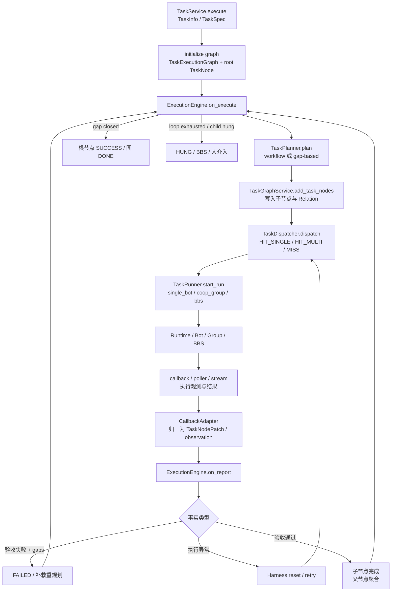

# Avernet Context 边界与协议：从当前 Task Loop 推导出的完整方案

> 日期：2026-09-09
> 文档性质：架构推导与协议定稿稿
> 适用范围：Avernet 当前 `community/core/task` 的动态任务流程，以及单 Bot、协作群、BBS 三种执行模态。

## 0. 先说本版解决什么问题

之前的讨论已经确认 Avernet 需要独立 Context，但仍存在三个容易混淆的层次：

1. 把 **Context 的来源、传输方式、消费方式** 混成了协议类型；
2. 把 **Context 提供事实** 与 **Task 根据事实推进状态** 混成了同一个接口；
3. 列出了若干合理协议，却没有证明它们覆盖当前 Task Loop，也没有说明为什么不再继续拆分。

本版不直接假定“Context 应该有几个协议”，而是从当前 Task Loop 的每个跨模块交互反推：

```text
当前交互发生了什么事实？
事实的权威所有者是谁？
交互是命令、事实还是视图？
它需要当前快照、时间序列、大型产物还是动态检索？
它需要同步读取、异步追加、订阅、重放还是流式解析？
```

推导结果需要明确两个**不同的计数口径**，否则会把“协议职责”和“数据语义”误认为互相竞争的结论：

```text
接口职责层（真正需要独立版本、鉴权和 conformance 的接口族）：3 个 Service API + 1 个 Plugin API

1. Fact Ingestion Service       外部事实写入 Context
2. Context Resolution Service   读取快照、视图和产物引用
3. Context Signal Service       事实到达/缺失/冲突等信号订阅与投递
4. Context Source Plugin        Context 主动从 Bot、Session、群、BBS 等来源采集

数据语义层（上述接口承载的稳定数据契约）：4 种
- Snapshot                      某版本下的当前事实
- Event                         已发生事实及其时间顺序
- Artifact Reference             大型产物的引用与内容访问元数据
- View                          面向用途、预算和权限的派生组合
```

因此本文的最终定稿不是“4 个 RPC 服务”或“3+1 与 4 选一”，而是：**接口层为 3+1，数据层为 4 种语义**。其中 Artifact 是资源/载荷契约，读写入口归入 Resolution/Fact Ingestion 的相应操作；Source Plugin 是 Context Core 调用外部来源的内部扩展边界，不是面向 Task 的第五种业务协议。

`TaskNodePatch`、`accept/retry/replan/suspend`、任务状态迁移和调度结果不属于 Context 协议，而属于 Task Domain Protocol。Context 提供事实，Task 根据事实做决策和状态变更。

`TaskNodePatch`、`accept/retry/replan/suspend`、任务状态迁移和调度结果不属于 Context 协议，而属于 Task Domain Protocol。Context 提供事实，Task 根据事实做决策和状态变更。

---

## 1. 当前 Avernet Task Loop：先固定事实流转的观察对象

当前实现的主闭环如下，依据 `core/task/README.md`、`domain/models.py`、`task_center/engine.py`、`task_plan/`、`task_dispatch/`、`task_runner/` 和 `task_harness/`：



### 1.1 当前已有的事实和机制

| 当前位置 | 已有语义 | 是否是 Context 事实 | 是否是 Task 机制 |
|---|---|---:|---:|
| `TaskSpec` | metadata、background、goal、acceptance | 是 | 否 |
| `TaskExecutionGraph` | `run_id`、`loop_round`、图状态、节点、relations | 是 | 部分 |
| `TaskNode` | `node_id`、`task_id`、节点规格、节点状态 | 是 | 否 |
| `RuntimeInfo` | run mode、assignee、output、acceptance、时间 | 是 | 部分 |
| `NodeActionEvent` | plan、dispatch、execute、verify、reset、transition 轨迹 | 是 | 否 |
| `TaskCallbackData` | 外部执行实体回投的原始事实 | 是 | 否 |
| `TaskNodePatch` | 将回投或内部结果写入节点的原子入口 | 否 | 是 |
| `ExecutionEngine.on_*` | 依据状态和事实推进下一步 | 否 | 是 |
| `TaskPlanner` | 根据目标、gap、已完成子节点产生计划 | 读取/产生 Context | 是 |
| `TaskDispatcher` | 搜推执行者、确定 run mode/assignee | 读取 Context | 是 |
| `TaskRunner/Executor` | 把执行上下文转换为三模态调用 | 消费/产生 Context | 是 |
| `TaskHarness` | 超时、崩溃、重试、恢复和 HUNG | 消费 Context | 是 |

核心结论：Avernet 不是缺少 Context，而是当前 Context 事实散落在图、运行态、回投、action log 和 prompt 拼装逻辑中，缺少统一的身份、版本、来源和消费契约。

### 1.2 当前状态机对协议边界的约束

当前节点状态包括 `PENDING`、`PLANNING`、`RUNNING`、`DONE`、`SUCCESS`、`FAILED`、`HUNG`、`CANCELLED`；图状态主要为 `RUNNING`、`DONE`、`HUNG`。

必须保留以下语义区分：

```text
Observation    执行实体观察到/上报发生了什么
Validation     系统、Verifier 或人工判断是否满足 Acceptance
Transition     Task 控制面依据事实执行状态迁移

RUNNING        不是成功
执行结束       不是验收通过
验收失败       不等于执行异常
Context Signal  不等于状态迁移
```

因此，Context Event 可以触发重新读取和决策，但不能直接把节点改成 `SUCCESS`、`FAILED` 或 `HUNG`。

---

## 2. 协议推导方法：先列所有 Context 交互，再按语义归并

### 2.1 当前 Task Loop 的跨边界交互清单

| 编号 | 当前流程交互 | 事实/信息 | 主要消费者 | 现有实现位置 |
|---:|---|---|---|---|
| I1 | 创建任务并初始化图 | TaskSpec、Goal、Acceptance、root identity | Graph / Engine | `TaskService`、`TaskGraphService` |
| I2 | Planner 读取当前任务 | 任务快照、拓扑、已完成结果、gap、loop round | Planner | `ExecutionEngine`、`TaskPlanner` |
| I3 | Planner 产生子任务 | 结构化 plan result、children、gap detail | Task Graph | `PlanResult`、`add_task_nodes` |
| I4 | Dispatcher 选择执行者 | capability、assignee、run mode、claim/lease | Dispatcher / Runner | `TaskDispatcher` |
| I5 | Runner 获取执行输入 | 当前节点、上游交付物、父/兄弟结果、约束 | Bot / Group / BBS | `ExecutionEngine.build`、`PromptFormatter` |
| I6 | Runtime 建立来源绑定 | task/node/attempt 与 run/session/group/BBS 的关联 | Callback / Poller / Recovery | `TaskExecutor`、callback correlation |
| I7 | Runtime 产生观测 | start、progress、message、tool result、checkpoint、error | Context / Audit | callback、poller、stream |
| I8 | Runtime 产生结果 | output、artifact、terminal status | Context / Verifier | `TaskCallbackData`、poller |
| I9 | Context 对账和补偿 | callback 丢失、迟到、重复、冲突、终态回读 | Harness / Engine | poller、reconciler |
| I10 | 验收和证据关联 | output 版本、acceptance、verifier、gaps、evidence | Engine / Verifier | `AcceptanceResult`、`RuntimeInfo` |
| I11 | Engine 做下一步决策 | retry、replan、dispatch、wait、handoff、stop | Task Domain | `ExecutionEngine.on_*` |
| I12 | 恢复执行 | attempt、checkpoint、side effect、lease、idempotency | Harness / Runner | `TaskHarness`、`recovery.py` |
| I13 | Dashboard / 审计读取 | 当前状态、历史轨迹、来源、解释链 | Dashboard / Operator | dashboard/query projection |
| I14 | 大型产物消费 | 文件、报告、代码、图片、日志 | Runner / Verifier / 下游 Task | Artifact/文件存储 |
| I15 | 历史知识增强 | 相似任务、经验、领域知识、RAG 结果 | Planner / Agent / Verifier | 可插拔增强，非当前权威状态 |

这 15 项并不是 15 个协议。它们只是在当前流程中出现的 Context 交互样本，下一步要按**数据语义**而不是按模块名称归并。

### 2.2 三种数据语义是第一层划分

每个交互都可以先回答它传递的是什么：

| 语义 | 定义 | Avernet 例子 | 权威者 |
|---|---|---|---|
| **Command** | 请求某个领域动作或状态变更 | plan、dispatch、accept、retry、replan | Task Domain |
| **Fact** | 记录已经发生或被观察到的事实 | callback、run result、checkpoint、artifact produced | Context / Runtime source |
| **View** | 为特定消费者从事实中派生的可消费投影 | planner snapshot、runner prompt、dashboard view | Context View builder |

这一步直接排除了一个常见错误：`TaskNodePatch` 虽然承载事实写入，但它本身是 Task 的写入/迁移机制，不是 Context 的通用协议。

### 2.3 四种事实形态是第二层划分

事实按消费时的基本操作可以归并为四种不可互相替代的形态：

| 事实形态 | 必须解决的问题 | 例子 |
|---|---|---|
| **Snapshot** | 某个版本下“现在是什么” | 图状态、节点状态、TaskSpec、当前 assignment |
| **Event** | “发生过什么、按什么顺序发生” | callback、start、progress、结果、reset、冲突 |
| **Artifact** | 大结果在哪里、如何安全读取 | 报告、代码、图片、日志、模型文件 |
| **Query / Retrieval** | 按条件动态选择哪些增强信息 | 历史任务、经验、领域知识、RAG |

这四种形态不是按来源划分，而是按事实的语义操作划分。例如一个 callback 可以产生 Event；callback 中携带的报告可以落成 Artifact Reference；Planner 最终读取的是 Snapshot 或 View；历史经验则作为 View 的可选增强输入来自 Query/Retrieval。

### 2.4 两种计数口径如何合并

前面的两层划分回答的是不同问题，必须同时保留：

| 问题 | 定稿答案 | 原因 |
|---|---|---|
| 需要几个独立的调用接口族？ | **3 个 Service + 1 个 Plugin** | 按调用方向和交互语义分离写入、读取、通知、外部采集；不同错误处理、幂等、重试和版本策略不能混用 |
| Context 需要稳定定义几类数据？ | **4 种语义：Snapshot/Event/Artifact/View** | 当前态、时间事实、大型资源、消费者投影的生命周期和消费方式不可互换 |

映射关系不是一一对应：`Fact Ingestion` 主要承载 Event 的追加，也可写入 Snapshot/Artifact 元数据；`Context Resolution` 读取 Snapshot、组装 View、解析 Artifact；`Context Signal` 通知有新 Event 或事实缺失/冲突；`Source Plugin` 负责把外部原生结果采集并归一为 Event/Snapshot/Artifact。这样既避免把同一语义重复定义成多个服务，也避免用一个“万能 Context API”掩盖不同调用契约。

### 2.5 为什么最终要有 View Protocol

仅有 Snapshot、Event、Reference、Query 仍不足以表达 I2、I5、I13：

- Planner 不能直接消费底层 Graph、Action Log、Artifact Store 的所有细节；
- Runner 需要按 token、权限和执行模态裁剪输入；
- Verifier 需要证据链，而 Agent 可能只需要摘要；
- Dashboard 需要完整度、版本和遗漏项，而不是一段 Prompt。

因此必须有一个独立的 **Context View Protocol**，把多来源事实按 `purpose + scope + version + budget + policy` 组装成受控视图。View 是派生结果，不是新的权威状态。

---

## 3. 候选方案比较：为什么不是一个协议，也不是按 Task 阶段拆一套

### 3.1 方案 A：一个万能 `ContextService`

```text
read(task_id)
write(task_id, payload)
notify(task_id)
resolve(task_id, purpose)
```

**优点**：入口少，初期实现简单。
**问题**：把同步读取、异步追加、来源回放、大文件读取和 Prompt 组装揉在一起；调用方无法从接口看出幂等、顺序、版本、权限和生命周期要求。Callback 丢失、结果重复、产物过大、视图降级会被迫使用同一套错误语义。

**结论**：拒绝。接口少不等于抽象深，实际复杂度会扩散到所有调用方。

### 3.2 方案 B：按 Task 阶段拆协议

```text
PlanningContext
DispatchContext
ExecutionContext
VerificationContext
RecoveryContext
```

**优点**：看起来贴近流程。
**问题**：同一事实会被复制到多个阶段；例如一个 output 同时服务 Planner、Verifier、Dashboard 和 Recovery，按阶段拆会造成重复 identity、重复版本和不一致的事实定义。Task 阶段也是可演进的，不应成为 Context 的分类轴。

**结论**：拒绝。阶段是 Task Loop 的机制，不是 Context 事实的稳定语义。

### 3.3 方案 C：按来源系统拆协议

```text
BotContext / GroupContext / BBSContext / SessionContext / FileContext
```

**优点**：容易对应现有适配器。
**问题**：三种执行模态的差异会泄漏到 Planner、Verifier 和 Dashboard；而它们都需要相同的 task/node/attempt/source 关联、事件幂等和产物引用能力。

**结论**：拒绝作为对外协议分类。来源差异应收敛在 `Context Source Adapter` 内部。

### 3.4 方案 D：语义协议 + 受控视图 + 来源适配器

```text
Snapshot / Event / Artifact / View
        +
Source Adapter
        +
Task Domain Protocol
```

**优点**：

- 能分别表达当前态、历史事实、大型产物和消费者视图；
- 能把同步、异步、重放、流式读取、预算裁剪等不同契约放在正确 seam；
- 单 Bot、协作群、BBS 只需要替换来源适配器，不改变 Task/Verifier/View 契约；
- Task 状态机仍由 Task Domain 保持，Context 不越权。

**结论**：采用。

---

## 4. 最终协议集合（数据语义层）

本节定义四种稳定数据契约；它们由上一节的三个 Service API 和一个 Source Plugin 承载，并不意味着需要四个相互独立的服务进程。

### 4.1 Context Snapshot Protocol：读取版本一致的当前事实

### 目的

给 Planner、ExecutionEngine、Dispatcher、Verifier、Recovery 和 Dashboard 读取某个 subject 在指定版本下的结构化当前事实。

### 典型输入

```json
{
  "subject_ref": "task/{task_id}/node/{node_id}",
  "scope": ["spec", "topology", "status", "runtime", "acceptance"],
  "as_of": {"snapshot_version": "42"},
  "consistency": "strong",
  "access_policy": "task-runtime"
}
```

### 典型输出

```json
{
  "context_ref": "ctx-snapshot-...",
  "subject_ref": "task/{task_id}/node/{node_id}",
  "schema_version": "1",
  "snapshot_version": "42",
  "produced_at": "2026-09-09T...Z",
  "payload": {
    "task_spec": {},
    "topology": {},
    "current_state": {},
    "runtime": {},
    "acceptance": {},
    "active_attempt": {}
  },
  "provenance": [],
  "completeness": {"complete": true, "omitted": []}
}
```

### 必须保证

- 版本一致：不能把 graph version 42 与 node/runtime version 43 随意拼成一个快照；
- 读写隔离：Snapshot Read 不直接修改 Task 状态；
- scope 明确：调用方声明需要哪些部分，不默认返回全部历史；
- 权威明确：Task 状态、拓扑和 acceptance 仍以 Task Graph/Domain 为准；
- 可解释：返回来源、版本、遗漏项和完整度。

### 覆盖的当前交互

`I1`、`I2`、`I4`、`I10`、`I12`、`I13`，以及 `I5` 的结构化输入部分。

---

### 4.2 Context Event Protocol：追加、订阅和重放时间事实

### 目的

接收 Runtime、callback、poller、人工或外部系统产生的事实，并提供按顺序、幂等、可重放的事件流。

### 事件信封

```json
{
  "event_id": "evt-...",
  "event_type": "RunCompleted",
  "subject_ref": "task/{task_id}/node/{node_id}",
  "source_ref": "bcs/run/{run_id}",
  "attempt_ref": "attempt/{attempt_id}",
  "occurred_at": "2026-09-09T...Z",
  "observed_at": "2026-09-09T...Z",
  "schema_version": "1",
  "sequence": 18,
  "causation_ref": "evt-start-...",
  "payload": {}
}
```

### 事件类型建议

```text
SourceBound
RunStarted
ProgressObserved
MessageObserved
ToolCallObserved
CheckpointCreated
ArtifactProduced
RunCompleted
RunFailed
InputRequired
ObservationConflictDetected
ValidationRecorded
RecoveryRequested
```

`ValidationRecorded` 可以作为事实进入 Context，但它不直接执行状态迁移；Task Domain 仍需依据 acceptance policy 决定 `SUCCESS/DONE/FAILED/HUNG` 等状态。

### 必须保证

- `event_id` 幂等：重复 callback、poll 和 stream 结果不能重复推进；
- 顺序可表达：迟到事件、cursor、sequence 和 causation 可追踪；
- 至少一次投递：订阅者失败后可重试或重放；
- 原始事实保留：归一化后的 `TaskNodePatch` 不能替代原始回投；
- 事件与迁移分离：事件处理器可以提出 Domain Command，但不能隐式修改终态；
- 冲突可见：多来源结果不静默覆盖，要产生冲突事实或 supersede 关系。

### 覆盖的当前交互

`I6`、`I7`、`I8`、`I9`、`I10`、`I12`，以及 `I11` 的触发输入。

现有 `TaskLoopCallbackProtocol.start_run/report_result/ingest/ingest_parse_error` 应在该协议下重新分层：

- `ingest` / `ingest_parse_error`：Event Ingestion；
- `start_run`：`RunStarted` Event；
- `report_result`：先形成 Observation/Result Event，再交给 Task Domain；
- `TaskNodePatch`：Event 到 Task Domain 的适配机制，不是 Context Event 本身。

---

### 4.3 Context Artifact Protocol：大型产物的引用、读取和流式解析

### 目的

让报告、代码、图片、日志、模型文件等大型或独立生命周期的数据不进入 Task Graph、Event 或 Prompt 的大 payload，同时保留版本、权限和完整性。

### 典型产物引用

```json
{
  "artifact_ref": "artifact://task/{task_id}/attempt/{attempt_id}/report/{artifact_id}",
  "artifact_type": "report",
  "content_type": "text/markdown",
  "version": "3",
  "size": 18342,
  "checksum": "sha256:...",
  "source_ref": "bcs/run/{run_id}",
  "access_policy": "task-runtime",
  "created_at": "2026-09-09T...Z",
  "expires_at": null
}
```

### 最小操作

```text
put(metadata, bytes/stream) -> ArtifactRef
head(artifact_ref) -> metadata
read(artifact_ref, range?) -> bytes/stream
resolve(artifact_ref, access_policy) -> readable target
supersede(artifact_ref, replacement_ref) -> version relation
```

### 必须保证

- Task Event 只携带 `ArtifactRef`，不默认内联完整内容；
- 读取时校验权限、版本、checksum 和过期时间；
- 产物可以独立 retention，不随短期运行态一起删除；
- Verifier 能指出验收对应的具体 artifact version；
- 下游 Task 可以按需读取或流式消费。

### 覆盖的当前交互

`I5`、`I8`、`I10`、`I13`、`I14`。

---

### 4.4 Context View Protocol：按目的组装最小、可追溯的消费视图

### 目的

把 Snapshot、Event、Artifact 和可选 Retrieval 结果按消费者目的组装成一个稳定、受预算约束的 Context View。View 是派生投影，不是新的状态源。

### 请求

```json
{
  "subject_ref": "task/{task_id}/node/{node_id}",
  "purpose": "runner",
  "scope": ["current_node", "accepted_upstream_outputs", "constraints"],
  "as_of": {"snapshot_version": "42"},
  "attempt_ref": "attempt/{attempt_id}",
  "budget": {"max_tokens": 8000, "max_bytes": 50000},
  "access_policy": "runner-visible",
  "retrieval_policy": {"enabled": false}
}
```

### 响应

```json
{
  "view_ref": "view-...",
  "subject_ref": "task/{task_id}/node/{node_id}",
  "purpose": "runner",
  "schema_version": "1",
  "based_on": {
    "snapshot_version": "42",
    "event_cursor": "evt-18"
  },
  "sections": [
    {
      "name": "accepted_upstream_outputs",
      "content_or_references": [],
      "provenance": []
    }
  ],
  "omitted": [],
  "completeness": {"complete": true, "score": 1.0},
  "rendering": {"format": "typed-json", "token_count": 3200}
}
```

### 典型 purpose

| purpose | 消费者 | 视图重点 |
|---|---|---|
| `planner` | `TaskPlanner` | Goal、Acceptance、当前 gap、拓扑、已验证产出、限制 |
| `dispatcher` | `TaskDispatcher` | 节点能力需求、可执行约束、已有 claim/lease、候选来源 |
| `runner` | `TaskRunner` / Bot / Group / BBS | 当前节点、已采纳上游交付物、执行约束、attempt 和回投地址 |
| `verifier` | 验收器/人工审核 | acceptance、候选 output/artifact、原始证据、来源和版本 |
| `recovery` | `TaskHarness` | attempt、checkpoint、最后观测、lease、副作用和幂等信息 |
| `dashboard` | Dashboard / Operator | 当前态、历史、完整度、冲突、下一步候选和 provenance |
| `explanation` | 审计/解释 | 从决策到事实、事件和产物的因果链 |

### 必须保证

- 目的驱动：同一任务对不同消费者可以产生不同视图；
- 最小化：预算、scope、权限和可见性参与组装；
- 只读派生：View 不得反向写 Task 状态；
- 版本绑定：明确基于哪个 graph snapshot 和 event cursor；
- 可追溯：每个关键片段都能回到 Fact/Event/Artifact；
- 降级可见：超预算、缺权限、缺来源或冲突时返回 omitted/incomplete，而不是伪装完整。

### 覆盖的当前交互

`I2`、`I4`、`I5`、`I10`、`I12`、`I13`、`I15`。

---

## 5. Context Source Adapter：内部来源适配 seam

Source Adapter 不是另一种面向业务的 Context 协议，而是 Context Core 对异构来源的内部接口。它解决“从哪里取得事实”，不改变事实对外的语义。

### 5.1 统一适配能力

```python
class ContextSourceAdapter(Protocol):
    async def get_status(self, source_ref: str) -> dict: ...
    async def read_result(self, source_ref: str) -> dict: ...
    async def list_events(self, source_ref: str, cursor: str | None = None) -> list[dict]: ...
    async def resolve_artifact(self, artifact_ref: str) -> object: ...
    async def subscribe(self, source_ref: str, cursor: str | None = None) -> object: ...
```

实际接口可按能力拆成多个 Python Protocol，但在架构上属于同一个 Source Adapter seam；不要求每个来源都实现所有能力。

### 5.2 三种执行模态的映射

| 来源模态 | Source Adapter | 主要 Event | 主要 Artifact/Reference | 特殊约束 |
|---|---|---|---|---|
| 单 Bot | Bot/Session adapter | RunStarted、MessageObserved、RunCompleted、RunFailed | 输出文本、工具结果、日志 | `run_id + session_id`，session 事件需 cursor/replay |
| 协作群 | Group/Thread adapter | 参与者消息、路由、引用、阶段结论 | 群产出、共享文件、会议记录 | 多参与者因果关系和局部可见性 |
| BBS | BBS/Post adapter | 发布、claim、lease、progress、submit、handoff | 提交报告、交接材料 | 所有权变化、超时回收、重复认领 |
| 文档/代码/文件 | Artifact adapter | ArtifactProduced、Superseded | 文档、代码、图片、日志 | 权限、版本、checksum、retention |
| 知识库/RAG | Retrieval adapter | 通常不进入 Task Event | 检索结果引用 | 来源、时间、相关性、可信度；不能伪装 Task 状态 |

这证明单 Bot、协作群和 BBS 不需要三套 Context 协议：它们在 Source Adapter 层不同，在 Snapshot/Event/Artifact/View 层共享统一契约。

---

### 5.3 接口职责层的最小操作集

为避免“四种语义”被误实现成四个互相竞争的服务，v1 先固定以下接口族边界。具体传输可以是 Python Protocol、HTTP、RPC 或消息总线，但不能改变调用方向和语义。

| 接口族 | 调用方向 | v1 最小操作 | 主要承载语义 | 关键非功能契约 |
|---|---|---|---|---|
| `Fact Ingestion Service` | Runtime/Task adapter → Context | `ingest(fact)`、`ingest_batch(facts)`、`supersede(fact_ref)` | Event、Snapshot/Artifact 元数据写入 | 事件级幂等、乱序可接收、原始事实保留、可返回 duplicate/conflict |
| `Context Resolution Service` | Planner/Runner/Verifier/Recovery/Dashboard → Context | `get_snapshot(req)`、`resolve_view(req)`、`head_artifact(ref)`、`read_artifact(ref, range)` | Snapshot、View、Artifact | 版本绑定、权限、预算、完整度、provenance、只读 |
| `Context Signal Service` | Context → Task/Recovery/Dashboard subscriber | `subscribe(filter)`、`poll(cursor)` 或 `push(signal)`、`ack(signal)` | Event 的派生通知 | 至少一次、cursor 重放、幂等消费；不得携带目标状态迁移 |
| `Context Source Plugin` | Context Core → Bot/Session/Group/BBS/文件来源 | `get_status(ref)`、`read_result(ref)`、`list_events(ref,cursor)`、`subscribe(ref,cursor)` | 外部原生结果，归一后进入 Event/Snapshot/Artifact | 插件隔离、来源专有模型不泄漏、替换实现不改变 ContextFact schema |

这四行就是“协议职责层”的完整接口集合：同步写入属于 Ingestion，同步读取和资源解析属于 Resolution，异步提醒属于 Signal，反向主动采集属于 Plugin。`Snapshot/Event/Artifact/View` 则是这些操作的输入输出类型，而不是额外的服务数量。

### 5.4 知识加工：Context 的生产面，而不是第五种事实协议

前文把 Retrieval 放在 View 的可选增强来源中，但仅有“检索”是不完整的：原始 Runtime 数据必须经过清洗、归一、抽取、聚合、验证和发布，才能成为可复用知识。因此 Context 需要显式补上**知识生产面（Knowledge Production Pipeline）**。

它和 Context 的关系不是“再建一个独立上下文”，而是：

```text
Source Plugin / Runtime
        ↓
Fact Ingestion
        ↓  原始事实（不可变、可追溯）
Knowledge Production Pipeline
        ├─ normalize      格式/单位/身份归一
        ├─ extract        从消息、报告、代码中抽取结构化事实
        ├─ aggregate      跨事件/跨节点/跨任务聚合
        ├─ validate       规则、Verifier 或人工校验
        ├─ publish        形成可复用知识版本
        └─ index          建立关键词/向量/图索引
        ↓
Knowledge Artifact / Knowledge Record
        ↓
Context Resolution → View → Planner / Runner / Verifier
```

#### 5.4.1 为什么不能在 Ingestion 里直接加工

原始事实的接收和知识生产必须解耦：

1. **接收必须快且可靠**：callback/poller 不能因为摘要、Embedding 或跨任务聚合失败而阻塞 Task Loop；
2. **原始事实必须可重放**：加工规则变化时，需要基于同一批原始 Event 重新生成知识，而不是覆盖原始数据；
3. **加工结果不是事实本身**：摘要、分类、经验和关联关系都是推导结果，必须携带生成器、规则版本和置信度；
4. **知识必须经过发布门禁**：草稿、低置信度或冲突结果不能直接进入 Planner 的权威输入；
5. **加工可能跨任务**：Task Context 关注当前任务，Knowledge Context 可以沉淀跨任务经验，两者生命周期不同。

因此 `Fact Ingestion` 只负责接收和持久化原始事实，知识加工通过 Event 订阅异步触发；加工完成后再以新的派生事实/产物回写 Context。

#### 5.4.2 知识对象的最小契约

知识加工结果至少需要与原始事实建立可追溯关系：

```json
{
  "knowledge_ref": "knowledge://domain/lesson/42",
  "subject_scope": {"task_types": ["..."], "domain": "..."},
  "knowledge_type": "normalized_fact|summary|procedure|lesson|entity_relation",
  "content_or_artifact_ref": "artifact://...",
  "source_refs": ["event://...", "artifact://..."],
  "producer": {"kind": "rule|model|human|hybrid", "id": "..."},
  "processing_version": "knowledge-pipeline/v3",
  "confidence": 0.91,
  "validation": {"status": "draft|validated|published|rejected|superseded", "by": "..."},
  "observed_at": "...",
  "created_at": "...",
  "expires_at": null
}
```

这里要明确三类对象：

| 对象 | 含义 | 能否作为 Planner 默认输入 |
|---|---|---:|
| `Raw Fact/Event` | Runtime 实际发生或被观测到的原始事实 | 可以，按当前 Task 权限和用途读取 |
| `Derived Knowledge` | 从事实推导出的摘要、规则、经验、关系 | 仅 `validated/published` 可以 |
| `Index Entry` | 为检索建立的倒排、向量或图索引 | 不可以；只能返回对应 Knowledge/Artifact 的引用 |

Embedding、向量命中分数和摘要文本都不能脱离 `source_refs` 单独成为 Context 事实；它们是检索实现或派生内容。

#### 5.4.3 知识生产如何接入四种语义

| 知识生产动作 | Context 语义 | 接入接口族 |
|---|---|---|
| 收到待加工的 `RunCompleted`、Message、Artifact | Event / Artifact | Fact Ingestion |
| 读取原始事件、产物和任务快照 | Snapshot / Event / Artifact | Context Resolution |
| 生成摘要、规范化事实、经验规则 | Artifact / Derived Knowledge | Fact Ingestion（写回） |
| 发布、替代或拒绝某个知识版本 | Event + Snapshot 元数据 | Fact Ingestion |
| 通知已有知识可用、失效或冲突 | Event 派生 Signal | Context Signal |
| 按当前任务检索已发布知识 | View | Context Resolution |

因此知识生产**不增加第五种 Task–Context 核心协议**：它是 Context 内部的生产流水线，输入和输出仍使用既有的 Event、Artifact、Snapshot、View 语义。若未来加工平台需要独立部署，可以增加一个内部 `Knowledge Processor Plugin`；其边界和 `Source Plugin` 类似，但它消费 Context 事实、产出派生知识，不改变 Task–Context 对外协议数量。

#### 5.4.4 与当前 Task Loop 的安全连接

知识加工不能直接改变 `TaskNode.status`，推荐采用以下链路：

```text
RunCompleted / ArtifactProduced
        → ingest 原始事实
        → signal knowledge_candidate_available
        → processor 异步加工
        → ingest KnowledgeProduced(draft/validated)
        → verifier / policy 发布
        → KnowledgePublished
        → Resolution(purpose=planner, retrieval_policy=published_only)
        → Planner 使用
```

在 v1 中，建议先实现“事实归一 + 产物引用 + 带来源摘要”，再逐步增加跨任务经验和自动规则。任何知识结果都必须能回答：**来自哪些原始事件？由谁/什么版本加工？何时生成？是否通过验证？何时失效？**

### 5.5 与现有 ECB Knowledge Engine 的结合：复用生产系统，不再另造一条流水线

读取 `ocb/src/ecb` 后可以确认，Avernet 不需要再抽象一个新的通用 `Knowledge Processor` 来承担知识加工。ECB 已经存在两层相关能力：

```text
knowledge_engine（已有生产/治理链）
  DataSource / RawRecord
    → Extractor
    → Fusion
    → KnowledgeStore + KnowledgeIndex
    → Reviewer
    → validated / published
    → ApplicationTarget 推送

knowledge_system（已有文档知识链）
  Source
    → Segment
    → Fact（带 quote/offset 证据）
    → Entity / Relation / Topic
    → KGBase 存储与向量/图检索
```

二者不是重复的两套 Task Context，而是知识生产的不同抽象层：

| ECB 能力 | 主要职责 | 在 Avernet Context 中的定位 |
|---|---|---|
| `knowledge_system.knowledge_ingestion` | 接收文件/Markdown 等原始来源，做 hash 幂等和异步导入 | Context Source / Fact Ingestion 的来源实现 |
| `knowledge_system.knowledge_extraction` | 解析、切 Segment、抽 Fact、抽 Entity/Relation、保留 quote/offset | 原始 Event/Artifact 到规范化事实的生产者 |
| `knowledge_system.knowledge_modeling` | 四层建模、Topic 聚合、图表示 | Derived Knowledge / Context Artifact 的生产者 |
| `knowledge_system.knowledge_retrieval` | KGBase hybrid、vector、graph expand，返回引用 | Context Resolution 的 Retrieval 实现 |
| `knowledge_engine.KnowledgePipelineService` | `extract → store → review`，并支持 Fusion、发布治理 | Knowledge Production 的治理编排器 |
| `governance` / `PublishManifest` | 审核、发布、撤回、版本化 | 知识是否允许进入 Planner View 的发布门禁 |
| `application_target` | 将已发布知识推送到下游 | 可作为 Context View/索引的物化目标，不是 Task 状态回调 |

#### 5.5.1 推荐的对接方向

Avernet 只需要把 Task Loop 的事实投影成 ECB 能理解的来源记录，并由 ECB 现有能力完成后续加工：

```text
Avernet Runtime
  → Context Fact Ingestion
  → Task-scoped RawRecord / Artifact
  → ECB knowledge_system extraction/modeling
  → KnowledgeUnit 或 Fact/Entity/Relation/Topic
  → ECB governance review/publish
  → Context Resolution(retrieval_policy=published_only)
  → Planner / Verifier / Runner View
```

更具体地说：

1. `RunCompleted`、`MessageObserved`、`ArtifactProduced` 等 Avernet Event，不直接拼成 Prompt，而是通过一个 **Avernet→ECB Source/Record Adapter** 投影为 `RawRecord` 或 `Source/Segment` 输入；
2. `knowledge_system` 的 `FactExtractOperator`、`GraphExtractOperator` 和批级 resolver 负责从消息/报告中生产 Fact、Entity、Relation，并保留原文 quote、offset 和来源链接；
3. 需要跨任务复用的事实，再投影为 `knowledge_engine.KnowledgeUnit`，利用已有的 `validated/published/retracted` 治理生命周期；
4. Planner 不直接读原始 KGBase 或向量命中，而是通过 `Context Resolution` 读取带 `source_refs`、版本、置信度和发布状态的 View；
5. 任务本身的 `TaskNode.status`、验收、重试和重规划仍由 Avernet Task Domain 负责，ECB 的知识发布结果只能影响后续 View，不直接改 Task 状态。

#### 5.5.2 为什么要有投影 Adapter，而不是直接复用 KnowledgeUnit

当前 `knowledge_engine` 的核心对象是 `KnowledgeUnit`，而 `knowledge_system` 的核心模型是 `Source → Segment → Fact → Entity/Relation`。两者都支持溯源，但粒度不同：

- `KnowledgeUnit` 适合 schema/pattern 驱动的治理、审核和发布；
- `Fact` 适合保留原文证据、offset、segment 隶属和四层检索；
- `Entity/Relation/Topic` 适合图扩展和组织知识；
- `Artifact` 适合保存完整报告、代码、日志等大内容。

因此应采用：

```text
Avernet Fact/Event/Artifact
        ↓
Avernet–ECB Projection Adapter
        ├─ 保留原始 source_refs / event_id / attempt_id
        ├─ 映射为 RawRecord / Source / Segment / Fact
        ├─ 可选映射为 KnowledgeUnit
        └─ 建立双向 lineage：Avernet event ↔ ECB knowledge object
```

不能把 `KnowledgeUnit.properties` 当成所有 Avernet Context 的万能容器，否则会丢失 `attempt`、事件顺序、Task 节点归属和原始证据回链。

#### 5.5.3 对现有协议数量的影响

引入 ECB 后，协议数量仍不增加：

```text
Fact Ingestion Service
  接收 Avernet 原始事实，并通过 Projection Adapter 交给 ECB

Context Resolution Service
  读取 Task Snapshot、Artifact、已发布 Knowledge 和 Retrieval View

Context Signal Service
  通知知识候选产生、加工完成、发布、撤回、冲突或过期

Context Source Plugin
  对接 Bot/Session/群/BBS/文件等来源

ECB Knowledge Engine / knowledge_system
  是 Context 内部或邻接域的知识生产与治理实现，不是第五种 Task–Context 数据协议
```

唯一需要新增的是一组**对接事件和血缘约束**，例如：

```text
KnowledgeCandidateCreated
KnowledgeExtractionCompleted
KnowledgeValidationCompleted
KnowledgePublished
KnowledgeRetracted
KnowledgeSuperseded
```

这些都是 Event 数据类型，不是新的协议族。这样可以直接利用 ECB 已有的 `KnowledgeTask`、`ExtractionJob`、`PublishManifest`、`SourceRef`、`ks_source/ks_segment/ks_fact` 和 KGBase 能力，而不是在 Avernet 重新实现抽取、融合、索引和治理。

## 6. 完备性证明：接口层与数据层分别覆盖当前 Task Loop

“覆盖完整”不是说任何未来能力都不需要扩展，而是说当前 Task Loop 的 Context 交互不存在未归类的语义。证明采用两个维度：**按流程交互覆盖**和**按数据形态覆盖**。

### 6.1 按 I1～I15 的覆盖矩阵

| 交互 | Snapshot | Event | Artifact | View | Task Domain |
|---|:---:|:---:|:---:|:---:|:---:|
| I1 初始化任务/图 | ✓ | 可选审计 |  |  | ✓初始化命令 |
| I2 Planner 读取 | ✓ | 可读历史 | 可引用 | ✓ planner view | ✓ plan 决策 |
| I3 Planner 产子任务 | 读取当前快照 | 可记录 PlanProduced | 可选引用 | 可选 plan view | ✓ add_task_nodes |
| I4 Dispatcher 选择 | ✓ | 可记录 DispatchObserved |  | ✓ dispatcher view | ✓ dispatch |
| I5 Runner 获取输入 | ✓ | 可读 attempt 轨迹 | ✓ | ✓ runner view | ✓ start_run |
| I6 来源绑定 | ✓当前绑定 | ✓ SourceBound | 可选 | ✓可投影 | ✓写入绑定 |
| I7 Runtime 观测 | 结果投影 | ✓ | 可选 | 可投影 | 不直接迁移 |
| I8 Runtime 结果 | 当前态投影 | ✓ RunCompleted/Failed | ✓ | ✓ verifier/runner view | ✓接受/拒绝 |
| I9 对账补偿 | ✓回读当前态 | ✓冲突/补录/重放 | 可选 | ✓ recovery view | ✓触发恢复 |
| I10 验收证据 | ✓ acceptance link | ✓ ValidationRecorded | ✓ | ✓ verifier view | ✓ transition |
| I11 下一步决策 | ✓决策输入 | 可记录 DecisionObserved | 可引用 | ✓ explanation view | ✓ retry/replan/stop |
| I12 恢复执行 | ✓ attempt/checkpoint 投影 | ✓ RecoveryRequested | ✓ checkpoint/artifact | ✓ recovery view | ✓ harness/retry |
| I13 Dashboard/审计 | ✓当前态 | ✓历史 | ✓证据 | ✓ dashboard/explanation | 只读 |
| I14 大型产物 | 元数据投影 | ✓ produced/superseded | ✓ | ✓按需引用 | 验收/消费命令 |
| I15 历史知识增强 | 基本约束 | 可记录检索审计/KnowledgePublished | 引用知识来源 | ✓ retrieval 注入 | 不改变权威状态 |

说明：一项交互可以同时使用多个协议，但每个数据语义都有唯一主归属。例如 `RunCompleted` 的 `output` 若很大，则 Event 携带 ArtifactRef，由 Artifact Protocol 提供内容；Runner 最终通过 View Protocol 得到受控输入。

### 6.2 逐函数覆盖核对（防止“矩阵看似覆盖、实际漏流”）

上表按业务交互归类；下面再按当前代码中的具体承载函数核对一次。每一行的“主协议”只选一个，辅助协议用括号标注，避免把同一条流重复计数。

| 代码落点 | 当前行为 | 主接口族 | 承载语义 | 边界结论 |
|---|---|---|---|---|
| `TaskService.execute` / `initialize_graph` | 创建 `TaskExecutionGraph` 与 root node | Task Domain | Snapshot | 图初始化命令与状态归 Task；Context 只接收可观测事实 |
| `TaskPlanner.plan` → `TaskGraphService.add_task_nodes` | 生成 children/gap 并改图 | Task Domain | Snapshot/Event（审计） | 计划是 Task 决策，不是 Context 写入命令 |
| `TaskDispatcher.dispatch` | 产生 run mode、assignee、claim/lease | Task Domain | Snapshot/Event（观测） | 调度裁决留 Task；绑定结果可进入 Context |
| `TaskRunner.start_run` | 建立 `run_id/session_id` 与 node/attempt 关系 | Fact Ingestion | Snapshot + Event | 来源绑定是事实；实际启动命令仍由 Runner/Runtime 执行 |
| `CallbackAdapter.adapt_start` → `ExecutionEngine.on_start` | 把 start 回投归一并翻转节点 | Fact Ingestion | `RunStarted` Event | Event 只记录观察；`PENDING→RUNNING` 留 Task Domain |
| `OpenApiBotPort.get_run` / `BcsClientPort.get_state_machine_run` | PULL 采集终态或状态 | Source Plugin | Event（归一后） | 原生 SDK 返回值不能越过 Plugin 边界进入 Task |
| `BcsClientPort.get_session_messages` | PULL 采集群/BBS 消息流 | Source Plugin | Event / Artifact | 采集与归一分离；大消息/文件使用 ArtifactRef |
| `TaskLoopCallback.report_result` | PUSH 上报结果 | Fact Ingestion | `RunCompleted` / `RunFailed` Event | 与 poller 结果必须归一为同一 schema，并以 `event_id` 去重 |
| `TaskExecutorResultPoller` → `ResultSink.report_result` | PULL 终态汇合到 `on_report` | Fact Ingestion | `RunCompleted` / `RunFailed` Event | PUSH/PULL 是传输模态，不是两种事实协议 |
| `ExecutionEngine.build` → `PromptFormatter` | 组装父/兄弟结果为执行输入 | Context Resolution | View | 选择配方由 purpose/scope 驱动；不在 Context 中做状态裁决 |
| `_rollup_done_children_output` | 聚合子节点输出 | Context Resolution + Task Domain | View + Snapshot | 事实聚合与父节点状态推进拆开；子项选择策略显式化 |
| `_build_parent_acceptance_result` | 由子 verdict 构造父 verdict | Task Domain | Snapshot（裁决结果） | 父验收是 Task 裁决，不能下沉为 Context 规则 |
| `NodeActionEvent` append / `load_action_logs` | 记录和读取动作轨迹 | Fact Ingestion / Resolution | Event + View | 是审计事件面，不等于完整 Event Store |
| `query_task_dashboard` / `list_task_summaries` | 读取图级 dashboard 投影 | Context Resolution | Snapshot + View | Dashboard 只读；不因展示结果改变状态 |
| `TaskHarness.on_harness` | 超时、崩溃、失败后的复位重投 | Context Signal + Task Domain | Signal | Signal 只提示缺失/失联；复位、重试、HUNG 由 Task 决定 |
| `claim_bbs_owner` / `attach_bbs_node` | BBS 所有权和归属变更 | Fact Ingestion + Source Plugin | Snapshot + Event | 所有权事实入 Context；claim 命令和 lease 裁决留 Task/BBS 控制面 |

该核对覆盖当前已识别的 F1–F16 事实流：PUSH、PULL、stream 最终都落入同一 Fact Ingestion 入口；所有“Context 产事实、Task 做裁决”的双段流被明确拆开；没有任何代码流需要新增第五种 Task–Context 协议。

### 6.3 按“事实在哪里/怎样被使用”覆盖

```text
当前权威状态      → Snapshot
发生过的变化      → Event
大体量或独立资源  → Artifact
面向消费者的组合  → View
外部来源差异      → Source Adapter
状态迁移和任务命令 → Task Domain Protocol
```

这是一个完备划分，因为 Context 交互若不是“当前事实”，就是“时间事实”；若内容体量/生命周期独立，则需要引用；若需要为消费者裁剪组合，则需要视图。来源差异和任务推进分别由 Adapter、Domain 承担，不能再塞进 Context 的第五、第六种对外协议。

### 6.4 为什么不把 Query/Retrieval 单独列为第五类对外协议

Query/Retrieval 是一种重要能力，但本版将其视为 View 的可选输入源和 Source Adapter 的一种来源能力，而不是当前 Task–Context 核心协议，理由是：

1. 它不承载当前任务的权威状态；
2. 它的输出最终必须经过 View 的目的、权限、预算、来源和可信度约束；
3. 如果直接把 Retrieval 结果交给 Task Domain，知识增强会冒充事实并污染状态机；
4. 未来可以替换向量库、历史任务库或知识服务，而不改变 Task–Context 的核心协议。

若未来出现独立的跨任务知识产品，允许将 Retrieval 抽成独立服务 API；那是 Context 增强面的演进，不影响本版四类核心协议的完备性。

---

## 7. 共同信封和一致性规则

四类协议 payload 不同，但必须共享以下可追溯语义：

```json
{
  "context_ref": "...",
  "subject_ref": "task/node/attempt/...",
  "source_ref": "bot/run/session/group/bbs/artifact/...",
  "schema_version": "1",
  "snapshot_version": "...",
  "produced_at": "...",
  "observed_at": "...",
  "expires_at": null,
  "provenance": [],
  "payload_or_reference": {}
}
```

事件额外需要：

```text
event_id、event_type、sequence、causation_ref、idempotency_key
```

产物额外需要：

```text
artifact_ref、artifact_version、content_type、size、checksum、access_policy
```

视图额外需要：

```text
purpose、scope、budget、based_on、omitted、completeness、rendering
```

### 7.1 身份关系

至少需要稳定表达：

```text
task_id
  └── graph_run_id
        └── node_id
              └── attempt_id
                    └── source_ref(run/session/group/BBS)
                          ├── event_id
                          ├── artifact_ref
                          └── validation_ref
```

其中：

- `task_id`：业务任务归属；
- `graph_run_id`：一次执行图实例；
- `node_id`：图中的任务节点实例；
- `attempt_id`：一次执行/重试尝试；
- `source_ref`：外部运行来源；
- `event_id`：单个事实事件；
- `artifact_ref`：大型产物；
- `validation_ref`：针对某个 output/artifact version 的判断。

### 7.2 生命周期不能共用一个字段

| 对象 | 典型生命周期 |
|---|---|
| Snapshot | 版本化，当前态可替换，历史版本可按策略保留 |
| Event | append-only，支持重放和审计 |
| Artifact | 独立 retention、权限、版本和 checksum |
| View | 可缓存，有明确 TTL 和 based-on 版本 |
| Retrieval result | 短期有效，必须有来源、时间和可信度 |
| Checkpoint | attempt 级，完成后可归档 |

---

## 8. 与当前模块的落位和迁移边界

| 当前模块 | 新模型中的职责 | 不应承担 |
|---|---|---|
| `TaskGraphService` | Task Snapshot 的权威存储/读取；图结构、状态和原子写 | Prompt 编排、外部来源 SDK |
| `ExecutionEngine` | 读取 View/Snapshot，执行 Task Domain transition | 作为所有上下文的存储桶 |
| `TaskPlanner` | 消费 `planner` View，产出结构化 Plan Command | 直接拼接所有历史和外部消息 |
| `TaskDispatcher` | 消费 `dispatcher` View，产出 assignment/dispatch command | 写 Agent 认知上下文 |
| `TaskRunner/Executor` | 消费 `runner` View，建立 Source Binding，调用外部 Runtime | 拥有 Task 状态 |
| `CallbackAdapter` | 将外部 Event 归一为 Observation，再交给 Domain | 直接决定终态 |
| `TaskHarness` | 消费 `recovery` View，处理对账、重试、恢复请求 | 验收策略 |
| `StaticPlanRuntime` | 解析声明式 DAG 和输入引用，作为 View/Plan 的一类解析器 | 取代动态 Planner |
| 新 Context Core | Snapshot/Event/Artifact/View 的组合与 provenance | 直接拥有 Task 状态机 |
| 新 Source Adapters | Bot、Session、群、BBS、文件、知识源接入 | 向上暴露来源专有模型 |

### 8.1 当前代码应如何理解

- `RuntimeInfo.output`：保留为当前态投影，但应补齐 producer、attempt、schema/version 和可消费性；
- `NodeActionEvent`：保留为事件/审计投影，不能替代完整 Event Store；
- `TaskCallbackData`：作为外部 Observation/Event 输入，不直接视作状态；
- `AcceptanceResult`：应绑定被验收的 output/artifact version，并逐步引入 verifier/validation identity；
- `ExecutionEngine.build`：逐步下沉到 `Context View Builder`，由 purpose/scope/version/budget 驱动；
- `TaskNodePatch`：继续作为 Task Domain 的原子迁移入口，不改名为 Context API。

---

## 9. 推进顺序和验收标准

### 9.1 推进顺序

1. **Canonical identity**：统一 `task/node/graph_run/attempt/source/event/artifact/validation` 关系；
2. **Snapshot seam**：把 Planner、Engine、Recovery 读取的结构化当前态收口；
3. **Event seam**：将 callback、poller、stream 和 action log 归一为可幂等、可重放事实；
4. **Artifact seam**：把大型 output、报告、日志改为引用；
5. **View seam**：将 `ExecutionEngine.build` 和 PromptFormatter 前的拼装按 purpose 收口；
6. **Source adapters**：分别接入单 Bot、协作群、BBS、Session、文件和 Retrieval；
7. **独立验证**：将 Observation、Validation、Transition 分开，并把 acceptance 绑定到产出版本；
8. **知识生产与经验检索**：先做原始事实归一、来源绑定和可追溯派生，再接入跨任务经验；检索严格只返回已发布知识。

### 9.2 每一类协议的最小 conformance tests

| 协议 | 必测行为 |
|---|---|
| Snapshot | 版本一致读取、scope 裁剪、并发版本冲突、权限失败、完整度标记 |
| Event | 重复事件幂等、乱序事件、cursor 重放、失败重试、冲突事件、原始 payload 保留 |
| Artifact | 权限校验、版本替代、checksum、范围/流式读取、过期策略 |
| View | purpose 隔离、预算裁剪、来源追溯、缺失/冲突降级、based-on 版本固定 |
| Source Adapter | 单 Bot/群/BBS 至少一个适配器满足统一身份、事件和结果归一契约 |

---

## 10. 最终结论

Avernet 当前 Task Loop 的 Context 协议不应按“规划、执行、验收、恢复”拆成阶段协议，也不应按“Bot、群、BBS”拆成来源协议。前者会复制同一事实的身份和版本，后者会把来源 SDK 泄漏给 Planner、Verifier 和 Dashboard。

经过真实 Task 流程枚举、同步/异步交互分类、代码函数级覆盖核对、候选方案比较和业界约束反推，最终定稿为两个正交层次：

```text
接口职责层：3 个 Service API + 1 个 Plugin API
  Fact Ingestion Service       写入/版本化外部观察事实
  Context Resolution Service   读取 Snapshot、组装 View、解析 Artifact
  Context Signal Service       通知事实到达、缺失、冲突和人工介入需求
  Context Source Plugin        Context 主动采集 Bot/Session/群/BBS 等来源

数据语义层：4 种稳定契约
  Snapshot                     某个版本下“现在是什么”
  Event                        “发生过什么”及其顺序、因果和幂等身份
  Artifact Reference           大型产物的引用、权限、版本和完整性
  View                         面向 Planner/Runner/Verifier/Recovery/Dashboard 的受控组合
```

这里的“完备”有明确边界：对当前 `community/core/task` 中已识别的 F1–F16 事实流，逐项都能落到上述接口族和数据语义；PUSH 与 PULL 只是采集模态，归一后共享同一事实 schema；`TaskNodePatch`、状态迁移、验收裁决、重试、重规划和调度结果始终留在 Task Domain。

这里的“准确”也有可验证标准：事件按事件级 `event_id` 幂等，事实带 `subject/source/attempt` 身份和发生/观测时间，大产物通过 ArtifactRef 隔离，视图返回 based-on 版本、provenance、omitted 和 completeness，信号不携带目标状态。对应约束都可由 Avernet 当前 callback/poller/engine/harness 的真实问题，以及 Temporal、LangGraph、A2A、MetaGPT、CrewAI 等业界实践反推，而不是事后堆字段。

最终边界可以压缩为一句话：

> **Context 是 Task 控制面与异构 Runtime 之间的事实平面：负责收集、保存、投影和通知事实；Task 负责依据事实规划、派发、验收、重试、重规划和状态迁移。**

---

## 参考资料

### Avernet 当前代码与文档

- `src/backend/src/agentclaw/community/core/task/README.md`
- `src/backend/src/agentclaw/community/core/task/domain/models.py`
- `src/backend/src/agentclaw/community/core/task/task_center/engine.py`
- `src/backend/src/agentclaw/community/core/task/task_loop_callback_protocol.py`
- `src/backend/src/agentclaw/community/core/task/task_runner/callback_adapter.py`
- `src/backend/src/agentclaw/community/core/task/task_plan/`
- `src/backend/src/agentclaw/community/core/task/task_dispatch/`
- `src/backend/src/agentclaw/community/core/task/task_runner/`
- `src/backend/src/agentclaw/community/core/task/task_harness/`
- `docs/arch/context-boundary-format.md`
- `docs/arch/task-loop-industry-context-study.zh-CN.md`
- `docs/arch/avernet-context-protocol-deduction.zh-CN.md`（接口职责层与 F1–F16 覆盖推导稿）

### 业界参照

- LoopX：长期控制面、bounded turn、claim/lease、evidence、recovery、writeback
- MetaGPT：Message identity、cause、route、metadata、局部 memory
- CrewAI：Task context、结构化 TaskOutput、guardrail、callback、Process/Flow
- Temporal / LangGraph：durable state、事件历史、checkpoint、恢复和版本连续性
- A2A：Task、Message、Artifact 以及 Push/Pull/Stream 的语义分离
