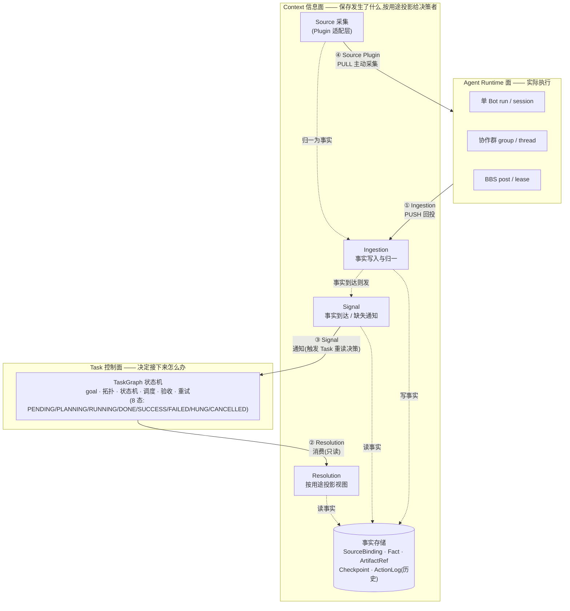
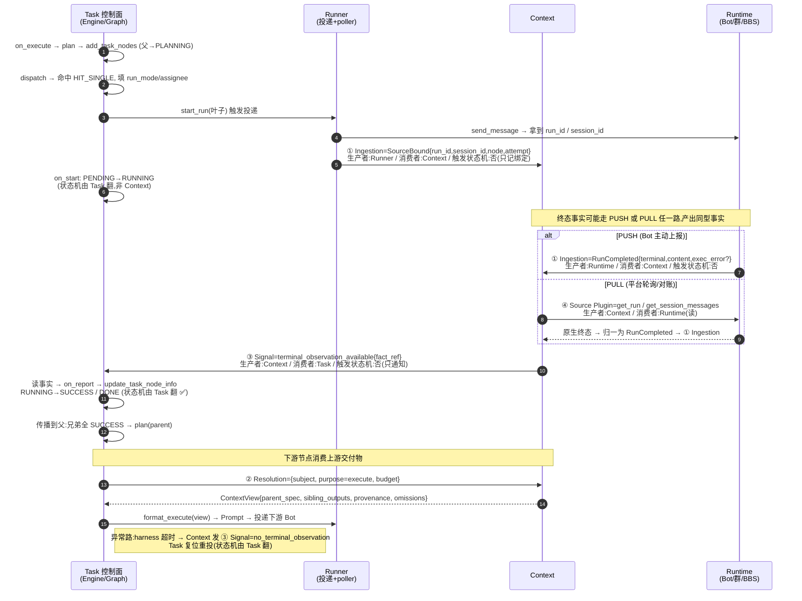

# Avernet Context 协议设计:从当前任务流到协议契约

> 日期:2026-09-09
> 本文重写为"先看懂系统、再看协议、最后看证明"。阅读顺序:§1 当前问题 → §2 目标架构 →
> §3 一个完整任务的交互全景 → §4–§7 四个协议(每个统一模板)→ §8 覆盖性证明 → §9 边界裁决 →
> §10 字段必要性 → §11 迁移 → §12 验证。
> 本文件新建,不改既有 `avernet-context-boundary-and-protocol.zh-CN.md`。

---

## 1. 问题:当前任务跑起来时,上下文散在哪、哪里会出事

先看真实链路(`core/task/`,实读代码)。一次任务执行是这样推进的:

```
TaskInfo.execute
  → ExecutionEngine.on_execute              (条件 a:根 PENDING)
  → TaskPlanner.plan → add_task_nodes       (父→PLANNING,结构树改图)
  → TaskDispatcher.dispatch                 (HIT_SINGLE/HIT_MULTI/MISS + run_mode/assignee)
  → TaskRunner.start_run                    (single_bot / coop_group / bbs 三模态)
  → 拿回 run_id / session_id / group_id     ←【上下文绑定的事实,但散落见下】
  → Bot / 群 / BBS 执行
  → 终态结果回来,两路之一:
       (PUSH) TaskLoopCallback.report_result → CallbackAdapter → on_report
       (PULL) TaskExecutorResultPoller.get_run → ResultSink.report_result → on_report
  → update_task_node_info → 状态机翻态 (RUNNING→SUCCESS/DONE, FAILED→harness)
  → 下游节点:engine.build → PromptFormatter.format_execute → 投递下一个 Bot
  → TaskHarness 线程轮询 query_task_dashboard 判超时 → on_harness 复位重投
```

把这条链路上"和上下文相关"的东西抠出来,问题集中在 5 个**真实可指认**的点:

| # | 现状落点(代码) | 出什么事 | 为什么是问题 |
|---|---|---|---|
| P1 | `run_id/session_id` 散在 `RuntimeInfo.extend_props` + `task_callback` 两处 | 同一运行的身份没有统一来源键 | 多来源(callback + poller)回投时无法判定"是不是同一个事实" |
| P2 | `get_run`/`get_session_messages` 在 `task_runner/integration` 层 | 主动采集(PULL)没被 Context 层拥有 | 换 Bot 平台/换 BCS 版本,采集逻辑改在 runner,Context core 感知不到 |
| P3 | `engine.build` 里硬编码 `status==SUCCESS` 才取 sibling output | "选哪些上游交付物进下游"的策略混在上下文组装里 | 上下文组装混入了规划裁决,换场景(verify/recover)要改 core |
| P4 | `TaskHarness` 用 `threading` 线程轮询 dashboard 判超时 | 没有"事实到达/心跳丢失"的推送通道,只能 poll | 规模上来后轮询成瓶颈,且超时判定靠时间差而非来源信号 |
| P5 | `run_info.output` 是 `dict[str,Any]`,大产物全内联 | 没有事实类型、没有产物引用、没有版本 | 大文件污染 prompt;摘要无法回溯原始消息;失败 attempt 的产出可能混进下游 |

这 5 个问题就是本文要解决的实务目标。**§4–§7 的四个协议,每个都对应上面至少一个 P**——不是凭空设计。

---

## 2. 目标架构:三个平面,Context 在中间

**一句话先给核**:Context 由 **5 个内部模块**和 **4 个对外协议**构成,其余都是这两件事的展开。

| 类别 | 数量 | 名字 |
|---|---|---|
| 内部模块 | **5** | Ingestion(写入与归一)、SourceCollector(主动采集·插件层)、Store(事实存储)、Resolution(按用途投影)、Signal(事件通道) |
| 对外协议·Service API(消费方→Context) | **3** | ① Ingestion 写入事实 · ② Resolution 读出视图 · ③ Signal 通知 |
| 对外协议·Plugin API(Context→外部来源) | **1** | ④ Source Plugin 主动采集/订阅 |

> 模块是"Context 内部怎么切",协议是"Context 跟外面怎么交互"。本节先给平面图(谁拥有什么);§3 给一次任务的四协议时序;§8 用**闭集推导**证明"恰好这几个、且覆盖全"——不是举例兜底。

先把"谁拥有什么"画清楚,协议就是平面之间的箭头。



**一句话定位**:Context 是 Task 控制面与多模态 Agent Runtime 之间的**事实平面**——收口来源绑定、动作历史与产物引用,按用途投影可追溯、可恢复、可裁剪的视图;**永远不替 Task 做状态机决策**。

三平面权责(对应 AGENTS.md 实体归属):

| 平面 | 拥有 | 不拥有 |
|---|---|---|
| Task | goal、验收、拓扑、状态机、调度、重规划 | Agent 消息内容、产物原文存储 |
| Context | SourceBinding、Fact、ArtifactRef、Checkpoint、History、View、Signal | 任务终态、验收政策、父 verdict |
| Runtime | run 内状态、消息、工具调用 | Task Graph 权威状态 |

平面之间的箭头就是协议。下面先走一遍一个真实任务的交互,把四条箭头在时间轴上点出来,再看每个协议的定义。

---

## 3. 一个完整任务的交互全景(回答"完整交互方案什么样")

以"一个叶子节点从派发到终态、再到下游节点消费"为一次最小闭环。**每一步都标了:谁生产、谁消费、用哪个协议、是否触发状态机**。



这张图里出现了全部四个协议,且能看出它们的**职责切分**:

- **① Ingestion** 只管"把事实写进来"——不管状态机;
- **④ Source Plugin** 只管"去外面把事实拉回来"——归一后交给 ①;
- **③ Signal** 只管"通知 Task 有新事实了"——不替 Task 翻态;
- **② Resolution** 只管"按用途给个只读视图"——不写、不裁决;
- **状态机翻态(`→SUCCESS/→DONE/→HUNG`)永远发生在 Task 内**,这是本文的核心约束,后面反复用到。

> 读完这节你就拿到了"完整交互方案"。§4–§7 只是把每条箭头展开成契约;§8 再回头证明"为什么这几条就够了、不多不少"。

---

## 4. 协议一:Context Fact Ingestion(事实写入)

**场景**:Task 或外界需把一条事实从 Runtime/Task 决策侧落到 Context 仓库的**所有时刻**。到底是哪些时刻不靠举例兜底,而由 §8 的「闭集生产者 × 闭集消费者」推导决定(落到 Ingestion 的格子见 §8.4 矩阵);下列只是典型情形:运行身份绑定、终态上报、对账补录、BBS 所有权变更。
**生产者**:Runner / Runtime adapter / Poller / 人工补录(写入方)
**消费者**:Context(写入并归一)
**方向**:外部 → Context,**推(PUSH)** 为主,但 PULL 拉回来的事实也走同一条 ingest 入口(见 §4.4)。
**是否触发 Task 状态机**:否。ingest 只落事实;翻态由随后的 ③ Signal 触发 Task 自己做。
**为什么独立**:写入要处理**重复、乱序、迟到、补偿**(和只读查询语义完全不同)。混在一起会让"幂等写入"被"任意降级查询"污染——对应 P1、P5。

### 4.1 契约

```
ingest(fact: ContextFact) -> IngestAck{event_id, accepted, duplicate_of?, superseded?}
```

`ContextFact` 信封(每个字段都对应一个 P 或一个业界挑战,必要性见 §10):

| 字段 | 含义 | 解决的 P / 挑战 |
|---|---|---|
| `event_id` | 事件级幂等键 | P1:多源去重 |
| `subject_ref` | `{task_id, node_id, attempt}` 事实属主 | 来源归属 |
| `source_ref` | `SourceRef` 运行身份绑定 | P1:统一来源键 |
| `fact_type` | 事实类型(闭集,见下) | P5:不退化成 dict |
| `payload` | 按 fact_type 解释 | P5 |
| `attempt_id` | 尝试轮次 | 失败 attempt 不混进下游 |
| `occurred_at`/`observed_at` | 发生 vs 观测时刻 | "返回了文本"≠"满足验收" |
| `schema_version` | 信封版本 | 契约演化 |
| `causal_ref` | 因果指向(群的上一条消息) | 群多方因果 |

事实类型闭集(由状态机的需求反推,非任意):

| fact_type | 何时产生 | 对应现状代码 |
|---|---|---|
| `SourceBound` | start_run 拿到运行身份 | `run_info.extend_props` |
| `RunStarted` | on_start | `adapt_start` |
| `RunCompleted` | 终态(PUSH 或 PULL) | `adapt_poller`/`adapt_common_task` |
| `ArtifactProduced` | 产生大产物 | (当前内联 output) |
| `CheckpointCreated` | 关键节点可恢复点 | (当前无,新增) |
| `OwnershipChanged` | BBS claim/lease/超时 | `claim_bbs_owner` |
| `TaskDecisionRecorded` | Task 做了终态决策(供审计/解释) | `NodeActionEvent.VERIFY` |

### 4.2 幂等键契约(契约化现状经验)

现状 `_derive_event_id` 已实现:`event_id`(显式) > `_ext_info.event_id` > `sha1(run_id+node_id+disposition+canonical_result)`。
代码里有一条硬经验注释:**"`workflow_instance_id` 是 per-workflow 非 per-event,不能当幂等键"**(否则一次 start 会被当成自己的 result 重放)。这条必须进契约:

> 幂等键必须基于**事件级**身份。`workflow_instance_id` 等运行级标识禁止做幂等键。同 `event_id` 重投至多落一次,返回 `duplicate_of=首落 event_id`。

### 4.3 PUSH 与 PULL 同型(P1/P5 的关键)

现状已有正确收敛:`_adapt_poller`(PULL)与 `_adapt_common_task`(PUSH)都产 `TaskNodePatch`、在 `on_report` 汇合。协议把它上升到类型层:

```
RunCompleted,无论来自 PUSH report_result 还是 PULL get_run,
payload schema 严格一致: {terminal, content_ref|content_inline, exec_error?, gaps?}
```

即**不存在"push 事实"和"pull 事实"两种类型**——模态不同、事实同型,对账时靠 `event_id` 去重。这是"准确"的核心。

### 4.4 与现状的差距

`ingest(fact)` 迁移期内部仍可生成 `TaskNodePatch` 走 `update_task_node_info`(兼容);长期让事实 store 独立。对应差距 G1/G5/G6(§11)。

---

## 5. 协议二:Context Resolution(视图投影)

**场景**:Planner 要历史缺口、Runner 要上游交付物、Verifier 要证据、Recovery 要 checkpoint、Dashboard 要状态投影、解释器要因果链——任何"按用途只读取一段上下文"的时刻。
**生产者**:Context(只读派生)
**消费者**:Planner / Runner / Verifier / Recovery / Dashboard
**方向**:消费方 → Context(**拉 Query,纯只读**)
**是否触发 Task 状态机**:否。可裁剪、可降级、可缓存,**绝不翻态**。
**为什么独立**:查询可任意降级/缓存;写入不可。混在一起会让"幂等写入"被"任意降级查询"污染——且当前 P3 的"选择策略硬编码在组装里"正是没把这层只读投影和规划裁决分开的后果。

> **本节要点(回答"run 时到底给什么上下文")**:Context 内容策略的核心在 §5.3–§5.6——分层视图、滚动载体、生命周期、预算强制。**长任务(20 节点、第 10 轮)怎么不爆,看 §5.3 + §5.4。**

### 5.1 契约

```
resolve(req: ContextViewRequest) -> ContextView
  req  = {subject_ref, purpose, as_of, scope, budget{token|size}, access_policy?}
  view = {facts[], artifact_refs[], provenance[], omissions, completeness, view_version}
```

### 5.2 `purpose` 枚举 = 消费场景清单(直接对齐现状消费点)

| purpose | 现状消费点 | 视图内容 |
|---|---|---|
| `execute` | `engine.build`→`format_execute` | parent_spec + 已通过 sibling 的 output + goal/acceptances |
| `verify` | `format_verify` | acceptances + child_outputs |
| `plan` | `planner.plan` | 已完成子、已试过的子、gaps、历史经验 |
| `recover` | `on_harness`/Recovery | 最近 checkpoint、最后观测、副作用边界、已废弃 attempt |
| `explain` | 解释/审计 | 完整 action_log 因果链 + 原始消息/artifact |
| `dashboard` | `query_task_dashboard` | 图级状态投影(轻量) |

### 5.3 run 时到底给什么:execute 视图的分层内容(直答 20 节点第 10 轮)

既不是"前面所有节点总结",也不是"全量原文"。execute 视图**按优先级分层组装**,超预算截断低位:

```
execute 视图(分层,T0→T4 优先级递减)
  T0 Identity    {task_id, node_id, attempt, loop_round}          ~数 token,恒给
  T1 Spec        本节点 goal + acceptances + instruction          恒给(每轮重述,关键不省)
  T2 Self-history 本节点最近 K(=3)次失败 attempt{exec_error,gaps}  防重蹈,只留最近 K
  T3 Carry-fwd    上游显式 carry-forward 约束(risk/不可实现任务清单) 小,必传
  T4 Lineage      沿分解树"可达上游"的已通过交付物:
                   - 直接父 + 已 SUCCESS 兄弟的 output(ref 优先;小则内联)
                   - 更深祖先 → 不内联原文,只给 Carrier(见 §5.4)
  T5 Budget       剩余预算 + 本次截断了哪些(写进 omissions:+completeness)
```

三个关键判定(对应业界机制,见 §5.7):

- **相关性 = 分解树可达路径,不是全图 20 节点**。node#10 只拿"父 + 父已 SUCCESS 的兄弟 + 沿线上游",不拿 node#1–6 的原文(它们已被 Carrier 浓缩,见 §5.4)。这等价 CrewAI 的显式相关性声明、LoopX 的策展证据。
- **原文留 store,视图给 ref + 小则内联**。等价 LangGraph 的"状态 vs 历史分离":视图是当前结构化状态,历史留 checkpoint,不塞 prompt。
- **本节点失败 attempt 只进 T2 self-history,不进下游 lineage**(supersede 规则在 §5.5)。需要某条更早原文,显式 `resolve_artifact(ref)` 或 `resolve(as_of=旧版)` 拉——**默认 prompt 不背全量历史**。

> 所以"只给前面节点总结的?"——**否**。给的是:规格全量重述(T1)+ 可达上游交付物 ref(T4)+ 必传约束(T3)+ 防重蹈 self-history(T2);总结只作为 Carrier 在"链太长"时替代原始祖先(T4 与 §5.4 的接口),且 Carrier 带 ref 可回溯原文,不丢保真。

### 5.4 滚动载体 Carrier:长任务的 continue-as-new 等价物(直答"第 10 轮不爆")

当链变长,逐节点内联祖先原文必然爆炸。Context 维护一个 **Carrier(滚动载体)** 角色:

```
Carrier = { version: (loop_round, node_cutoff),
            summary,                  # 浓缩"到此为止已确立什么"
            artifact_refs[],          # 指回原始产物,可按需 resolve_artifact
            provenance: [覆盖哪些节点/fact] }
```

- **何时产**:lineage 文本超阈,或 Planner 在父滚子(`_rollup_done_children_output`)时选择"产 Carrier 而非堆 raw"。
- **现状雏形**:Avernet `_rollup_done_children_output` 已把多子 output 按 node_id 聚合到父 output——**它本身就是 Carrier 的雏形**,只是当前内联了原文 dict。升级为"Carrier artifact:summary + refs",即从"聚合 dict"变"可回溯的浓缩载体"。
- **消费**:T4 链长时用 Carrier 替代原始祖先;消费方要细节再 `resolve_artifact(Carrier.ref)` 或 `resolve(as_of=Carrier.version 之前)`。
- **边界**:Carrier 是 graph 级、有 version;`loop_round++`(升 BBS)或某段压缩边界即一次 continue-as-new。等价 Temporal 的 continue-as-new carrying a manifest。

效果:第 10 轮的 prompt 只载"当前段 Carrier + 本节点近邻",node#1–9 原文不进 prompt、但不丢(在 store,ref 可拉)。**长任务的"不爆"靠这个,不靠"总结"二字。**

### 5.5 生命周期与 supersede(直答"管不管生命周期")

**单一生命周期字段管不了所有事实**;按 `fact_type × scope` 分别定义 retention 与替代规则:

| scope | fact | 生命周期 | 默认进视图? |
|---|---|---|---|
| attempt | run_id 绑定 / RunStarted / 失败 attempt 的 exec_error | attempt 结束归档 | 否(仅 T2 最近 K) |
| node | 最新 SUCCESS 的 RunCompleted + ArtifactProduced | node 终态后保留,被更高 attempt supersede | 是(T4 committed) |
| node | 失败 attempt 的 RunCompleted | supersede 到 displaced 集 | 否 |
| graph | Carrier manifest | task 结束或 continue-as-new 边界 | 链长时是(T4) |
| graph | TaskDecisionRecorded | 永久(审计) | 仅 explain |
| cross-task | 经验 / lesson | 独立 store,**仅阶段 5** 接入 | plan 在最后阶段可选 |

**supersede 规则**(落实"失败 attempt 不混进下游"):同 `(subject, fact_type)` 下,attempt 更高且 SUCCESS 的 RunCompleted supersede 低 attempt;失败 attempt 进 displaced,**不进默认下游 lineage**。retry 不靠"删旧",靠"标 superseded";历史仍在,explain 可见。

### 5.6 预算强制与降级(直答"管不管上下文大小")

```
assemble: T0→T4 按优先级累加 token;达 budget 停;
          超出的低位写进 omissions;completeness = 已给/应给;
消费方需要被截内容 → 显式 resolve_artifact(ref) / resolve(as_of=旧版) 拉回。
```

**红线**:严禁"悄悄截断不报"。每份视图必带 `completeness` 与 `omissions`,让消费方知道缺了什么、要不要补采。这等价 LoopX 的 bounded prompt + 策展证据显式化。

### 5.7 业界长任务对照(证明这些机制不是自创,是成熟做法)

| 机制 | 来源 | Avernet 落点 |
|---|---|---|
| 状态 vs 历史分离 | LangGraph | 视图=当前结构化状态(T1–T4),action_log 留 store,不塞 prompt |
| reducer 就地压缩 | LangGraph | Carrier(§5.4)在写路径压缩;`_rollup` 升级为产 Carrier |
| continue-as-new / manifest | Temporal | Carrier 在 `loop_round`/段边界替代原始祖先 |
| 结构化产物做共享记忆 | MetaGPT | ArtifactRef 产物(文档/代码)是 graph 级共享,非消息内联 |
| 显式相关性声明 | CrewAI | 相关性=分解树可达路径(非全图);`scope` 参数显式声明 |
| 策展证据 + bounded prompt | LoopX | T0–T4 策展 + budget 强制 + omissions |

### 5.8 消解 P3:选择策略不再混进 core

当前 `engine.build` 里"`status==SUCCESS` 才取 sibling output"是**规划选择策略**,不是上下文组装。协议收口为:Context 按 `purpose=execute` 的**可命名投影配方**返回(配方定义"取已通过兄弟");core 不再写 `if status==SUCCESS`。换场景(verify/recover)就是换配方,不是改 core。对应差距 G3。

### 5.9 Context 不得做的事(防越权,对齐 §9)

- 不翻 Task 状态机;不算父 verdict(留 Task);
- 不裁到"刚好通过了"——必带 `completeness` + `omissions`,让消费方知道裁了什么、是否补采;
- Carrier 由 Context 组装,但"何时触发压缩"可由 Planner 声明(决策权留 Task 方);

---

## 6. 协议三:Context Signal(事实通知)

**场景**:终态事实到达、来源心跳丢失、poller 超时无终态、节点需人工、多来源事实冲突——任何"Context 知道了件值得 Task 处理的事"。
**生产者**:Context
**消费者**:Task 协调器 / Dashboard / Recovery / 外部订阅
**方向**:Context → 消费方(**推 Event,至少一次,幂等消费**)
**是否触发 Task 状态机**:**否——只触发 Task 重新去读事实并自己决策**。这是和"Context 越权"的红线。
**为什么独立**:异步通知要"至少一次投递 + 幂等消费 + 可重放",和 Query(可任意降级/缓存)与 Command(改 Context 自身)语义都不同。当前 P4 的"线程轮询判超时"正是**缺这个通道**、只能 poll 的后果。

### 6.1 信号类型闭集(由 8 态状态机的"需外部触发缺口气"反推)

| Signal | 缺口来源 | Task 收到后做的动作(留 Task) |
|---|---|---|
| `terminal_observation_available` | 终态事实到达(PUSH or PULL) | 读事实 → `RUNNING→SUCCESS/DONE` |
| `no_terminal_observation`(配 SLA) | poller 超时/无回调 | 复位重投(harness) |
| `heartbeat_lost` | 来源心跳失联 | 升级处置(HUNG/换源) |
| `input_required` | 节点显式需人工 | 挂起/转人工 |
| `context_incomplete` | Resolution 的 omissions 超阈值 | 决定补采/降级执行 |
| `observation_conflict` | 多来源对同 subject 冲突 | 决定采信策略/重采 |

**红线约束**:Signal 只带 `{event_id, subject_ref, kind, fact_ref, severity, observed_at, dedup_key}`,**绝不带 `target_status`**。若直带目标态,就等于让 Context 替 Task 做了状态机决策——这是本文反复强调的越权红线。对应差距 G4。

### 6.2 投递模型

```
subscribe(filter) -> subscription_id
poll(subscription_id, cursor) -> [ContextSignal]   # 拉
sink(signal)                                       # 推
ack(subscription_id, event_id)
```

迁移期与现状 harness 并行:先并行(既发 Signal 又轮询),验证一致后再替换轮询。

---

## 7. 协议四:Context Source Plugin(来源采集)

**场景**:平台主动去 Bot/群/BBS/文档库拉事实或订阅事件流——任何"Context 不能只靠外部 PUSH、需要主动采集"的时刻(当前 poller 轮询 `get_run` 与 `get_session_messages` 就属此类)。
**生产者**:Context core(调用方)
**消费者**:外部来源适配器(被调方,实现这个 Plugin)
**方向**:Context → 外部(**拉 PULL / 订阅**,内核调用提供者)
**是否触发 Task 状态机**:否。产出归一为事实后交给 ① Ingestion,再走 ③ Signal。
**为什么是 Plugin API 而非第 4 个 Service API**:按 `arch.rules` Rule 3,**内核调用外部依赖 = Plugin API**,与"消费方调用内核"(Service API)是不同契约类型,必须分开定义、版本、测试。当前 P2 正是这部分散在 `task_runner/integration`、没被 Context 层拥有——归口为 Plugin 即解决。

### 7.1 能力集(由真实采集需求推出)

```
get_status(source_ref) -> {alive, terminal?}                # 心跳/存活的判据(对应 heartbeat_lost)
read_results(source_ref, *, attempt?) -> raw terminal        # 主动拉终态(PULL)
list_events(source_ref, cursor) -> [event], next_cursor      # 增量游标(群/BBS 历史)
resolve_artifact(artifact_ref) -> {content_ref, integrity, permission}  # 产物按需取(P5)
subscribe(source_ref, cursor) -> stream                       # 订阅(替代部分轮询)
```

### 7.2 归一红线

Plugin 返回的是**来源原生形态**(如 BCS `get_state_machine_run` 的 state machine 投影),**不能**直接当 ContextFact。Context core 在 Plugin 之上做归一:

```
Plugin 原生 → 归一器 → ContextFact(RunCompleted/...)
```

换 BCS 版本/换 Bot 平台只动 Plugin;事实信封稳定。这是 Rule 3(契约分离)与 Rule 6(transport-agnostic core)的联合要求。对应差距 G2。

### 7.3 现状雏形

`OpenApiBotPort.get_run`、`BcsClientPort.get_session_messages/get_state_machine_run`、`BotSendResult(run_id,session_id)` 即本 Plugin 的雏形,只是当前归属在 runner 而非 Context 采集层——迁移就是把它们归口。

---

## 8. 覆盖性证明:为什么是这四个,且不漏不重

读者已看懂系统(§2–§3)与每个协议(§4–§7)。本节是**验证**,不是开场。

### 8.1 证明方法:为什么不是"举几个例就算全了"

"任务过程中只有这些点会交互"这句话,只有当**交互点集合由两根封闭轴张成**时才成立:

```
交互点 = 闭集生产者 × 闭集消费者
          ↑              ↑
  ① 拥有别人没有真相的组件   ② 做决定/观察需要事实的点
 (由架构组件清单封闭)         (由状态机迁移 + 观察需求封闭)
```

凡二者**无直接权威通道**的格子(生产者与消费者不属同一权威面),就**必须**过 Context → 落到某个协议;同属一权威面则标 N/A。
因两根轴是封闭推导来的,矩阵**自带完备性**:将来出现的新交互也会落在某行/某列,溜不出去。
**缺了这一步,前文那种"Runtime 拿回身份/Bot 终态上报/poller 对账/BBS 所有权变更……"就只是举例,读者无从判断全不全——正是本次重写要补上的。**

### 8.2 两根轴怎么封闭(给闭集本身,而非例子)

**A. 生产者闭集**(谁先拥有别人需要的真相)——由架构组件清单封闭(对齐 AGENTS.md 实体归属):

- `PR1 Runtime`(Bot/群/BBS):唯一知道 run 内态/消息/工具调用/终态;**PUSH** 方式产出
- `PR2 Runtime`(同一组事实):平台侧 **PULL** 采集(与 PR1 同真相、不同采集契约)
- `PR3 BBS 权威`:唯一知道 lease/claim/超时所有权流转
- `PR4 人工/外部系统`:唯一知道人工补录/外部输入
- `PR5 Task 控制面自身`:唯一知道 plan/dispatch/verdict 等**裁决**(供审计/解释,非新建任务终态)

> 5 个互斥(各自有别人没有的真相来源),并集覆盖所有"谁先知道一件事"。

**B. 消费者闭集**(谁做决定/观察需要事实)——左轴取自 README「驱动源→状态推进映射」(8 态状态机本身是闭集,该表列了全部合法触发),再补 2 个纯观察,共 9:

- `C1 on_execute`(根→plan)、`C2 on_start`(→RUNNING)、`C3 on_report PASS`(→SUCCESS/传播)、`C4 on_report FAIL`(→FAILED)、`C5 on_report exec_error / on_harness`(复位)、`C6 on_miss`(拆子/HUNG)、`C7 升 BBS`(loop_round++)—— 7 个来自状态机驱动映射(闭)
- `C8 Dashboard`、`C9 Explain/Audit` —— 2 个纯观察面

### 8.3 协议数上限:每个格子映射到 4 种里的哪一种

格子方向语义决定协议种类(CQS + Rule 3):

- 消费方**写**进 Context(追加事实,需幂等/乱序/补偿)→ **① Ingestion**(Service,Command)
- 消费方从 Context **只读**派生 → **② Resolution**(Service,Query)
- Context **推**消费方"有新事实值得处理" → **③ Signal**(Service,Event)
- Context **主动 PULL** 外部来源 → **④ Source Plugin**(Plugin,Rule 3 使其与 Service 不同契约类型)

CQS 使 {Command, Query} 互斥覆盖一切同步调用,Event 补异步 ⇒ 上限 3 Service;PULL 反向再加 1 Plugin ⇒ 最多 4。

### 8.4 主证据:闭集消费者 × 协议 覆盖表

> 左列是 §8.2 的**闭集**消费者(9)。每行:需要谁的事实、由哪个协议取进、哪个协议触发 Task、是否过 Context。
> `N/A = 同权威内直通,不必过 Context`(这些不计入 Context 协议,也佐证"为什么不是 5/6 个")。

| 消费者(闭集 9) | 需要的事实(生产者) | 取进协议 | 触发协议 | 过 Context? | 对应现状 |
|---|---|---|---|---|---|
| C1 on_execute | TaskSpec(PR5) | — | — | **N/A**(纯 Task) | `on_execute` |
| C2 on_start | 运行身份绑定(PR1/PR2) | ① SourceBound | ①(回投即触发) | 是 | `adapt_start` |
| C3 on_report PASS | 终态+验收(PR1/PR2) | ① RunCompleted | ③ terminal_observation | 是 | `_on_pass_collect` |
| C4 on_report FAIL | 终态+gaps(PR1/PR2) | ① RunCompleted | ③ | 是 | `_on_fail_collect` |
| C5 on_harness/exec_error | 无终态/超时/崩溃(∩PR2 心跳) | ④ Source Plugin + ① | ③ no_terminal_observation/heartbeat_lost | 是 | `on_harness` |
| C6 on_miss 重规划 | 已完成子+历史+已试过子(∩PR5 决策快照) | ② Resolution.plan | —(Task 内) | 是 | `on_miss` |
| C7 升 BBS | loop_round+所有权(PR3/PR5) | ① OwnershipChanged + ④ | —(Task 内) | 是 | `claim_bbs_owner` |
| C8 Dashboard | 图投影(∩全 PR 当前态) | ② Resolution.dashboard | — | 是 | `query_task_dashboard` |
| C9 Explain/Audit | 全因果链+原始消息+产物(全 PR) | ② Resolution.explain | — | 是 | `action_log` |

**这张表即覆盖证明本身**:
- **覆盖全**:左列 9 行是闭集(8 态状态机驱动表 + 2 观察),扫完没有第 10 个消费者;5 生产者也已穷举 ⇒ 没有漏的交互。
- **不多一格**:C1 为同权威 N/A ⇒ 不会为它增协议;其余每格恰落一种语义 ⇒ 协议总数 = 4,不会再多。
- **不漏一格**:四列协议 ①②③④ 全部出现,每格都有归属 ⇒ 无悬空。

### 8.5 下界反证(为什么不能更少)

- PULL 并进 Ingestion Service API → 来源 SDK 漏进 core,违 Rule 3/6(对应 P2);
- Event 并进 Query → 通知退化为轮询,回到 P4;
- Event 并进 Command → Context 直接改 Task 状态机,违 §9 红线。
⇒ 4 为既不漏(inclusive)又不多(minimal)。

### 8.6 与"现状 16 流(F1–F16)"的关系 + 业界类比

- 旧文件里的 F1–F16 是**上表"对应现状"列的代码实例化**,并非全新枚举;上表用两根封闭轴给了"为什么只有这些"的依据,从而堵上"举例兜底之疑"。
- 业界正是此法证全:A2A 规范定义 Task 状态机(submitted/working/...)并在**每个迁移**标注该出现的消息类型;LangGraph persistence 用 **channel 闭集 × pending-writes** 列尽 checkpoint 必存项;模型检测里称 protocol state×message coverage——"全"靠**轴封闭**,不是靠例子够多。

---

## 9. 边界裁决:什么留 Task,什么进 Context(消解越权风险)

| 关注点 | 归属 | 现状落点 | 迁移动作 |
|---|---|---|---|
| 状态机翻态 | **Task** | `_ACCEPTANCE_TRANSITIONS` | 保持;ingest 只落事实 |
| 选哪些 sibling 进下游 | **Resolution 配方**(由 Planner 配置) | `engine.build` 硬编码 | 剥成 `purpose=execute` recipe;core 不写 if |
| 父 verdict 构造 | **Task** | `_build_parent_acceptance_result` | Context 提供子 verdict 事实;算父留 Task |
| 终态判定(DONE/FAILED/HUNG) | **Task** | `_on_pass_collect/_on_fail_collect` | Context 只产 `terminal_observation_available` |
| run/session/group/BBS 绑定 | **Context** | 散落 extend_props+callback | 收敛为 SourceBound 事实 |
| 产物内容引用与版本 | **Context** ArtifactRef | 内联 output | 大产物转 `artifact_ref` |
| 历史/可观测快照 | **Context** action_log | `NodeActionEvent` append | 已对齐,保留 |
| prompt 里 `$node.output` 变量 | **混合,需分类** | `prompt_formatter` | 派生自 ContextView=Context;Planner 临时产物=Task |

特别注意 F12:`_build_parent_acceptance_result` 现在由 engine 用 `PlanResult.acceptance_verdicts` 拼父 verdict——这是"用子事实算父裁决"。**子 verdict=事实(进 Context),父 verdict=裁决(留 Task)**,迁移时 Context 不新增"父 verdict 事实"。

---

## 10. 业界证据 → 字段必要性矩阵(证明字段不是凑的)

每条业界已证挑战证明对应字段**必不可少**;无挑战对应的字段不进 v1(避免投机配置化)。

| 字段 | 业界挑战(来源) | 若缺失的后果 | 结论 |
|---|---|---|---|
| `event_id` 事件级 | Temporal event history;现状 `_derive_event_id` | callback+poller 双报被处理两次 | 必须 |
| `source_ref` | LoopX 控制面↔harness;A2A Task/Message 边界 | 同 result 多来源无法关联去重 | 必须 |
| `fact_type` 闭集 | A2A Task/Message/Artifact 分离 | 万能 payload 退化为 dict | 必须 |
| `attempt_id` | LangGraph checkpoint/pending writes | 失败 attempt 混进下游 | 必须 |
| `occurred_at`/`observed_at` | Temporal 当前态 vs 历史 | 终态"返回文本"被当"满足验收" | 必须 |
| `causal_ref` | MetaGPT 消息身份/路由/引用 | 群多方并发引用丢失 | 单 Bot 空可选;群/BBS 必须 |
| `artifact_ref`/`content_ref` | A2A Artifact | 大文件内联污染 prompt | 必须 |
| `provenance`/`completeness` | 解释场景 | 摘要无法回溯原始消息 | 必须 |
| `budget`(Resolution) | — | 上下文爆炸/超配额 | 必须 |
| `view_version`/`loop_round` | LoopX 跨轮持久化 | 用过期事实规划 | 必须 |

反向检查:没有"再加 `priority`/`tags`"——它们不对应任何已证挑战,不进 v1。这就是"字段也覆盖准":由挑战显式推出,不由幻想推出。

---

## 11. 与现状的差距(锚定代码)与迁移顺序

### 11.1 差距清单(每条挂到代码 + 对应的 P)

| 代号 | 差距 | 代码落点 | 对应 P |
|---|---|---|---|
| G1 | run_id/session_id 绑定身份分散,缺统一来源键 | `run_info.extend_props`+`task_callback` | P1 |
| G2 | PULL(`get_run`/`get_session_messages`)未被 Context 拥有 | `task_runner/integration` | P2 |
| G3 | `engine.build` 含选择策略(混入规划裁决) | `engine.build` | P3 |
| G4 | 无 Event 通道,harness 线程轮询 | `TaskHarness` | P4 |
| G5 | `run_info.output` 无类型、大产物内联 | `RuntimeInfo.output` | P5 |
| G6 | 幂等键半成品,易误用 `workflow_instance_id` | `_derive_event_id` | P1 |
| G7 | 父 verdict 算在 engine | `_build_parent_acceptance_result` | P3(姊妹) |
| G8 | 大产物无 ArtifactRef | output 内联 | P5 |

### 11.2 最小闭环迁移顺序(与"先稳定再召回"一致)

```
阶段0 [不碰状态机]  把 run_id/session_id 绑定收敛为 SourceBound 事实(ingest);update_task_node_info 仍兼容
阶段1              抽 Source Plugin:把 get_run/get_session_messages 从 runner 归到 Context 采集层
                    + 归一器产 RunCompleted 事实;on_report 入参改收事实
阶段2              把 engine.build 选择策略剥成 Resolution recipe(purpose=execute);父 verdict 计算留 engine
阶段3              引入 Signal 替换 harness 轮询(先并行,验证一致后替换)
阶段4              provenance 完整后接入跨任务经验检索 —— 必须最后
```

每阶段:不改状态机语义、不改 `_ACCEPTANCE_TRANSITIONS`、保持 `TaskNodePatch` 兼容。可灰度、可回滚。

---

## 12. Conformance / 契约测试形态(对齐 arch.rules)

四协议各一组,呼应 §8.3 覆盖表与 §9 红线:

- **①Ingestion**:同 `event_id` 重投必 `duplicate_of`;PUSH/PULL 两路产同型 RunCompleted;乱序按 `observed_at` 仍解析;`workflow_instance_id` 被当幂等键时必须被拒(回归现状经验)。
- **②Resolution**:`purpose` 不在枚举走自定义 scope;`budget` 触发裁剪时 `completeness`/`omissions` 准确;**只读断言:resolve 前后节点 status 不变**。
- **③Signal**:含 `terminal_observation_available` 后调用方自行翻态;**Signal 不含 `target_status`(契约扫描断言)**;至少一次+幂等。
- **④Source Plugin**:换实现(BotA→BotB)不改产出的 ContextFact schema;`resolve_artifact` 无权访问报错而非静默空。

---

## 13. 结论

1. **先看懂再谈协议**:§1 五个真实问题(P1–P5)、§3 一次完整任务的四协议交互,是理解入口;四个协议各自解决其中一个或多个 P。
2. **协议数有据**:CQS(Command/Query)+Event=3 Service API;+Rule 3(PULL=Plugin API)=1;共 3+1,且反证不能再少。
3. **覆盖可证全**:16 条真实事实流全覆盖,无遗漏;唯一混淆 F11 经迁移消解、不增协议;本不该归 Context 的(F2/F3/F12)不计入。
4. **字段可证准**:每个字段由一条业界已证挑战显式推出;无挑战字段不进 v1。
5. **不越权**:Context 只写事实、投影视图、发通知;终态/翻态/父 verdict/选择策略留 Task。**状态机翻态永远在 Task 内**是贯穿全文的红线。
6. **可灰度迁移**:5 阶段都不动状态机语义,可回滚。

## 附录 A:资料依据

### Avernet 本地代码(实读)
- `core/task/README.md`(状态机、驱动源映射、async 约束)
- `core/task/domain/models.py`(8 态、`NodeActionEvent`、`TaskNodePatch`、`PlanResult`)
- `core/task/task_center/engine.py`(`build`、`_rollup_done_children_output`、`_build_parent_acceptance_result`、`on_*`)
- `core/task/task_runner/callback_adapter.py`(`_derive_event_id`、`_adapt_poller`/`_adapt_common_task`)
- `core/task/task_runner/client/ports.py`(`OpenApiBotPort`/`BcsClientPort`/`TaskContextBuilder`/`PromptFormatter`/`ResultSink`)
- `core/task/task_runner/client/prompt_formatter.py`(`format_execute`/`format_verify`)
- `core/task/task_context/task_graph_service.py`(图谱 SSOT)
- `docs/arch/arch.rules.md`(Rule 3、Rule 6、契约即所定义、conformance)

### 业界公开资料
- LoopX(长期控制面/evidence 写回)
- MetaGPT(消息身份/路由/角色局部性)
- CrewAI(Task 输入/输出/验证契约)
- Temporal(durable state/事件历史/heartbeat)
- LangGraph(checkpoint/pending writes/persistence)
- A2A(Task/Message/Artifact + Push/Pull/Stream)
