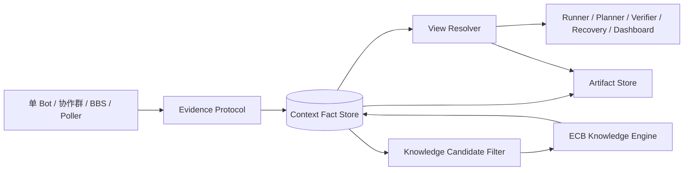

# Avernet Context 设计：从现状问题到承上启下协议

> 日期：2026-09-09  
> 文档状态：设计定稿候选  
> 适用范围：Avernet `community/core/task` Task Loop，以及单 Bot、协作群、BBS、主动采集和 ECB Knowledge System 的交互。

## 0. 摘要

本设计不把 Context 理解成“给 Agent 拼 Prompt 的模块”，也不把它理解成“所有事实转发给 ECB 的 Adapter”。它解决的是一个更具体的问题：

```text
上游以不同形式产生运行事实；
下游在不同阶段需要不同范围、不同可信度、不同大小的事实；
当前 Avernet 没有一个统一的事实记录和选择契约，把两端连接起来。
```

因此 Context 由三部分组成：

```text
Fact Store：完整保存可追溯的任务运行事实；
View Resolver：按消费场景选择事实并控制大小；
Artifact/Knowledge Bridge：分别连接大产物和 ECB 知识生产。
```

Task 仍然负责：

```text
规划、派发、验收、重试、重规划、状态迁移。
```

ECB 仍然负责：

```text
知识抽取、归一、融合、审核、发布和撤回。
```

Context 负责两条核心协议：

```text
1. Evidence Protocol：事实如何进入、保存和关联；
2. View Protocol：某个消费者在某个时刻应该看到什么。
```

ECB 交互是一个邻接协议，不是所有运行事实的必经通道。

---

## 1. 现状：Avernet 当前 Task Loop 和真实上下文流转

当前链路大致是：

```text
TaskService.execute
  → initialize TaskExecutionGraph
  → ExecutionEngine.on_execute
  → TaskPlanner.plan
  → TaskGraphService.add_task_nodes
  → TaskDispatcher.dispatch
  → TaskRunner.start_run
  → single_bot / coop_group / bbs Runtime
  → callback 或 poller
  → CallbackAdapter 归一回投
  → ExecutionEngine.on_report
  → acceptance / retry / replan / recovery
```

当前 `TaskRunner._build_context(task_id, node_id)` 有两个分支：

### 1.1 执行节点

没有结构子节点时，当前代码主要组装：

```text
父节点 task_spec
+ 父节点下已成功兄弟节点的 run_info.output
+ 当前节点 task_spec
```

这是一个有价值的初始规则：它避免把整个 Task Graph 全量塞给当前 Agent。

但它只解决了“结构上取哪些 output”，没有解决：

```text
本次派发是否是该 Node 第几次尝试？
上次失败留下了什么必须继承的约束？
output 是结果、错误、消息，还是大文件？
多个来源给了矛盾结果怎么办？
内容超过模型预算后如何降级？
```

### 1.2 验收节点

有结构子节点时，当前代码主要组装：

```text
当前节点 goal / acceptance / instruction
+ 已成功子节点的 run_info.output
```

这能完成基本验收，但当前 `output` 没有统一的证据契约，因此验收方无法稳定判断：

```text
这个结果来自哪一次执行？
它是否已经是当前有效版本？
它是否有对应的原始产物？
是否还有另一个来源给出不同结果？
```

### 1.3 当前失败重试到底是什么

当前代码不是失败后在 Graph 中复制一个同名节点。通常是：

```text
同一个 TaskNode
  → 执行失败或超时
  → harness_retries 增加
  → TaskNode 从 FAILED/RUNNING 复位为 PENDING
  → 再次派发
```

所以需要区分三个概念：

```text
TaskNode：图上的稳定节点，例如 Node 20；
Attempt：Node 20 的第 1 次、第 2 次执行尝试；
Run：某次 Attempt 对外部 Bot/群/BBS Runtime 发起的具体运行。
```

当前 Graph 通常只有一个 Node 20，但 Context 应该保存：

```text
Node 20 Attempt 1 → Run 1 → 失败
Node 20 Attempt 2 → Run 2 → 超时
Node 20 Attempt 3 → Run 3 → 当前执行
```

失败节点和新执行之间不是父子节点关系，而是同一个 TaskNode 下的历史 Attempt/Run 关系。Task 决定是否重新派发；Context 负责让这些历史可以被区分、查询和按场景使用。

---

## 2. 承上：不同来源产生什么事实，为什么需要统一外壳

这一节只讨论上游现状，不讨论方案。

单 Bot、协作群、BBS 和主动采集产生的内容不同，但下游都必须知道一组共同问题：

```text
这条内容属于哪个 Task 和 Node？
它发生在节点的哪次执行？
谁从哪个外部系统上报？
什么时候真实发生，什么时候被我们观察到？
这条记录是否已经处理过？
它能否回到原始消息、日志或文件？
```

如果这些字段每种来源都自己定义，Task、Context、ECB 就无法稳定关联事实。因此需要统一“外壳”。

### 2.1 什么叫统一外壳

统一外壳不是统一业务内容，而是统一以下六类元信息：

| 元信息 | 含义 | 为什么需要 |
|---|---|---|
| 身份 | 事实属于哪个 Task/Node/Attempt/Run | 防止不同任务、不同重试相互混淆 |
| 类型 | 这条记录是什么性质的事实 | 下游知道如何处理，不能把消息当结果、把错误当成功 |
| 来源 | 谁从哪里产生或观察到它 | 判断可信度、追责、去重和回溯 |
| 时间 | 什么时候发生、什么时候被系统看到 | 处理延迟、乱序和超时判断 |
| 顺序/因果 | 与同一来源的前后关系、由什么触发 | 重放事件链和定位原因 |
| 原始引用 | 原始消息、文件、日志在哪里 | 摘要或 Prompt 裁剪后仍能回到证据 |

各模态的实际业务内容不放在统一字段里，而放在带类型的 `payload` 中。

### 2.2 四种来源的特有 Payload

#### 单 Bot

```json
{
  "payload_type": "BotExecutionResult",
  "payload": {
    "instruction": "分析接口超时原因",
    "tool_calls": [
      {"tool": "search_log", "arguments": {"service": "order"}, "result_ref": "artifact_log_1"}
    ],
    "result": "发现数据库连接池耗尽",
    "status": "completed|failed|timeout",
    "error_code": null
  }
}
```

#### 协作群

```json
{
  "payload_type": "CoopMessage",
  "payload": {
    "author_id": "bot_a",
    "message_role": "proposal|question|challenge|evidence|decision|final",
    "reply_to": "evt_101",
    "content": "建议把连接池上限从 100 调到 200",
    "mentioned_participants": ["bot_b"]
  }
}
```

#### BBS

```json
{
  "payload_type": "BbsWorkState",
  "payload": {
    "post_id": "post_20",
    "action": "claim|lease|progress|handoff|submit|release|timeout",
    "owner_id": "bot_b",
    "lease_id": "lease_7",
    "lease_expire_at": "2026-09-09T10:30:00Z",
    "handoff_to": "bot_c",
    "result_ref": "artifact_report_2"
  }
}
```

#### 主动采集

```json
{
  "payload_type": "PollObservation",
  "payload": {
    "external_run_id": "bcs_run_9",
    "external_status": "RUNNING|SUCCESS|FAILED",
    "cursor": "cursor_18",
    "collection_batch": "poll_20260909_001",
    "delta": {},
    "raw_response_ref": "artifact_raw_3"
  }
}
```

这些 Payload 不能强行合并。例如 `CoopMessage.message_role=proposal` 不能变成 `BotExecutionResult.result`，BBS 的 `lease` 也不能变成 Node 成功。

### 2.3 Evidence Envelope 的字段定义

进入 Context 的统一事件格式如下：

```json
{
  "event_id": "evt_123",
  "event_type": "run_finished",
  "subject": {
    "task_id": "task_1",
    "node_id": "node_20",
    "attempt_id": "attempt_3",
    "run_id": "run_20_3"
  },
  "source": {
    "mode": "single_bot",
    "source_id": "bcs_session_9",
    "adapter_id": "bcs_adapter"
  },
  "occurred_at": "2026-09-09T10:00:00Z",
  "observed_at": "2026-09-09T10:00:02Z",
  "sequence": 17,
  "causation_id": "evt_122",
  "payload_type": "BotExecutionResult",
  "payload": {},
  "artifact_refs": ["artifact_9"],
  "schema_version": "1"
}
```

字段含义和赋予方如下：

| 字段 | 谁赋予 | 含义 | 约束 |
|---|---|---|---|
| `event_id` | Context 接入层或上游带入后校验 | 一条事实的唯一标识 | 同一事实重传必须保持不变；重复写入幂等 |
| `event_type` | Avernet Context 协议定义，Adapter 映射 | 事实的生命周期类别 | 不能由模型随意生成；必须属于枚举 |
| `subject.task_id` | Task 创建时产生 | 所属 Task | 必填 |
| `subject.node_id` | Task Graph 创建时产生 | 所属稳定 TaskNode | 必填；重试不改变 |
| `subject.attempt_id` | Task 在一次派发前产生 | 该 Node 的第几次尝试 | `pre_execute` 起可用；重试时新建 |
| `subject.run_id` | 外部 Runtime 启动后返回 | 这次具体外部运行 | 派发前可以为空；启动后必须绑定 |
| `source.mode` | Adapter 按接入类型填写 | 来源属于单 Bot、群、BBS、poller 等哪一类 | 受控枚举，不代表可信度 |
| `source.source_id` | 外部系统返回或配置产生 | 外部会话、群、帖子、采集对象的 ID | 用于回查外部来源 |
| `source.adapter_id` | Avernet 接入配置 | 哪个 Adapter 解释并提交了事实 | 用于审计和版本定位 |
| `occurred_at` | 外部来源提供，缺失时由 Adapter 标记推断 | 事实在外部真实发生的时间 | 不得和观察时间混用 |
| `observed_at` | Context 接入时写入 | Avernet 看到这条事实的时间 | 用于延迟和乱序分析 |
| `sequence` | 外部来源或 Adapter 维护 | 同一 `source_id` 内的递增序号 | 不是全局序号；没有序号时为空 |
| `causation_id` | 产生新事实的组件填写 | 直接触发当前事实的上一条事实 | 不是父节点 ID；没有明确因果时为空 |
| `payload_type` | Adapter 根据外部内容映射 | `payload` 的结构类型 | 必须与 Schema Registry 中的类型匹配 |
| `payload` | 外部来源提供，Adapter 只做必要转换 | 模态特有业务内容 | 不因统一外壳而丢失 |
| `artifact_refs` | Artifact 接入层登记 | 大内容或原始证据的引用 | 引用必须可读取和校验 |
| `schema_version` | Context 协议发布方 | Envelope 结构版本 | 用于兼容和重放 |

### 2.4 `event_type` 的核心枚举

`event_type` 不是所有业务动作的无限列表，而是 Context 需要识别的事实生命周期类别。第一版只定义以下核心类型：

| `event_type` | 什么时候产生 | 典型 Payload | 是否代表 Task 完成 |
|---|---|---|---|
| `run_started` | 外部执行真正启动并返回 Run ID | `RunStarted` | 否 |
| `observation` | 观察到消息、工具结果、进度或外部状态 | `BotExecutionResult` / `CoopMessage` / `PollObservation` | 否 |
| `run_finished` | 外部 Run 到达终态 | `BotExecutionResult` / `RunFinished` | 否；只提供执行事实 |
| `artifact_registered` | 文件、报告、日志等被登记 | `ArtifactRegistered` | 否 |
| `ownership_changed` | BBS claim、lease、handoff、release 发生 | `BbsWorkState` | 否 |
| `validation_recorded` | Verifier 记录某个事实/产物的验证结果 | `ValidationRecord` | 否；Task 决定状态迁移 |
| `fact_superseded` | 新事实使旧事实不再作为当前有效事实 | `SupersedeRecord` | 否 |
| `conflict_detected` | 检测到互相不一致的事实 | `ConflictRecord` | 否；是否阻塞由 Verifier/Task 决定 |

`run_finished(status=SUCCESS)` 只表示外部 Runtime 成功返回，不等于 `TaskNode.SUCCESS`。后者仍由 Task/Verifier 根据 acceptance 决定。

---

## 3. 核心问题：按 Task 场景看，当前上下文为什么会失效

本节先固定问题，不给方案。判断一个问题是否属于 Context，不看它是否听起来像“状态管理”，而看它是否会造成以下可观察的失败：

```text
1. 任务在某个阶段拿不到完成当前动作所需的事实；
2. 拿到的内容超过消费方预算，导致调用失败、截断或模型注意力被稀释；
3. 拿到的内容没有区分事实性质，导致模型、Planner 或 Verifier 误判；
4. 事实虽然存在，但无法证明它来自哪次执行、是否仍有效、是否有原始证据；
5. 出现失败、冲突或重试时，系统无法稳定恢复和解释。
```

因此，“边界不清”不是问题本身。真正的问题是：**当前上下文没有可执行的范围、语义和证据约束，已经会在具体场景中导致过大、缺失、误用或不可恢复。**

### 3.1 场景集合：谁在什么时刻消费上下文

Avernet 的 Context 消费方不是一个“Agent 输入”场景，而至少有以下八类。每类场景的目标不同，不能用同一个 `output` 拼接规则代替。

| 场景 | 触发时机 | 消费者 | 需要回答的问题 | 当前主要风险 |
|---|---|---|---|---|
| `plan` | 创建 Task、拆解任务或重规划 | Planner | 现在要做什么、已经完成什么、还缺什么、哪些方案不要重复 | 只看 Node 状态和 output，事实、失败、验证状态混在一起，重规划可能重复或误用 |
| `pre_execute` | Node 第一次派发前 | Runner | 当前 Node 的硬依赖是什么，哪些内容只是参考，成功条件是什么 | `_build_context` 按结构邻接拼接，未声明依赖强度和预算，可能拿到很多无关内容或漏掉非邻接但必要约束 |
| `execute` | Run 已启动，执行中继续工作 | Runner / Runtime | 本次 Run 已经观察到什么，下一步可继续做什么 | 当前 callback/poller 结果主要沉淀到 output，进度、消息、工具证据和终态语义不稳定 |
| `retry` | Node 失败、超时后准备新 Attempt | Runner / Task | 上次为什么失败，已经试过什么，新 Attempt 必须改变什么 | 同一 Node 复位后重派，缺少稳定的 Attempt/Run 事实视图，容易重复失败方案或误把失败结果当输入 |
| `recover` | 服务重启、进程中断、租约失效、外部 Run 未知 | Recovery / Runner | 哪次 Run 处于什么状态，是否有副作用，能否继续、取消还是重新派发 | 没有统一的事件时间线和 as-of 读取，可能重复执行或遗漏外部副作用 |
| `verify` | 子节点产出后执行验收 | Verifier | 当前版本的产物是否满足 acceptance，证据是否充分，是否有冲突 | 只读成功子节点 `output`，无法稳定判断版本、来源、验证状态和证据覆盖 |
| `knowledge_produce` | 运行事实进入知识加工 | ECB Knowledge System | 哪些事实值得加工，范围和证据是什么，是否可复核 | 若直接把所有 output 投递，会把心跳、租约、重复 callback 当成知识；若只投最终 output，又丢失血缘 |
| `explain/dashboard` | 人工查看、审计、问题定位 | Dashboard / Operator | 为什么看到了这些、哪些被省略、当前状态依据是什么 | 当前 `_build_context` 没有选择日志，无法解释缺失是范围、相关度、预算还是权限造成 |

后续方案必须逐场景定义 View；如果一个设计只能回答“把哪些 output 拼进去”，它仍没有覆盖 Task Loop。

### 3.2 `plan`：Planner 的依据不具备事实分层，重规划可能走错方向

**当前做法：** Planner 主要依赖 Task Graph 中的节点状态、节点规格和已有 `output`。`output` 是执行结果的通用容器。

**问题：** Planner 无法从同一个容器中稳定区分：

```text
运行观察（例如某接口当前超时）;
外部 Run 的返回结果（例如某 Bot 声称已完成）;
Verifier 已确认的交付事实;
尚未验证的候选结论;
已经被新版本替代的旧事实;
某次 Attempt 的失败原因和已尝试方案。
```

**后果：** 重规划依据可能不可靠：

- 把“Bot 返回成功”当成“任务已经完成”，跳过必要节点；
- 把未经验证的猜测当作下一轮规划前提；
- 不知道已经失败过哪些方案，再次生成同样的动作；
- 无法判断某个旧 output 是否仍适用于当前 Graph 版本。

这不是“Planner 没有更多字段”的局部问题，而是 Planner 没有读取到一个可区分事实性质、有效性和证据的上下文。

### 3.3 `pre_execute`：结构邻接不等于可执行输入，可能超预算也可能缺硬依赖

**当前做法：** 当前节点没有结构子节点时，`_build_context` 主要拼接：

```text
父节点 task_spec
+ 已成功兄弟节点的 run_info.output
+ 当前节点 task_spec
```

这是“按图邻接找内容”，不是“按当前动作需要找内容”。它没有把每一项内容标成硬依赖、参考信息、失败约束或历史信息，也没有在组装前计算模型输入预算。

**后果：** 在 Node 20 这种节点开始前，系统同时面临两类相反风险：

```text
过量：兄弟节点很多，输出和日志直接拼入，超过 token/字节限制，调用失败或被底层截断；
缺失：某条必要约束来自非直接兄弟、较早节点或已发布知识，但结构邻接规则没有把它带入。
```

即使没有立刻超限，也会出现语义稀释：模型看到很多“都像输入”的内容，却不知道哪些必须满足，导致任务理解偏移。这里的核心问题不是抽象上“边界不清”，而是**当前输入没有硬约束、预算和相关性的可验证表示**。

### 3.4 `execute`：执行中的事实没有形成可继续的状态，Runner 只能依赖临时 output

**当前做法：** callback 和 poller 将单 Bot、协作群、BBS 等不同来源的内容归入节点运行信息，Runner 再从 output 读取。

**问题：** 执行过程中的内容没有稳定表达：

```text
这是进度、工具结果、群成员提议、已确认决策，还是外部状态观察；
这条事实属于哪个外部 Run，是否是重复上报；
它是否已经产生 Artifact，是否可以作为后续执行依据。
```

**后果：** Run 中断后无法只恢复“可继续状态”，只能重新依赖临时对话或重新拉取一堆原始内容；重复 callback 可能覆盖或污染当前 output；协作群中的建议可能被下游误当成结论。

### 3.5 `retry`：失败重试没有执行谱系，可能重复失败或污染成功输入

**当前做法：** 当前 Graph 通常不复制 Node。失败后同一个 `TaskNode` 增加 `harness_retries`，状态复位为 `PENDING`，再派发一次。

正确的运行关系应理解为：

```text
Node 20（Graph 中只有一个稳定节点）
├── Attempt 1 → Run 1 → FAILED
├── Attempt 2 → Run 2 → TIMEOUT
└── Attempt 3 → Run 3 → 当前派发
```

**问题：** 当前上下文没有稳定回答：

```text
Attempt 3 是由哪次失败触发的；
Attempt 1/2 各自尝试了什么；
哪些失败结果只能作为诊断，不能作为成功交付物；
哪些依赖结果在重试期间仍有效；
本次重试必须改变的条件是什么。
```

**后果：** 新 Attempt 可能重复同一失败方案；Verifier 可能把不同 Attempt 的 output 混在一起；恢复时无法判断旧 Run 是失败、仍在外部运行，还是已经产生不可逆副作用。失败节点与新执行不是 Graph 父子关系，而是同一 Node 下的执行历史；当前缺少的是这段历史的可读、可筛选表达。

### 3.6 `recover`：中断恢复没有一致性锚点，可能重复派发或读取到混合状态

**当前做法：** Task 状态、Run 信息、callback/poller 结果分散在多个记录中；读取时没有统一声明“截至哪个 Graph 版本、哪个 Context 版本”。

**问题：** Recovery 无法保证一次读取中的信息属于同一个逻辑时刻。例如它可能读到：节点已经复位，但上一次 Run 的终态 callback 尚未写入；或者读到新 Graph 版本的规格和旧版本的产物。

**后果：**

- 对实际仍在运行的外部 Run 再次派发，造成重复执行；
- 丢失外部 Run 已产生的产物或副作用；
- 恢复后 Runner 使用与当前任务规格不一致的旧输入。

因此“一致性读取”不是一个小的状态字段，而是恢复和重试不重复执行的前提。

### 3.7 `verify`：有 output 不等于有可验收证据，版本和冲突不可判定

**当前做法：** 验收节点主要读取已成功子节点的 `run_info.output`。

**问题：** `output` 没有统一的证据身份和有效性语义，Verifier 无法稳定判断：

```text
当前看到的是哪一次 Attempt/Run 的结果；
结果对应哪个产物版本，是否有 hash 或原始引用；
结果是否已由其他规则/Verifier 验证；
另一个来源是否给出不同结果；
acceptance 的每一条要求由哪些证据覆盖，哪些还缺失。
```

**后果：** 验收可能出现“有文字结果但无证据”“旧产物覆盖新产物”“冲突被最后写入的 output 静默覆盖”等错误；即使验收判定正确，也无法向人解释依据。

### 3.8 `knowledge_produce`：原始事实到知识生产之间缺少可筛选的加工边界

**当前做法：** ECB Knowledge System 已负责知识抽取、归一、融合、审核和发布；但 Task 运行事实进入 Context、再进入 ECB 的候选边界尚未明确。

**问题：** 如果把所有运行 output 直接送入知识引擎，知识生产会同时接收：

```text
有效交付物、过程日志、重复 callback、心跳、BBS lease、临时提议和失败噪声。
```

如果只送最终 output，又可能丢掉：

```text
原始证据、适用范围、失败条件、来源差异和版本关系。
```

**后果：** ECB 可能生产出不可复核、适用范围错误或被过程噪声污染的知识；Context 也无法说明一条 Published Knowledge 由哪些运行事实产生。

### 3.9 `explain/dashboard`：上下文选择不可解释，问题无法定位到缺数据还是选择错误

**当前做法：** `_build_context` 直接返回拼好的字典，没有保存候选集、排序、预算裁剪和省略原因。

**问题：** 当某项事实未进入 Runner/Verifier 输入时，系统无法区分：

```text
它不在当前 Scope；
它不是硬依赖且相关度不足；
它超过预算被压缩；
它因权限/版本不可用；
它被摘要替代；
它本身存在冲突或已被 supersede。
```

**后果：** 线上出现“模型没看到关键事实”时，无法判断是事实没采集、查询范围错误、排序错误、预算不足还是权限问题；也无法验证 Context 的选择是否完整。

## 4. 业界对标：先对照同一个问题，再选择机制

业界对标不用于证明“某个产品有 Context”，而用于回答：**第 3 节暴露的失败模式是否是长周期 Agent/任务系统的共性问题，以及它们用什么机制避免。**

| 场景问题 | 业界机制（白话） | 机制如何解决问题 | 对 Avernet 的启发 | 不直接照搬的部分 |
|---|---|---|---|---|
| `plan` 误把过程结果当规划依据 | LoopX 的持久目标、事件账本和状态投影 | 长期目标、运行记录、证据事件和当前投影分层保存；Planner 读取可解释的当前状态，而不是聊天或最后一次输出 | 事实、验证结果、Task 状态必须分层，Planner 读取带版本和来源的 View | LoopX 面向 goal/control-plane；Avernet 需要绑定 Task Graph/Node/Acceptance |
| `pre_execute` 输入可能过大或缺重点 | LangGraph 的 checkpoint 与模型输入分层；AutoGen 的 memory query | 完整状态可持久化，但本轮模型输入通过裁剪、摘要或检索显式生成 | 不能把 Fact Store 等同于 Prompt；必须有预算化 View | 不采用通用聊天 memory 作为 Node 依赖模型 |
| `execute` 中断后无法继续 | LoopX 的 bounded work + evidence writeback | 一次执行有明确边界；结束时写回结果、证据、未完成项、阻塞原因，下一次读取结构化状态 | Run 结束必须写回可继续事实，而不是只保留 transcript | Avernet 的边界由 Attempt/Run/Acceptance 定义 |
| `retry` 重复失败、历史混用 | LoopX 的 run history；长周期系统常见的 checkpoint/restart 记录 | 每次运行是独立记录，恢复时能看到前因、当前状态和下一步，而不是覆盖旧输出 | Node、Attempt、Run 三层身份必须稳定 | TaskNode 不因重试复制成多个图节点 |
| `recover` 读取混合时刻 | LangGraph checkpoint | 以某个 checkpoint/thread 状态恢复，而不是从多个实时字段拼一个不一致快照 | View 必须声明 Graph/Context 的读取版本 | checkpoint 只解决状态快照，不能替代 Avernet 的事件血缘 |
| `verify` 没有足够证据 | LoopX evidence events；LangGraph 保留原始消息并允许 summary | 结果/状态推进和证据记录分开；压缩不删除可追溯原文 | “产生结果”与“验收通过”必须分开；证据必须能回源 | 不把模型 summary 当验证结论 |
| `knowledge_produce` 把运行噪声当知识 | LoopX 的 evidence/public-private projection 边界；ECB 本身的生产流水线 | 运行事实先成为可审计证据，再按规则投影为可发布内容 | Context 选择 Knowledge Candidate，ECB 负责语义加工、审核、发布 | 不让 Context 自己做知识抽取和融合 |
| `explain` 无法说明为什么省略 | AutoGen 的 query 结果带相关性；LoopX 的状态投影和事件账本 | 选择是显式动作，有查询条件、相关性或状态投影，必要时可回溯原始记录 | View 返回 included/compressed/omitted/conflicts 和原因 | 不把单一 relevance score 当完整性证明 |

### 4.1 LoopX：它不是“相关 turn 检索”，而是把长任务变成可继续的有限执行

LoopX 的 `bounded turn` 可以用 Avernet 读者熟悉的方式理解：**一次执行只负责一个目标明确、范围明确、停止条件明确的工作片段，并在结束时写回结构化结果。** 写回内容不只是一句回复，还包括进度、证据、阻塞、未完成事项和下一步条件。

`continuation state` 也不是“挑几条相关历史消息”。它是控制面根据：

```text
当前长期目标；
已经完成/未完成的事项；
当前 gate 或阻塞；
最近有效证据；
失败原因和下一步条件；
```

重新生成的“下一次可以继续执行的状态包”。因此它回答的是“接下来允许做什么、还缺什么”，而不只是“过去聊过什么”。LoopX 的公开状态模型明确把持久目标、运行历史、证据事件和当前状态投影分开，并要求执行器做有边界的转换而不是充当长期事实源。

映射到 Avernet：

```text
一个 TaskNode 的 Attempt 是一个有限执行片段；
Run 结束写回 evidence、artifact、未完成项和失败原因；
下一 Attempt 读取“可继续状态”，不读取全部对话；
Task 仍决定 retry/replan，Context 只提供有血缘的事实 View。
```

### 4.2 LangGraph：完整状态可以保留，但模型每轮只拿到经过处理的输入

LangGraph 将线程级短期状态持久化到 checkpoint，并支持 trim 或 summary 来控制消息长度；官方示例同时强调摘要是对历史的压缩，不等于删除原始状态。这个机制正好对应 Avernet 的两个层次：完整事实可回放，本轮 Runner/Verifier 只接收按 purpose 和预算生成的 View。

### 4.3 AutoGen：memory 的职责是“存、查、显式更新模型上下文”

AutoGen 的 Memory 接口把 `add`、`query` 和 `update_context` 分开：系统先保存内容，再根据当前查询取相关内容，最后显式把结果加入模型上下文。它说明“事实存在”与“模型本轮看到”是两个操作。Avernet 应采用这个分层，但把查询条件扩展为 Task/Node/Attempt/Acceptance/权限/预算，而不是只有自然语言相似度。

### 4.4 对标后的结论：业界共性不是“Context 模块”，而是三个控制点

无论叫 memory、checkpoint、state projection 还是 event ledger，长周期系统反复出现的控制点都是：

```text
1. 完整状态与本轮输入分离：否则上下文必然增长到不可用；
2. 每次执行写回结构化证据：否则重试、恢复和交接只能猜；
3. 选择过程显式且可回溯：否则无法证明为什么看到了 A、没看到 B。
```

这三点正是 Avernet 当前 Task Loop 的缺口。它们不是凭空假设的“Context 需求”，而是从 plan、派发、执行、重试、恢复、验收和知识加工场景中实际会失败的控制点。

## 5. 方案：先落协议，再逐步升级能力

方案不要求第一期同时完成 Fact Store、语义检索、摘要和知识生产。第一期可以先把协议接入现有 Task Loop，建立稳定身份、事实血缘和可解释读取；后续再逐步替换 `_build_context` 的拼接逻辑。这样协议先于能力实现，协议本身不依赖某一种存储或检索算法。

建议演进顺序：

```text
阶段 1：Evidence Protocol 接入 callback/poller，保留现有 output 作为兼容投影；
阶段 2：View Protocol 接入 plan/pre_execute/retry/verify，先实现硬依赖、预算和省略记录；
阶段 3：加入语义相关度、摘要、冲突检测和 recover 快照；
阶段 4：接通 ECB Knowledge Projection，建立候选加工和 Published Knowledge 回流。
```

### 5.1 Context 的定义和边界

Context 不是 Adapter，也不是 PromptFormatter。它的最小闭环是：

```text
接收事实 → 保存事实及其血缘 → 按消费场景读取事实 → 返回可解释的 View。
```

如果只有接收转发，没有保存、版本、选择和读取契约，它只是 Adapter；如果还替 Task 决定 retry、验收和知识发布，它又越界了。

### 5.2 为什么先改协议，而不是先改 `_build_context`

协议解决的是“事实如何被识别、保存和读取”的稳定约定；功能实现解决的是“用什么存储、检索和摘要算法达到约定”。两者不应绑定：

```text
先有协议：callback、poller、Runner、Planner、Verifier 和 ECB 对同一事实使用同一身份和语义；
再换实现：第一期可以仍然使用现有 output，第二期再替换为预算化 View，第三期再加入语义检索和摘要；
```

如果反过来先做一个新的 `_build_context`，很容易把某个阶段的拼接规则误当成 Context 的边界，后续一旦加入 retry、recover、verify 或知识生产，就要再次改身份和数据模型。第一期的最低交付不是“立刻更聪明地选内容”，而是让每次事实和每次读取都可识别、可回放、可解释。

## 5.3 核心协议（第一期交付物）

### 5.3.1 Evidence Protocol：事实进入 Context

#### 写入接口

```python
class EvidenceProtocol(Protocol):
    async def append(self, event: ContextEvent) -> IngestAck: ...
    async def register_artifact(self, artifact: ArtifactRef) -> ArtifactAck: ...
    async def replay(self, scope: ContextScope, cursor: str | None = None) -> EventPage: ...
```

#### 核心字段

```text
event_id：幂等键；
event_type：事实类型；
subject.task_id/node_id/attempt_id/run_id：任务执行归属；
source：来源模式、外部 ID、适配器；
occurred_at / observed_at：发生时间和观察时间；
sequence / causation_id：顺序和因果；
payload_type + payload：模态特有业务内容；
artifact_refs：大内容引用；
schema_version：协议版本。
```

#### 约束

```text
同一 event_id 重复上报不能产生两个事实；
PUSH 和 PULL 观察到同一运行结果时必须可以关联；
乱序事实不能覆盖更晚版本而不留痕；
原始 Payload 不因生成摘要而删除；
Context 接收事实，但不因此修改 TaskNode.status。
```

### 5.3.2 View Protocol：消费者读取 Context

#### 读取接口

```python
class ViewProtocol(Protocol):
    async def resolve(self, request: ContextViewRequest) -> ContextView: ...
    async def read_artifact(self, ref: ArtifactRef, access: AccessContext) -> ArtifactContent: ...
```

#### Request 核心字段

```json
{
  "scope": {
    "task_id": "task_1",
    "node_id": "node_20",
    "attempt_id": "attempt_3",
    "run_id": null
  },
  "purpose": "pre_execute|execute|retry|recover|plan|verify|dashboard|explain",
  "as_of": {
    "graph_revision": 18,
    "context_version": "ctx_v25"
  },
  "budget": {
    "max_input_tokens": 12000,
    "max_inline_bytes": 200000
  },
  "policy": {
    "knowledge_status": "published_only",
    "history_depth": "recent_failure",
    "cross_task_memory": "disabled"
  }
}
```

注意：`pre_execute` 时外部 Run 尚未启动，`run_id` 可以为空；`retry/recover/verify` 读取既有执行时，必须指定 `attempt_id` 或 `run_id`。

#### Response 核心字段

```json
{
  "view_id": "view_123",
  "scope": {},
  "purpose": "pre_execute",
  "items": [
    {
      "item_id": "fact_77",
      "kind": "task_spec|dependency_result|failure|summary|knowledge",
      "representation": "inline|summary|snippet|ref",
      "content": {},
      "source_refs": ["evt_123", "artifact_9"],
      "selection": {
        "priority": "P0|P1|P2|P3",
        "reason": "direct_dependency",
        "score": 0.91
      }
    }
  ],
  "based_on": {
    "graph_revision": 18,
    "context_version": "ctx_v25"
  },
  "budget": {
    "max_input_tokens": 12000,
    "used_input_tokens": 8900,
    "max_inline_bytes": 200000
  },
  "compressed": [],
  "omitted": [],
  "conflicts": [],
  "completeness": {
    "status": "complete|partial|blocked",
    "missing_required": []
  }
}
```

#### View 的选择顺序

```text
1. Scope：先限定 Task / Node / Attempt / Run；
2. Hard dependency：加入当前目标和验收所需的硬依赖；
3. Semantic rank：按目标、gap、失败原因和 acceptance 相关性排序；
4. Budget materialize：在预算内决定 inline、summary、snippet、ref 或 omitted。
```

不能只用“最近 K 条”或纯向量检索：

```text
直接依赖即使语义相似度低，也不能被淘汰；
旧但仍有效的约束不能因不够新而淘汰；
大产物不能因太大而失去引用；
冲突事实不能被单一高分结果静默覆盖。
```

### 5.3.3 Knowledge Projection Protocol：Context 与 ECB 的边界

```python
class KnowledgeProjectionProtocol(Protocol):
    async def submit_candidate(self, candidate: KnowledgeCandidate) -> KnowledgeJobRef: ...
    async def accept_published(self, result: PublishedKnowledgeRef) -> ProjectionAck: ...
```

候选至少带：

```text
candidate_id；
source_refs；
task/node/attempt/run 范围；
covered_time_range；
候选类型和内容；
producer；
processing_version；
```

Published Knowledge 至少带：

```text
knowledge_id / knowledge_version；
source_refs；
applicability；
validation_status；
supersedes / revoked_by。
```

边界：

```text
Context 选择候选，不负责抽取、融合、审核和发布；
ECB 产生知识，不直接修改 TaskNode 状态；
知识撤回后，新的 View 不能继续使用被撤回版本。
```

---


## 5.4 运行架构：Context 在 Avernet 中到底是什么



### 5.4.1 Context 的三个内部职责

#### Fact Store

保存：

```text
原始 Evidence Envelope；
事实状态、验证状态和 supersede 关系；
TaskNode / Attempt / Run 关联；
ArtifactRef；
冲突记录；
来源和版本。
```

#### View Resolver

根据：

```text
scope、purpose、graph revision、context version、预算和权限
```

生成当前消费者的 View。

#### Artifact / Knowledge Bridge

```text
Artifact Bridge：大内容引用和按需读取；
Knowledge Bridge：只把符合条件的候选投影给 ECB，并接收有血缘的 Published Knowledge。
```

### 5.4.2 Context 不负责什么

```text
不负责 TaskNode 状态机；
不决定是否 retry/replan；
不计算 acceptance verdict；
不生产 ECB 的语义知识；
不把所有模态 Payload 强行变成同一种业务结果。
```

---

## 6. 典型场景：30 个节点、第 20 个 Node 的第 3 次 Attempt

假设：

```text
Task 有 30 个 Node；
当前要执行 Node 20；
Node 20 之前失败过两次；
Node 20 依赖 Node 7、12、19；
Node 19 生成 200KB 报告；
Node 1～6 是较早阶段；
ECB 有一条相关的已发布知识。
```

### 6.1 派发前：`pre_execute`

此时 Node 20 还没有本次 Runtime 的 `run_id`。View 应包含：

```text
Node 20 instruction / goal / acceptance；
Node 7、12、19 当前有效交付物；
Node 20 上一次失败的可操作原因；
Node 19 报告的摘要、hash、大小和 ArtifactRef；
适用 Published Knowledge 的摘要和来源；
当前 graph_revision。
```

应压缩：

```text
Node 1～6 阶段摘要；
更早失败 Attempt 的过程。
```

应只保留引用：

```text
Node 19 的 200KB 原始报告；
完整日志和工具调用；
与 Node 20 无依赖、无语义关联的节点原文。
```

### 6.2 Retry

`retry` View 不创建新的 Graph Node。它读取：

```text
同一个 Node 20 的新 Attempt；
上一 Attempt 的失败类别、失败证据和关键错误；
已经尝试过的方案；
不能重复的条件；
仍然有效的依赖结果。
```

### 6.3 Recover

`recover` View 才需要展开：

```text
多个 Attempt 的完整时间线；
每次 Run 的输入版本和输出 Artifact；
超时、心跳、lease、外部副作用；
重复失败的共同条件。
```

### 6.4 Verify

`verify` View 重点是：

```text
Acceptance；
当前有效目标产物；
产物版本、hash 和原始证据；
失败证据；
未解决冲突；
缺失必需证据。
```

---

## 7. 摘要、冲突、完整性和可解释性

### 7.1 摘要是谁生产

```text
操作性摘要：Context 可物化，例如大小、条数、版本、产物列表；
语义摘要：ECB Knowledge System/Engine 生产，例如结论、根因、经验和步骤。
```

所有摘要都必须带：

```text
source_refs；
covered_scope；
covered_time_range；
producer；
processing_version；
validation_status。
```

摘要只能压缩消费输入，不能替代原始事实；Verifier 必须能从摘要回到原始 Event/Artifact。

### 7.2 冲突怎么处理

Context 只负责运行事实层面的冲突保留和呈现：

```text
保留双方事实；
记录 fact_refs、来源、版本和发现时间；
在 View.conflicts 中返回；
不静默选择一方覆盖另一方。
```

ECB 负责知识语义层面的抽取、融合、审核和发布。

Task/Verifier 决定冲突是否阻塞当前任务。

### 7.3 View 完整性

```text
complete：当前 purpose 的必需事实全部存在；
partial：非必需内容被压缩/省略，但必需事实仍可用；
blocked：必需事实缺失或关键冲突未解决。
```

### 7.4 选择必须可解释

每个 View 都要记录：

```text
included：直接内联的内容；
compressed：被摘要/片段化的内容及原因；
omitted：被省略的内容、原因和是否可恢复；
conflicts：冲突事实；
source_refs：原始来源；
based_on：版本锚点；
budget：实际消耗。
```

---

## 8. 方案不变量和验证标准

### 8.1 不能被策略覆盖的不变量

```text
1. 原始事实可重放，压缩不删除事实；
2. TaskNode、Attempt、Run、Event 身份不混淆；
3. View 绑定 graph_revision 和 context_version；
4. 硬依赖不能被相关度模型淘汰；
5. 大产物始终可以回到 Artifact；
6. 冲突不能静默覆盖；
7. 省略和压缩必须有机器可读原因；
8. Context 不直接修改 Task 状态；
9. ECB 知识撤回后，新的 View 不再引用它。
```

可配置的是：

```text
预算大小、排序权重、摘要阈值、历史深度、知识召回数量和不同 purpose 的默认配方。
```

### 8.2 最小验收用例

```text
1. 同一结果通过 callback 和 poller 回来，只生成一个可识别的事实；
2. Node 20 重试不复制 Graph Node，但能查询 Attempt 1/2/3；
3. 新 Attempt 能看到上次失败原因，但不会把失败 output 当成成功交付物；
4. 200KB 报告不会默认内联到 Runner Prompt；
5. Verifier 能从摘要回到原始 Artifact/Event；
6. 两个冲突结果都能在 View.conflicts 中看到；
7. 超预算时返回 compressed/omitted，而不是静默截断；
8. pre_execute、retry、recover、verify 得到不同 View；
9. 任意 View 都能根据版本和 source_refs 重建；
10. ECB 撤回知识后，新的 Planner View 不再使用旧知识。
```

---

## 9. 最终结论

Context 的建设不是因为“上下文”这个名词听起来应该独立，而是因为当前 Avernet 的两端存在一个真实断层：

```text
承上：不同模态产生的事实格式不同、时序不同、可靠性不同；
启下：不同消费者需要不同范围、不同证据、不同预算和不同历史深度；
当前 Task 的 output 拼接无法稳定处理这些差异。
```

因此最终边界是：

```text
Evidence Protocol：把不同来源的事实以统一 Envelope + 特有 Payload 接入并保存；
View Protocol：按 purpose、scope、依赖、相关度和预算生成可解释 View；
Knowledge Projection：选择性接入 ECB 的知识生产和已发布知识；
Task：继续拥有规划、验收、重试和状态机。
```

最重要的判断标准是：

> Context 必须能准确回答“Node 20 第 3 次 Attempt 在派发前、重试时、恢复时和验收时分别应该看到什么”，并能说明每项内容来自哪里、为什么被选中、什么被压缩、什么被省略以及如何恢复。否则它只是 Adapter，而不是 Avernet 的 Context 模块。

---

## 附录：参考资料

### Avernet / ECB

- `src/backend/src/agentclaw/community/core/task/task_runner/task_runner.py`
- `src/backend/src/agentclaw/community/core/task/task_center/engine.py`
- `src/backend/src/agentclaw/community/core/task/task_runner/callback_adapter.py`
- `src/backend/src/agentclaw/community/core/task/task_runner/client/prompt_formatter.py`
- `ocb/src/ecb/docs/knowledge-engine-analysis.md`
- `ocb/src/ecb/docs/specs/knowledge_system/_shared/overview.md`
- `ocb/src/ecb/docs/specs/knowledge_system/_shared/integration-with-knowledge-system.md`

### 业界

- LoopX README：<https://github.com/huangruiteng/loopx>
- LoopX State Interaction Model：<https://github.com/huangruiteng/loopx/blob/main/docs/state-interaction-model.md>
- LoopX Project Agent Todo Contract：<https://github.com/huangruiteng/loopx/blob/main/docs/project-agent-todo-contract.md>
- LangGraph Memory：<https://docs.langchain.com/oss/python/langgraph/add-memory>
- OpenAI Agents SDK Context：<https://openai.github.io/openai-agents-python/context/>
- OpenAI Agents SDK Compaction Session：<https://openai.github.io/openai-agents-python/ref/memory/openai_responses_compaction_session/>
- AutoGen Memory：<https://microsoft.github.io/autogen/stable/reference/python/autogen_core.memory.html>
