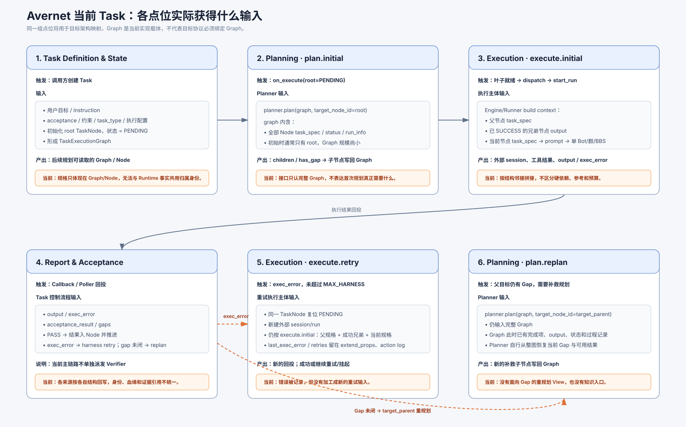
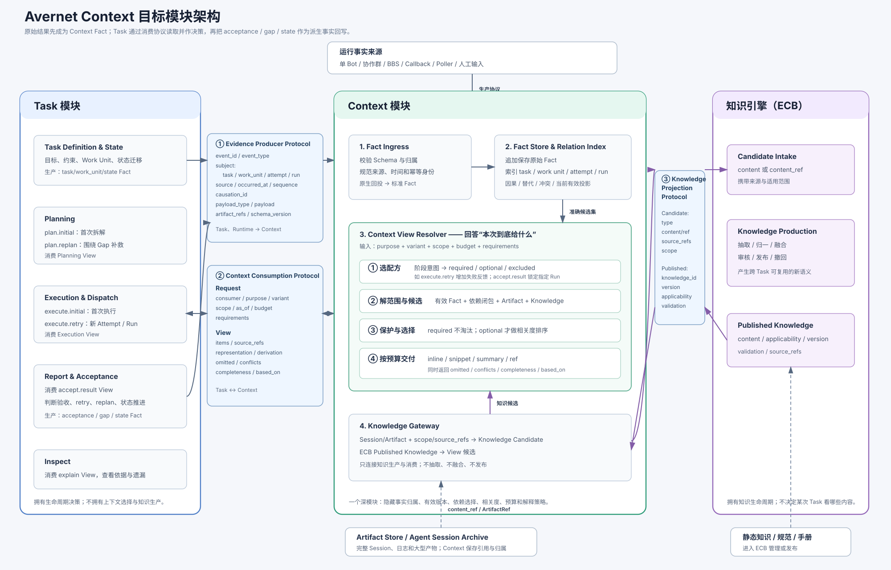

# Avernet Context V3：从当前 Task 上下文到模块协议

> 日期：2026-09-10  
> 文档状态：讨论稿  
> 范围：Avernet 当前 dynamic Task Loop、单 Bot/协作群/BBS/主动采集，以及 ECB Knowledge System 的衔接。

# 一、现状：一个 Task 如何被拉起



当前链路的关键事实只有三点：

1. **Planner 读完整 Graph**：`planner.plan(graph, target_node_id)`，初始规划和 Gap 重规划没有不同的输入协议；
2. **执行主体读结构邻接信息**：父节点规格、成功兄弟 `output`、当前节点规格；
3. **重试复用同一 Node 和首次执行配方**：新建外部 session/run，但 `last_exec_error` 等失败记录尚未成为明确的重试输入。

当前主链路没有独立的 Verifier 派发。`output`、`exec_error`、`acceptance_result` 和 `gaps` 由 Callback/Poller 回投后驱动状态推进。因此本文不假设“失败结果必然混入验收”，也不为不存在的独立验收流程预建复杂 Context。

---

# 二、问题：先抽象根问题，再用阶段明细验证覆盖

阶段不是问题本身，而是问题出现和被验证的位置。当前不是“完全没有协议”，而是已有约定过度依赖 Graph、Node 和各 Runtime 的内部结构。四个可观察问题是：

| 编号 | 问题 | 当前表现 | 实际后果 | 需要建设的能力 |
|---|---|---|---|---|
| P1 | **Planner、Runner 拿到的是固定拼装结果，不能按本次目的取数** | Planner 统一接收完整 Graph；Runner 固定拼“父规格 + 成功兄弟 output + 当前规格”；首次规划、重规划、首次执行和重试的差异隐藏在调用代码里 | 消费方必须自行理解 Graph/output；重试可能重复首次方案，重规划需要从整图自行恢复当前 Gap | 显式消费请求、按 `purpose + variant` 定义的 View 配方 |
| P2 | **同一结果在多来源、多次尝试下，难以稳定判断归属和当前有效版本** | callback、Poller、Bot/群/BBS 消息和 Task 派生结论按不同结构回写；Work Unit、Attempt、Run、重传、因果和替代关系没有共同表达 | 重复或乱序回投难去重；同一 Work Unit 重试后，难稳定回溯“哪个 Run 产生了什么、哪个结论仍有效” | 统一事实 Envelope、幂等接入、因果/替代关系、ArtifactRef |
| P3 | **Task 变大后，上下文只能继续膨胀或被粗暴截断** | 当前主要按结构邻接或整图取内容，没有先保护目标、约束、硬依赖和失败反馈，再处理参考信息 | 非关键历史挤占预算；截断时可能丢关键证据；线上也无法说明哪些内容被省略 | 必需项保护、候选选择、相关度排序、表示降级、预算与遗漏说明 |
| P4 | **规划和执行用不到已有知识，完整 Session 也无法沉淀为经验** | Planner/Runner 没有静态知识和 ECB Published Knowledge 的稳定入口；完整 Agent session 没有带 Task 范围和来源进入 ECB 的链路 | 同类任务重复探索；成功方案、失败模式和约束停留在单次会话中 | Knowledge Gateway、Session Artifact、Knowledge Candidate、Published Knowledge 查询 |

四个问题分别回答：

```text
P1：本次消费到底需要什么？
P2：这些事实属于谁、哪次尝试，当前哪条有效？
P3：候选很多时，怎样保住关键内容并控制大小？
P4：Task 外的知识怎样进来，Task 内的经验怎样沉淀出去？
```

## 2.1 阶段明细：用于验证四类问题是否覆盖完整

| 阶段 | 消费者 | 当前输入/上下文 | 根问题 | 当前缺口 | 实际影响 |
|---|---|---|---|---|---|
| Task 初始化 | Task 控制流程 | 目标、instruction、acceptance、约束、执行配置 | P2 | 规格和 root 身份只体现在 Graph/Node，没有跨来源通用的事实身份 | 后续读取必须理解 Graph/Node 内部结构 |
| `plan.initial` | Planner | `planner.plan(graph, root)`；此时 Graph 通常较小 | P1 | 输入可运行，但只表达“给整图”，没有表达首次规划所需的目标、约束、能力和知识 | 当前不一定超限，但 Planner 与 Graph 结构绑定 |
| `plan.initial` | Planner | 当前 Task 内信息 | P4 | 没有静态规范和已发布经验入口 | 已知正确做法无法复用 |
| `execute.initial` | Runner/执行主体 | 父节点规格、成功兄弟 `output`、当前节点规格 | P1、P3 | 结构相邻即进入，未声明硬依赖、参考、约束和预算 | 节点增多后信息失焦或超限，关键内容没有优先级 |
| `execute.initial` | Runner/执行主体 | 当前 Task 的局部结果 | P4 | 领域规范和历史经验没有稳定入口 | 执行质量取决于当前 Task 是否碰巧携带相关信息 |
| 执行结果回投 | Task 控制流程 | callback/Poller 的 `output`、`exec_error`、`acceptance_result`、`gaps` | P2 | 原始结果直接进入 Task 回写流程，各来源没有共同的 Fact 身份、来源和证据引用 | 重传、乱序、多 Runtime 和重试并存时难以稳定去重与追溯 |
| `execute.retry` | Runner/执行主体 | 同一 Node、新外部 session/run，仍复用首次执行拼装 | P1、P3 | 没有重试专用输入；错误虽有记录，但未明确成为失败反馈、已尝试方案和不可重复条件 | 新 session 可能重复原方案，或遗漏真正需要改变的条件 |
| `plan.replan` | Planner | `planner.plan(graph, target_parent)`；仍是完整 Graph | P1、P3 | 完成项、未完成项、当前 Gap、失败证据没有被组织成重规划输入 | Planner 需从整图恢复焦点，过程信息越多越容易干扰规划 |
| `plan.replan` | Planner | 当前 Task 内错误和结果 | P4 | 没有查询同类失败模式或已发布补救经验的入口 | 容易重复当前 Task 之外已经验证失败的方向 |
| 结果验收与推进 | Task 控制流程 | 执行主体返回的结果和 acceptance 信息 | P2 | 当前链路能运行，但原始结果、验收结论、Gap 和状态变化之间缺少稳定因果引用 | 事后难说明“基于哪个 Run 的哪些证据作出该结论” |
| `inspect` | 人工/审计工具 | Graph、Node 与运行记录 | P2、P3 | 无法统一解释事实版本，以及某项内容为何被纳入、压缩或省略 | 出现缺失时，难区分未采集、未选中、超预算或权限问题 |

> 注：`plan.initial` 时 Graph 通常只有 root，因此不能把当前问题夸大为“首次规划已经因整图而爆上下文”。真正的问题是接口没有表达消费意图，并且同一粗粒度接口会继续用于信息更丰富的 `plan.replan`。

当前不单独定义：

- `recover`：现阶段“状态未知后再试一次”可归入 `execute.retry`；
- 执行中续接：尚无证据表明它是当前主要消费场景；
- `knowledge.produce`：知识引擎是加工者，不是 Task Loop 消费节点。知识建设由 P4 中 Planner/Runner 的知识需求反推。

---

# 三、目标架构：Task、Context 与知识引擎



四类根问题与模块不是并列堆砌，而是一一落位：

| 根问题 | 主要承接模块 | 稳定的接口 |
|---|---|---|
| P1 不能按本次目的取数 | Context View Resolver | `Consumption Request → Context View` |
| P2 难判断事实归属和有效版本 | Fact Ingress、Fact Store & Relation Index | `Evidence Producer Protocol` |
| P3 上下文膨胀或粗暴截断 | Context View Resolver | View 的必需项保护、选择、表示、预算与遗漏说明 |
| P4 已有知识进不来、Session 经验出不去 | Knowledge Gateway、ECB | `Knowledge Candidate ↔ Published Knowledge` |

因此 Context 的核心不是转发：它在一个稳定接口后集中隐藏候选组装、硬依赖保护、知识查询、排序、表示降级、预算和解释策略。删除该模块，这些策略会重新散落到 Planner、Runner 和 Inspect。

## 3.1 用同一组 Task 点位对齐现状与目标架构

目标架构不改变 Task 的业务决策权，只改变事实进入和上下文读取的方式：

| Task 点位 | 当前做法 | 目标交互 | Context 提供的内容 |
|---|---|---|---|
| Task Definition & State | 规格和状态保存在 Graph/Node | 按生产协议记录 Task/Work Unit 定义与状态变化 | 可追溯的 Task Fact，不替 Task 作决策 |
| Planning：`plan.initial` | `planner.plan(graph, root)` | 按消费协议请求 `plan.initial` View | 目标、约束、能力、必要状态、相关知识 |
| Execution：`execute.initial` | 父规格 + 成功兄弟 output + 当前规格 | 请求 `execute.initial` View | 当前规格、硬依赖、acceptance、按需参考与知识 |
| Report & Acceptance | callback/Poller 结果直接进入 Task 回写流程 | 原始结果先按生产协议进入 Context；Task 再请求 `accept.result` View | 指定 Run 的结果、错误、Artifact 和来源证据 |
| Execution：`execute.retry` | 同一 Node 新建 session/run，复用首次拼装 | 请求 `execute.retry` View，指定新 Attempt 和上次失败 | 首次必需输入 + 失败反馈 + 已尝试方案 + 不可重复条件 |
| Planning：`plan.replan` | `planner.plan(graph, target_parent)` | 请求 `plan.replan` View，指定 Gap | 完成项、未完成项、可用结果、失败证据与相关知识 |

### 结果回投属于 Context，但结果决策属于 Task

目标链路应是单一事实链，而不是 Runtime 同时修改两份状态：

```text
Runtime Adapter / Poller
  ── Evidence Producer Protocol：run_finished / observation / ArtifactRef
  → Context

Task.Report & Acceptance
  ── Context Consumption Protocol：purpose=accept, variant=result
  → 读取该 Run 的结果与证据
  → Task 判断 acceptance、retry、replan 和状态迁移
  ── Evidence Producer Protocol：acceptance_recorded / gap_recorded / state_changed
  → Context
```

因此：

- **原始执行结果是 Context 中的事实**；
- **验收、状态推进和是否重试是 Task 的决策**；
- Task 的决策结果也作为派生事实回写 Context，并通过 `causation_id` 指向原始 Run 结果。

这比“结果一份写 Context、一份直接写 Task”更稳定：Context 是事实读取的唯一入口，Task 不会绕过 Context 使用另一份结果副本；同时 Context 仍不会变成第二个 Task Engine。

Task 如何被唤醒属于运行编排，而不是第三类上下文内容协议：现有 Callback handler 可以在收到 `IngestAck` 后触发 Task，未来也可以使用队列通知或轮询。通知最多携带 `fact_ref`，真正的结果内容仍通过 Context Consumption Protocol 读取。

## 3.2 Context 内部模块：上报后到底发生什么

Context 第一版包含四个内部模块，主链路是：

```text
生产协议上报
→ Fact Ingress：校验、归一、幂等
→ Fact Store & Relation Index：保存原始事实，建立归属/因果/有效版本关系
→ Context View Resolver：按消费目的解出候选，选择并控制表示大小
→ 消费协议返回 Context View
```

| 模块 | 输入后实际处理 | 为什么不能省略 |
|---|---|---|
| **Fact Ingress** | 实现 Evidence Producer Protocol；校验 Envelope/Payload Schema；补齐或验证幂等键、来源和观察时间；把单 Bot、群、BBS、Callback、Poller 的原生结构映射为标准 Fact | 协议只是约定，Ingress 才是执行约定的实现。没有它，每个生产者都要自行保证归属、幂等和兼容 |
| **Fact Store & Relation Index** | 原始 Fact 追加保存；按 `task/work_unit/attempt/run` 建范围索引；记录 `causation/supersedes/conflict/artifact`；计算“当前有效事实”投影但不删除历史 | View Resolver 必须先准确找到“本任务、本 Work Unit、本 Attempt、当前有效”的候选。没有这层，相关度再高也可能检索到错误 Run 或已被替代的结果 |
| **Context View Resolver** | 接收消费请求；选择阶段配方；从事实索引、Artifact 和知识中解候选；保护必需项、选择可选项；在预算内决定 inline/snippet/summary/ref；返回遗漏和依据 | 它回答“这个阶段到底给什么”。删除它后，Planner、Runner、Acceptance、Inspect 都要各自实现范围、依赖、相关度、预算和解释逻辑 |
| **Knowledge Gateway** | 将 Session/Artifact 连同事实范围投影为 Knowledge Candidate；查询 ECB Published Knowledge；把知识候选交给 View Resolver | Context 不做知识抽取，但必须把 Task 事实与 ECB 的知识生产、知识消费连接起来 |

### Context View Resolver 的四个必要步骤

四步有严格前后关系，不是功能清单：

```text
1. 选配方
   purpose + variant → required / optional / excluded
   例：accept.result 必须读取指定 Run 的原始结果；execute.retry 必须增加失败反馈。

2. 解范围与候选
   scope(task/work_unit/attempt/run) → 当前有效事实、依赖闭包、ArtifactRef
   requirements → 是否查询 ECB Published Knowledge。

3. 保护必需项并选择可选项
   required 不参与语义淘汰；
   optional 才按适用范围、相关度、时效和可信度排序；
   有冲突时并列返回，不由 Context 替 Task 裁决。

4. 按预算交付
   对入选项决定 inline / snippet / summary / ref；
   返回 items、omitted、conflicts、completeness、based_on。
```

前两步保证**选对集合**，第三步保证**关键内容不被相关度算法误删**，第四步才解决**大小和模型输入形式**。如果直接从“向量召回 + summary”开始，无法证明硬依赖完整，也无法证明拿到的是当前 Run 的有效结果。

### Context 与 ECB：Session、Summary 和知识加工

完整 Agent Session 的链路是：

```text
Agent Session 全量内容 → Artifact Store
Session 的 artifact_registered + Task/Work Unit/Attempt/Run 范围 → Context
Knowledge Gateway → Knowledge Candidate(content_ref + source_refs) → ECB
ECB 按 content_ref 读取完整 Session → 抽取、归一、融合、审核、发布
Published Knowledge → Knowledge Gateway → 按需进入某次 Context View
```

`content` 与 `content_ref` 至少提供一个：短候选可直接传 `content`，完整 Session 和大型产物只传 `content_ref`，不要求把全文复制进 Context。

是否属于“知识加工”，不看是否调用了 summary，而看是否产生跨 Task 可复用的新语义：

| 场景 | 归属 |
|---|---|
| 为本次 Runner 控制 token，把一份长证据临时缩短，并保留原始引用 | Context 的**消费表示加工** |
| 从一个或多个 Session 提炼可跨 Task 复用的规律，定义适用范围、版本、验证和撤回 | ECB 的**知识加工** |
| ECB 已发布知识在某次 View 中再次截短 | 知识归 ECB；本次表示归 Context |

## 3.3 三个系统模块的职责

| 系统模块 | 负责 | 不负责 | 对外接口 |
|---|---|---|---|
| Task | 目标与 Work Unit、规划、派发、重试、验收和状态迁移 | 不负责检索、压缩和选择上下文，不负责知识加工 | 生产任务事实；携带消费意图请求 Context View |
| Context | 事实接入与血缘；内容选择、消费表示和交付；连接 Artifact 与知识 | 不决定是否重试/重规划，不判断业务验收，不抽取发布知识 | Evidence Producer Protocol；Context Consumption Protocol；Knowledge Projection Protocol |
| 知识引擎（ECB） | 将候选事实抽取、归一、融合、审核、发布和撤回 | 不保存全部任务运行态，不决定某次调用应带哪些内容 | Knowledge Candidate 接入；Published Knowledge 查询 |

Context 不是只做字段转换和转发的 Adapter。删除 Context 后，Planner、Runner、Report & Acceptance、Inspect 都必须分别实现事实去重、依赖选择、知识查询、表示降级、预算装配和解释逻辑；复杂度会扩散到多个调用方。Context 的深度来自：**用一个稳定消费接口隐藏多来源事实和完整的内容处理策略。**

## 3.4 三类对象

### Fact：任务运行事实

```text
某个外部来源在某个时间观察到的任务相关事实。
```

例如：

```text
某次 Bot 执行返回错误；
协作群成员提出方案；
BBS lease 发生交接；
Poller 观察到外部 Run 成功；
某个 Artifact 被登记。
```

### Knowledge：可跨 Task 复用的语义知识

```text
经过抽取、归一、融合、审核和发布，能够脱离单次运行复用的内容。
```

### View：面向某次消费的上下文视图

```text
从 Fact、Knowledge、Task 规格和 ArtifactRef 中，按消费意图选择出来的输入。
```

三者不能混为一谈：

```text
Fact Store 中存在的事实，不等于 Planner/Runner 一定看到；
Fact 不等于 Knowledge；
View 不等于新的事实，只是一次有范围的读取结果。
```

## 3.5 Context 的职责边界

| 能力 | Context | Task | ECB | Artifact Store |
|---|---|---|---|---|
| 接收运行事实 | 负责 | 提供任务归属 | 不负责 | 不负责 |
| 保存事实来源和血缘 | 负责 | 提供身份 | 不负责 | 保存实际内容 |
| 生成消费 View | 负责 | 提供消费目标 | 提供知识 | 提供产物引用/内容 |
| 决定 retry/replan | 不负责 | 负责 | 不负责 | 不负责 |
| 判断 acceptance | 不负责 | 负责流程推进 | 不负责 | 提供证据 |
| 抽取/融合/发布知识 | 不负责 | 不负责 | 负责 | 不负责 |
| 选择哪些知识给 Planner/Runner | 负责编排读取 | 提供目标 | 提供已发布内容 | 不负责 |

## 3.6 生产者和消费者

### 事实生产者

```text
Task：产生 Task/Work Unit 定义、派发、验收、Gap 和状态事实；
单 Bot Runtime：产生执行结果、工具调用和错误；
协作群 Runtime：产生消息、提议、质疑、决策；
BBS：产生 claim、lease、handoff、submit 等工作状态；
Poller：观察外部运行状态；
Task Report & Acceptance：基于结果产生验收、Gap 和状态派生事实；
未来 Verifier：若引入，则产生独立验证事实；
```

它们的内容不同，但都需要生产“可归属、可追溯、可去重”的事实。

### Context 消费者

```text
Planner：消费规划 View；
Runner：消费执行 View；
Task Report & Acceptance：消费 `accept.result` View；
Verifier：只有未来独立验证场景成立时才消费 verify View；
Inspect：消费解释 View。
```

ECB 主要是知识生产者/加工者，不应在“消费节点清单”中冒充 Task Loop 的消费节点。

## 3.7 从问题到能力，并用业界机制校验

| 当前问题 | Context 必须提供的能力 | 业界同类机制为什么能佐证 |
|---|---|---|
| 完整状态直接成为本轮模型输入 | Fact/Task State 与本轮 View 分离 | LangGraph 将 checkpoint 状态与可裁剪/摘要的消息输入分开；说明“完整保存”不等于“完整注入” |
| 结构相邻内容全部进入 Runner | 硬依赖优先，非必需内容再做相关度选择 | AutoGen memory 需要显式 query/update model context；说明 memory 存在不代表应自动全量注入 |
| 重试没有形成差异化输入 | `execute.retry` View 显式携带失败反馈和不可重复条件 | LoopX 的 bounded work 是目标、范围和停止条件明确的一次有限执行；下一轮根据未完成项、证据和失败原因形成 continuation state，而不是复用上一轮输入 |
| 大历史需要压缩但原始证据不能丢 | `inline / summary / snippet / ref / omitted` 分级，并保留 source refs | OpenAI Agents SDK 的 compaction/session 机制区分应用状态、会话历史与实际模型输入；压缩不等于删除原始事实 |
| 跨任务经验缺入口 | Context 查询静态知识和 ECB Published Knowledge | 业界 memory/retrieval 都要求查询动作；对 Avernet 而言，知识引擎负责生产，Context 负责按当前消费目标选择 |

这些机制只校验方案方向，不要求 Avernet 复制任何产品的对象模型。

---

# 四、协议：先稳定接口，再逐步替换实现

## 4.1 协议全景与落地顺序

协议字段直接承接前文问题：

| 根问题 | 由哪些协议字段解决 |
|---|---|
| P1 不能按本次目的取数 | `purpose`、`variant`、`scope`、`requirements`、`completeness` |
| P2 难判断事实归属和有效版本 | `event_id`、`event_type`、`subject`、`source`、`sequence`、`causation_id`、`artifact_refs` |
| P3 上下文膨胀或粗暴截断 | `kind`、`priority`、`representation`、`budget`、`derivation`、`omitted`、`conflicts` |
| P4 已有知识进不来、Session 经验出不去 | `candidate_type`、`source_refs`、`applicability`、`knowledge_version`、`validation_status` |

Task 与 Context 之间只有两类协议；Context 与 ECB 另有一类知识协议：

```text
Task / Runtime Adapter ── Evidence Producer Protocol ──> Context
Task(Planner / Runner / Report & Acceptance / Inspect) ── Context Consumption Protocol ──> Context View
Context <── Knowledge Projection Protocol ──> ECB Knowledge System
```

其中生产协议解决“发生了什么并如何归属”，消费协议解决“本阶段要读取什么”；不能把两者合成一个双向大接口。 异步通知只是触发方式，不承载上下文内容，因此不单独扩成第三类 Task–Context 内容协议。

协议先于算法落地：

```text
1. 先统一事实身份、来源与 Payload；
2. 再让 Planner/Runner/Report & Acceptance 显式声明 plan.initial、plan.replan、execute.initial、execute.retry、accept.result；
3. 先实现确定性范围、硬依赖和预算，再增加语义相关度、摘要和冲突处理；
4. 接入静态知识与 ECB Published Knowledge；
5. 只有 Verify 的额外证据需求成立后，才增加 verify View。
```

## 4.2 Evidence Producer Protocol：事实如何生产

### 4.2.1 统一 Envelope + 特有 Payload

统一外壳只放所有消费者都需要理解的元信息；模态差异放在 `payload`。

```json
{
  "event_id": "evt_123",
  "event_type": "run_finished",
  "subject": {
    "task_id": "task_1",
    "work_unit_id": "node_20",
    "attempt_id": "attempt_2",
    "run_id": "run_20_2"
  },
  "source": {
    "mode": "single_bot",
    "source_id": "session_9",
    "adapter_id": "bcs_adapter"
  },
  "occurred_at": "2026-09-09T10:00:00Z",
  "observed_at": "2026-09-09T10:00:02Z",
  "sequence": 17,
  "causation_id": "evt_122",
  "payload_type": "BotExecutionResult",
  "payload": {},
  "artifact_refs": ["artifact_9"],
  "schema_version": "1"
}
```

### 4.2.2 字段为什么存在

| 字段 | 由谁赋予 | 作用 | 必填/约束 |
|---|---|---|---|
| `event_id` | 生产者提供；无法提供时由 Ingress Adapter 根据来源幂等键稳定生成 | 事实幂等，重复 callback 不重复落库 | 必填；同一事实重传必须不变 |
| `event_type` | Context 协议定义，Adapter 映射 | 表达 Task 定义、Work Unit、状态、Run、验收、Gap 等稳定事实类别 | 必须是受控枚举；业务细节进入 `payload_type/payload` |
| `subject.task_id` | Task 创建时产生 | 事实属于哪个任务 | 必填 |
| `subject.work_unit_id` | Task 编排产生 | 事实属于哪个稳定执行单元 | Work Unit 相关事实必填；当前实现由 `node_id` 映射，不把协议绑定 Graph |
| `subject.attempt_id` | Task 在每次派发前产生 | 区分同一执行单元的第几次尝试 | 执行前生成；重试新建 |
| `subject.run_id` | 外部 Runtime 启动后返回 | 区分一次具体外部会话 | 派发前可为空，启动后必填 |
| `source.mode` | Adapter 根据接入类型填写 | 区分单 Bot、协作群、BBS、Poller 等来源模式 | 受控枚举，不等于可信度 |
| `source.source_id` | 外部系统或 Adapter | 回查外部会话、群、帖子或采集对象 | 同一来源内应稳定 |
| `source.adapter_id` | Avernet 接入配置 | 说明哪个 Adapter 将原始数据解释成该 Payload | 用于审计、兼容和解释版本定位 |
| `occurred_at` | 外部来源提供 | 事实在外部实际发生的时间 | 不得用观察时间替代 |
| `observed_at` | Context 接入层 | Avernet 看到事实的时间 | 用于延迟和乱序分析 |
| `sequence` | 外部来源提供或 Adapter 维护 | 同一来源内的顺序 | 不是全局序号；没有可靠顺序时为空 |
| `causation_id` | 产生新事实的组件 | 指向直接触发当前事实的上一事实 | 不是父节点 ID；不明确时为空 |
| `payload_type` | Adapter 映射 | 指出 `payload` 的结构类型 | 必须可由 Schema Registry 解析 |
| `payload` | 外部来源提供，Adapter 做必要转换 | 保存模态特有内容 | 不因归一而丢失语义 |
| `artifact_refs` | Artifact 接入层登记 | 大内容和原始证据不内联时仍可回查 | 引用必须可校验 |
| `schema_version` | 协议发布方 | 支持协议演进和重放 | 必填 |

### 4.2.3 `event_type` 第一版枚举

`event_type` 表达稳定的事实类别，`payload_type` 表达不同模态的具体结构。若只定义 Run 事件，Task 定义、规划、状态和 Gap 就无法进入统一事实账本，因此第一版至少覆盖以下类别：

| 类型 | 含义 | 典型 Payload | 主要生产点位 |
|---|---|---|---|
| `task_defined` | Task 目标、约束或验收要求被定义/修订 | `TaskDefinition` | Task Definition & State |
| `work_unit_defined` | 规划产生或修订一个稳定 Work Unit | `WorkUnitDefinition` | `plan.initial` / `plan.replan` |
| `state_changed` | Task 或 Work Unit 状态发生迁移 | `StateTransition` | Task 控制流程 |
| `run_started` | 一次外部执行真正启动 | `RunStarted` | `execute.initial` / `execute.retry` |
| `observation_recorded` | 记录消息、进度、工具结果或外部状态观察 | `CoopMessage` / `PollObservation` | Runtime / Poller |
| `run_finished` | 外部 Run 到达终态 | `RunFinished` / `BotExecutionResult` | Callback / Poller |
| `artifact_registered` | 大产物或原始证据被登记 | `ArtifactRegistered` | Artifact 接入层 |
| `acceptance_recorded` | 记录 Task 对结果的验收结论及证据 | `AcceptanceRecord` | Report & Acceptance |
| `gap_recorded` | 记录尚未满足的目标或验收缺口 | `GapRecord` | Report & Acceptance |
| `ownership_changed` | claim、lease、handoff、release 变化 | `BbsWorkState` | BBS |
| `fact_superseded` | 指定旧事实不再是当前有效版本 | `SupersedeRecord` | Task / Context |
| `conflict_detected` | 登记两个或多个事实之间的明确冲突 | `ConflictRecord` | Context / 人工核对 |

受控枚举不应无限吸收业务动作：例如“协作群提出建议”仍是 `observation_recorded + CoopMessage(message_role=proposal)`。`run_finished(status=SUCCESS)` 只表示外部执行成功返回，不能直接等同于 Task/Work Unit 验收通过；后者必须由 `acceptance_recorded` 表达。

### 4.2.4 特有 Payload 示例

```json
{
  "payload_type": "BotExecutionResult",
  "payload": {
    "status": "failed",
    "result": null,
    "error_code": "timeout",
    "tool_calls": [
      {"tool": "search_log", "result_ref": "artifact_log_1"}
    ]
  }
}
```

```json
{
  "payload_type": "CoopMessage",
  "payload": {
    "author_id": "bot_a",
    "message_role": "proposal",
    "reply_to": "evt_101",
    "content": "建议调整连接池上限"
  }
}
```

```json
{
  "payload_type": "BbsWorkState",
  "payload": {
    "action": "handoff",
    "owner_id": "bot_b",
    "lease_id": "lease_7",
    "handoff_to": "bot_c"
  }
}
```

```json
{
  "payload_type": "PollObservation",
  "payload": {
    "external_run_id": "external_run_9",
    "external_status": "SUCCESS",
    "cursor": "cursor_18",
    "raw_response_ref": "artifact_raw_3"
  }
}
```

## 4.3 Context Consumption Protocol：如何消费 View

### 4.3.1 请求协议

```json
{
  "consumer": "runner",
  "purpose": "execute",
  "variant": "retry",
  "scope": {
    "task_id": "task_1",
    "work_unit_id": "node_20",
    "attempt_id": "attempt_2"
  },
  "as_of": {
    "task_revision": 18,
    "context_version": "ctx_v25"
  },
  "budget": {
    "max_input_tokens": 12000,
    "max_inline_bytes": 200000
  },
  "requirements": {
    "include_hard_dependencies": true,
    "include_failure_feedback": true,
    "include_cross_task_knowledge": true
  }
}
```

这里将 `node_id` 抽象为 `work_unit_id`，只是为了不把未来方案绑定到 Graph；在当前实现中可以由 `node_id` 映射而来。

### 4.3.2 不同消费节点的 View 配方

#### `plan.initial`

```text
必须：Task 目标、约束、规划目标、可用能力；
可选：相关静态知识、已发布跨任务经验；
默认不带：其他节点的详细执行日志和原始大产物。
```

#### `plan.replan`

```text
必须：当前任务状态、目标节点、已完成结果、未完成事项；
必须：失败原因、已尝试方案、不可重复条件；
可选：相关跨任务知识；
默认不带：与当前重规划无关的完整历史。
```

#### `execute.initial`

```text
必须：当前 Work Unit 规格、硬依赖结果、当前约束、验收要求；
可选：相关知识、参考结果；
大内容：只提供摘要、片段或 ArtifactRef，不默认内联全文。
```

#### `execute.retry`

```text
必须：首次执行所需输入；
新增：上次失败原因、失败证据、已尝试方案、不可重复条件；
明确排除：把上次失败结果当作当前成功交付物。
```

#### `accept.result`

```text
必须：指定 Attempt/Run 的原始结果、错误、ArtifactRef、来源和结束状态；
按需：执行过程中的关键 observation、逐项验收证据；
默认不带：其他 Work Unit 的完整历史和无关知识。
```

该 View 供 Task 内现有 Report & Acceptance 流程使用，不代表新增独立 Verifier。Task 基于它产生 `acceptance_recorded`、`gap_recorded` 和 `state_changed`。

#### `verify`

只有当验收需要超出成功 output 的信息时启用：

```text
必须：acceptance、待验收产物、产物来源；
按需：原始 Artifact、验证记录、冲突和证据缺口；
不默认：全部失败历史。
```

### 4.3.3 View 返回协议

```json
{
  "view_id": "view_123",
  "consumer": "runner",
  "purpose": "execute",
  "variant": "retry",
  "items": [
    {
      "item_id": "fact_77",
      "kind": "hard_dependency|constraint|failure_feedback|knowledge|artifact",
      "representation": "inline|summary|snippet|ref",
      "content": {},
      "source_refs": ["evt_123", "artifact_9"],
      "selection": {
        "priority": "required|important|optional",
        "reason": "hard_dependency|retry_feedback|semantic_match|budget_downgrade"
      },
      "derivation": {
        "generated_by": "context_view_resolver",
        "method_version": "summary_v1",
        "covers": ["evt_123"]
      }
    }
  ],
  "budget": {
    "max_input_tokens": 12000,
    "used_input_tokens": 8900,
    "max_inline_bytes": 200000
  },
  "compressed": [],
  "omitted": [],
  "conflicts": [],
  "completeness": {
    "status": "complete|partial|blocked",
    "missing_required": []
  },
  "based_on": {
    "task_revision": 18,
    "context_version": "ctx_v25"
  }
}
```

### 4.3.4 View 选择规则

这里需要区分两种“加工”：

- **ECB 知识加工**：把运行事实生产为可跨 Task 复用的 Knowledge；
- **Context 表示加工**：只为本次消费把已有 Fact/Knowledge 表示成 `summary` 或 `snippet`，不会产生新的权威事实，也不能覆盖原始证据。

当 `representation=summary|snippet` 时，`derivation` 必须记录生成方、方法版本和覆盖的 `source_refs`。摘要是否可用，不靠声称“绝不丢信息”，而靠三项约束：required 项不得只剩无证据摘要、原始 ArtifactRef 始终可回查、`completeness/omitted` 明确暴露缺口。

```text
第一层：按 purpose 和 scope 限定候选范围；
第二层：保证 required/hard dependency 不被相关度淘汰；
第三层：对非必需内容按目标、失败原因和 acceptance 做语义排序；
第四层：按预算决定 inline、summary、snippet、ref 或 omitted；
第五层：记录每项选择、压缩和省略原因。
```

不能采用以下单一规则：

```text
只取最近 K 条：会丢失仍有效的旧约束；
只做向量检索：硬依赖可能因为文本相似度低而被漏掉；
超限直接截断：无法知道哪些证据被丢弃。
```

## 4.4 Knowledge Projection Protocol：Context 与 ECB 的联动

### 4.4.1 为什么需要它

该协议不是由“运行事实应该都进入知识加工”推导出来的，而是由消费需求推导出来的：

```text
Planner/Runner 需要跨任务经验或背景知识；
当前 Task 内没有这些信息；
已有静态知识可以直接查询；
可复用的运行事实需要经过 ECB 加工后才能成为知识。
```

### 4.4.2 Context → ECB：候选生产

```json
{
  "candidate_id": "kc_123",
  "candidate_type": "failure_pattern|solution|constraint|background",
  "content": {},
  "content_ref": "artifact://agent_session_9",
  "source_refs": ["evt_123", "artifact_9"],
  "scope": {
    "task_id": "task_1",
    "work_unit_id": "node_20",
    "covered_time_range": ["2026-09-01", "2026-09-09"]
  },
  "producer": "context_candidate_filter",
  "processing_version": "candidate_v1"
}
```

`content` 与 `content_ref` 至少一个非空：短候选可以直接携带 `content`；完整 Agent Session 或大型产物使用 `content_ref`，ECB 按引用读取原文。

Context 只负责：

```text
选择候选；
保留来源和适用范围；
提交 ECB；
接收候选处理结果。
```

ECB 负责：

```text
抽取、归一、融合、审核、发布、撤回。
```

### 4.4.3 ECB → Context：已发布知识

已发布知识至少需要：

```text
knowledge_id；
knowledge_version；
content；
source_refs；
applicability；
validation_status；
supersedes/revoked_by。
```

Context 读取知识时只纳入满足消费节点要求的已发布版本；撤回版本不能继续进入新的 View。

## 4.5 第一阶段实现边界

第一阶段不要求一次完成语义检索和知识生产，先完成协议闭环：

```text
1. 给 callback/poller 的结果补充稳定事实身份和来源；
2. 保留现有 output 作为兼容投影；
3. 给 Planner 增加 plan.initial/plan.replan 的请求标识；
4. 给 Runner 增加 execute.initial/execute.retry 的请求标识；
5. 让 Report & Acceptance 从 Context 读取 accept.result，而不是继续直接消费回投副本；
6. Retry View 至少注入失败原因和重试次数；
7. 记录 View 的版本、预算和省略原因。
```

后续再替换 `_build_context` 和 Planner 的整图输入方式。

## 4.6 协议验证场景

| 验证场景 | 应验证的行为 |
|---|---|
| 初始 Planner | 能区分规划目标、任务结构和可选知识；不会默认带入全部执行细节 |
| 重规划 | 能看到失败原因和已尝试方案；不会再次无条件重复同一方向 |
| 首次 Runner | 能区分硬依赖、参考信息和大产物引用；超预算有明确降级记录 |
| Runner 重试 | 输入明确标识为 retry，并包含失败反馈；不是简单复用首次输入 |
| 结果验收 | Runtime 原始结果先进入 Context；Task 通过 `accept.result` 读取指定 Run 证据，再回写验收派生事实 |
| Verify（若启用） | 能从验收结果回到产物和原始证据；不把失败节点当成功依赖 |
| ECB 联动 | 只有被选为候选的事实进入知识加工；Published Knowledge 能回溯来源 |
| Inspect | 能解释某项事实为什么纳入、压缩或省略 |

---

## 附录：当前代码与参考资料

### Avernet 当前实现

```text
src/backend/src/agentclaw/community/core/task/task_runner/task_runner.py
src/backend/src/agentclaw/community/core/task/task_center/engine.py
src/backend/src/agentclaw/community/core/task/task_plan/planner.py
src/backend/src/agentclaw/community/core/task/task_runner/client/prompt_formatter.py
```

### ECB

```text
ocb/src/ecb/docs/knowledge-engine-analysis.md
ocb/src/ecb/docs/specs/knowledge_system/_shared/overview.md
ocb/src/ecb/docs/specs/knowledge_system/_shared/integration-with-knowledge-system.md
ocb/src/ecb/ecb/application/knowledge_engine/pipeline/production_pipeline.py
ocb/src/ecb/ecb/application/knowledge_system/knowledge_extraction/extraction_pipeline.py
```

### 业界参考

```text
LoopX：长期目标、有限执行片段、结构化状态回写
LangGraph：checkpoint、状态持久化与本轮输入分离
AutoGen：memory 的保存、查询与显式更新模型上下文
OpenAI Agents SDK：应用上下文不自动等于模型输入
```
