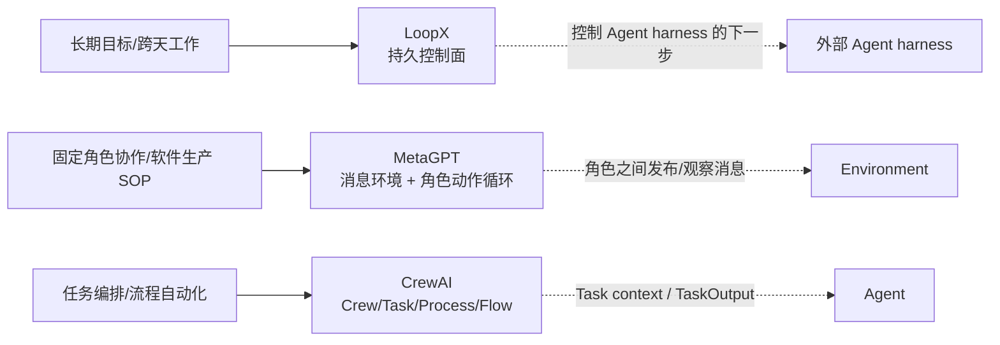
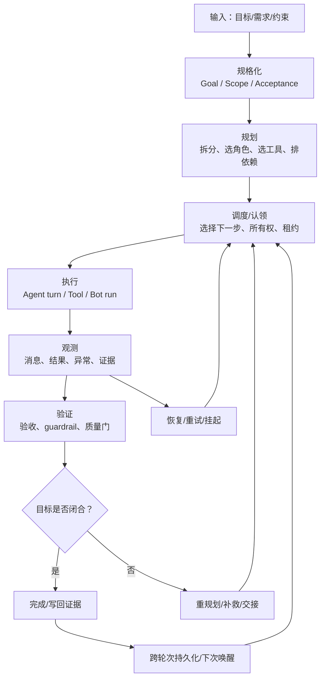
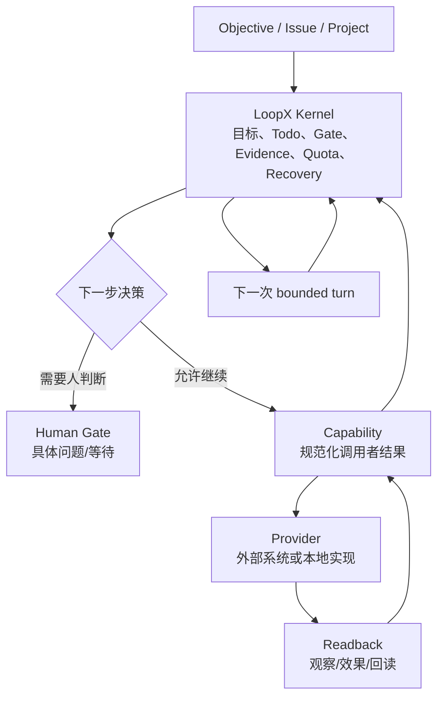
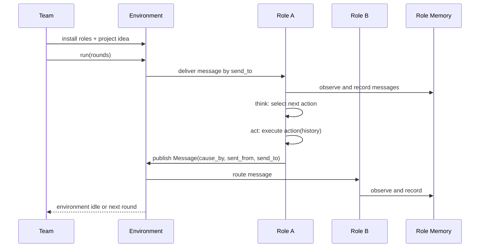
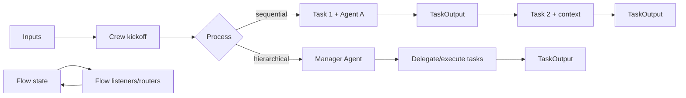
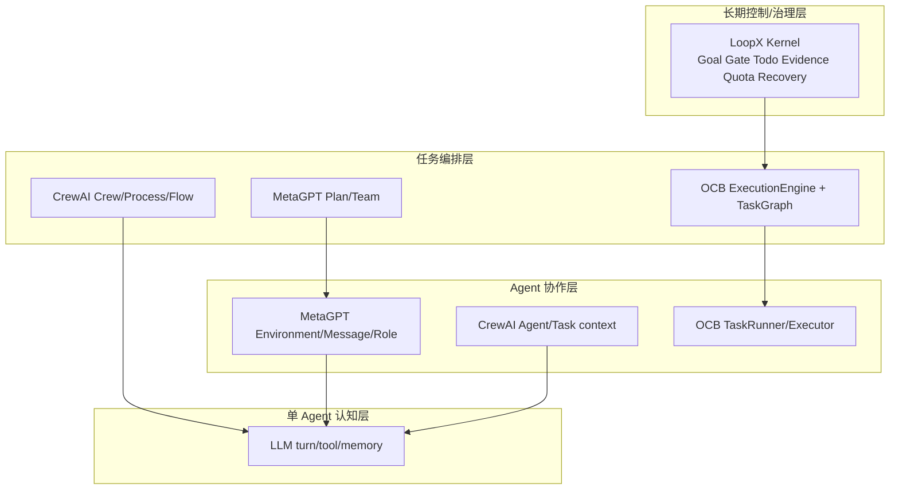
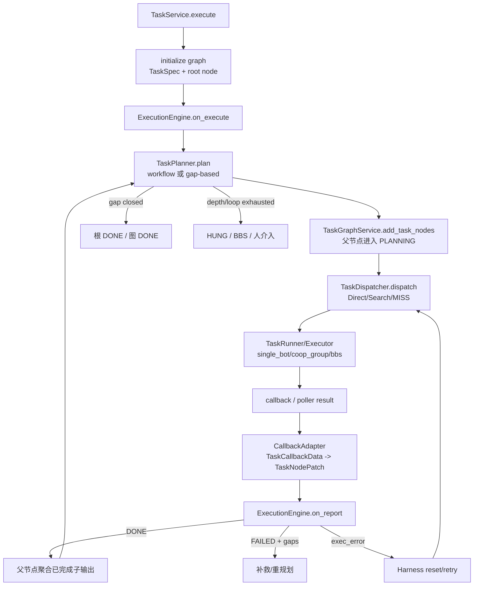
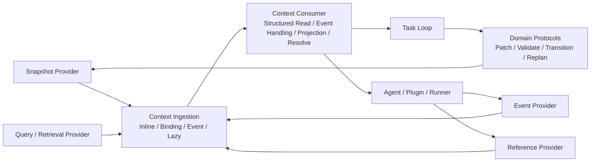

# 任务 Loop 与上下文工程：业界实现、OCB 对照与融合判断

> 调研日期：2026-08-31
> 讨论范围：任务如何串联、运行分层、上下文如何流转、领域对象如何承载这些语义。
> 非本主题：不讨论演示、内容收敛、Bot 话术或某个具体业务的提示词规范。

## 0. 先给结论：业界不是一类产品，而是三条不同的架构轴

不能把所有多 Agent 产品直接并列比较。它们解决的问题不同：



| 架构轴 | 典型实现 | 主要回答的问题 | 与 OCB Task Loop 的相似度 |
|---|---|---|---|
| **长期控制面** | LoopX | 目标跨多次运行如何继续？谁拥有下一步？何时暂停、恢复、交接？ | **最高：同样把 durable state 放在 Agent 运行时之外** |
| **角色协作运行时** | MetaGPT | 多个角色怎样通过消息和 SOP 协作完成一轮工作？ | **中高：同样有任务、角色、产出、循环；但它更偏内存中的协作环境** |
| **任务/流程编排** | CrewAI | 固定任务怎样串行/层级执行？任务输出怎样成为下游输入？ | **中高：同样有 Task DAG/Process/回调；但它的主语是 Crew workflow** |
| 单 Agent 认知循环 | ReAct、Reflexion 等 | 一个 Agent 怎样在一次任务中观察、思考、行动、反思？ | **低：是叶子执行算法，不是 OCB 的任务控制面** |
| Agent 记忆/上下文存储 | MemGPT、RAG memory 等 | Agent 怎样管理长短期记忆？ | **低到中：是 Context Provider，不是完整 Task Loop** |

因此本文分别讲清前三类，再做 OCB 融合。这里的“相似”只表示**控制问题或领域对象的重叠**，不表示可以直接复用对方的代码模型。

---

## 1. 先统一观察框架：一个 Task Loop 到底由哪些阶段组成

业界实现虽然命名不同，但可以拆为以下观察阶段。不是说每个产品都完整实现全部阶段，而是用这张图定位它们各自覆盖的部分。



### 1.1 阶段与上下文的关系

“上下文”不能只理解为一段 prompt。至少要区分：

| 阶段 | 必须知道的事实 | 典型上下文形态 |
|---|---|---|
| 规格化 | 目标是什么、范围是什么、成功标准是什么 | `Goal`、`Scope`、`Acceptance` |
| 规划 | 已完成什么、还缺什么、有哪些约束 | plan snapshot、依赖、历史产出、限制条件 |
| 调度 | 谁能做、谁正在做、是否可继续 | assignee、capability、claim/lease、quota |
| 执行 | 当前 Agent 要做什么、上游交付了什么 | task input、父任务、兄弟结果、工具上下文 |
| 观测 | 发生了什么，结果是否可信 | message/event、run result、error、evidence |
| 验证 | 结果是否满足目标，而不是是否返回了文本 | acceptance verdict、guardrail、quality gate |
| 恢复 | 上次停在哪里，重试是否会重复副作用 | checkpoint、attempt、idempotency、handoff |
| 跨轮次 | 下次唤醒后哪些事实仍然有效 | durable state、版本、证据新鲜度、待办 |

这里已经能看出一个关键判断：

> **Task Context 是执行对象的上下文；Loop Context 是推进对象的上下文；Agent Context 是认知对象的上下文。三者有交集，但不能用一个 `dict` 代替。**

---

## 2. LoopX：最像 OCB Task Loop 的控制面参考

### 2.1 它解决的核心问题

LoopX 的定位不是替代 Codex、Claude Code 或其他 Agent harness，而是在其上面提供 provider-neutral、stateful 的长期控制面：目标、gate、todo、scope、evidence、quota、recovery 和 handoff 等状态不依赖某一次 Agent turn。Agent runtime 只执行一个有边界的 turn，控制面决定下一步是否继续、由谁继续、是否需要人判断。详见其 README 对 control plane 与 harness 的区分，以及架构文档中的 Kernel/Capability/Provider 分层。



### 2.2 分层设计

| 层 | LoopX 的职责 | 领域对象/信息 |
|---|---|---|
| Kernel / state | 持有长期真相，不让 dashboard 或聊天记录成为真相 | Goal、Todo、Gate、Evidence、Quota、Claim、Lease、Run history、Recovery |
| Capability | 定义一个可验证的调用者结果，归一 provider 输出并提出 typed transition | capability contract、transition proposal、validation |
| Provider | 对接外部系统/本地实现，返回 observation、effect result、readback | provider invocation、effect、readback |
| Agent / harness | 规划、分析、使用工具并完成一个 bounded action | turn、prompt、tool call、handoff |
| Projection / operator surface | 把状态投影到看板或协作面 | status、todo、gate 的只读/受控投影 |

这和 OCB 的相似点不在于“都有 Bot”，而在于：

1. **控制状态与 Agent 执行解耦**：LoopX Kernel 对应 OCB 的 `TaskGraphService + ExecutionEngine` 这一控制组合；harness/provider 对应 OCB 的 `TaskRunner/TaskExecutor` 及其适配器。
2. **每轮只做 bounded work**：LoopX 通过 `should-run → claim → update → refresh-state → spend-slot` 驱动一小段工作；OCB 通过节点派发、运行、回投、状态推进驱动一段节点执行。
3. **回写才算推进**：LoopX 要求 evidence/handoff/next todo 写回后才进入下一 tick；OCB 也把 callback/report 作为状态推进入口，而不是把“已发送消息”当成完成。
4. **恢复是领域能力**：LoopX 把 recovery、handoff、quota 放在控制面；OCB 已有 Harness、重试、HUNG、BBS 升级和图持久化。
5. **投影不是权威**：LoopX 明确 board/dashboard 是 projection；OCB 的 dashboard 应是 `TaskExecutionGraph` 的查询投影，不能反向成为状态源。

### 2.3 Context 如何流转

LoopX 的上下文不是“把所有历史塞给 Agent”，而是由 durable state 生成下一轮最小可用状态：

```text
持久 Goal 状态
  -> 当前 gate / authority
  -> 已 claim 的 todo
  -> 最近有效 evidence / handoff
  -> quota / capability / stop condition
  -> 一个 bounded turn 的输入
  -> provider readback + validation
  -> accepted writeback
  -> 新的下一轮上下文
```

这对 OCB 的直接启发是：`run_info.output` 不能单独承担全部上下文职责。它是某个节点某次执行的产出，不等于：

- 当前任务还缺哪些 acceptance gap；
- 哪些输出已被父任务采纳；
- 该输出对应哪一轮、哪一次尝试、哪个执行者；
- 输出是否已经过验证；
- 下一轮允许携带哪些信息。

### 2.4 LoopX 的边界与 OCB 不同处

LoopX 的基本工作单元是长期目标下的 todo/turn，强调 peer agent、claim/lease、quota 和人机治理；OCB 的基本工作单元是有结构关系的 `TaskNode`，强调 graph、dynamic planning、三种执行模式和 callback 收口。LoopX 不直接等价于 OCB 的任务图实现，但它对“任务以外的长期控制状态”提供了最强的参考。

---

## 3. MetaGPT：消息环境中的角色协作循环

### 3.1 它解决的核心问题

MetaGPT 把软件公司 SOP 映射为多个 Role/Agent：角色有 profile、goal、constraints、actions 和 memory；Environment 承载角色和消息；Team 负责组织角色并反复运行环境。它的重点是**角色之间如何通过消息触发下一步动作**，而非跨天持久化的任务控制面。



### 3.2 分层与领域对象

| 层 | MetaGPT 对象 | 作用 |
|---|---|---|
| 协作容器 | `Team` | 持有 idea、投资/运行轮数和 `Environment`，直到 idle 或轮数耗尽 |
| 消息环境 | `Environment` | 持有 roles、消息路由、环境 history；`publish_message` 把消息放入目标 Role buffer |
| 角色 | `Role` | 角色身份、profile、goal、constraints、actions、状态和 memory |
| 认知循环 | Role `observe → think → act` | 从消息 buffer 取未处理消息，选择 action，再把 action 结果包装成 Message |
| 任务计划 | `Plan` / `Task` | 以 task_id、依赖、instruction、assignee、result、is_finished 管理一组任务 |
| 结构化消息 | `Message` | content、instruct_content、cause_by、sent_from、send_to、metadata、id |
| 产出/资源 | `ActionOutput`、`Document`、`Documents`、`TaskResult` | 承载结构化 action 产出、文件资源或任务结果 |

这些对象之间不是一张统一的 Task Graph：

```text
Team
 └── Environment
      ├── Role A ── Memory ── Message[]
      ├── Role B ── Memory ── Message[]
      └── history: Message[]

Plan
 ├── Task 1 (dependent_task_ids)
 ├── Task 2
 └── current_task_id
```

### 3.3 Context 如何保障流转

MetaGPT 的 context 流转主要靠四件事：

1. **Message 是可路由的上下文载体**：消息有来源、原因、目标和 metadata，不只是纯字符串。
2. **Environment 是共享消息总线和历史**：消息发布后进入目标角色 buffer，同时写入 environment history。
3. **Role Memory 负责局部去重和检索**：Role 的 `observe` 从 buffer 取消息，并写入自己的 memory；`important_memory` 可按关注的 action 筛选。
4. **Action 接收历史并产生消息**：`act` 使用 role context/history 执行动作，再用 `cause_by` 和 `sent_from` 标注产出来源。

它的优点是局部性强：每个角色看到的是与自己有关的消息，而不是整个全局状态。缺点也很明确：若要做可恢复的长期 Task Loop，仅有 role memory、environment history 和 `is_finished` 不足以表达 lease、版本、验证证据、重试幂等和跨进程恢复。

### 3.4 与 OCB 的对应和差异

| MetaGPT | OCB 可对应对象 | 是否同义 |
|---|---|---|
| `Team` | 任务运行的协作容器/TaskService facade | 否；Team 更偏角色集合，OCB facade 负责服务入口 |
| `Environment` | TaskGraph/回投路由的部分职责 | 否；OCB 图服务是状态 SSOT，不是通用消息总线 |
| `Message` | `TaskCallbackData`、`NodeActionEvent`、执行 prompt 的部分载体 | 否；OCB 将执行回投、审计事件、执行上下文分开 |
| `Plan/Task` | `TaskExecutionGraph/TaskNode/Relation` | 部分同义；OCB 有节点状态机和持久化关系约束 |
| Role memory | OCB 的任务上下文派生/外部会话历史 | 否；OCB 尚未把 Agent 认知记忆作为 Task Graph 的权威状态 |

**重要判断**：MetaGPT 值得参考的是“消息为何必须带 identity、cause、route 和 metadata”，不是把 `Message` 直接替换成 OCB 的 `TaskNode`。

---

## 4. CrewAI：Task/Process 编排与 Flow 状态机

### 4.1 它解决的核心问题

CrewAI 的核心抽象是 `Agent`、`Task`、`Crew` 和 `Process`。`Task` 有 description、expected output、agent、context、callback、guardrail、output schema 等；`Crew` 组织 agents/tasks，并用 sequential 或 hierarchical process 执行。其 Flow 提供更明显的事件驱动、状态和条件路由能力。



### 4.2 分层与领域对象

| 层 | CrewAI 对象 | 作用 |
|---|---|---|
| Agent | Agent/BaseAgent | 角色身份、LLM、tools、memory、delegation、执行能力 |
| Task | `Task` | 一个交付单元；指定描述、期望结果、执行 Agent、context 和验证/回调 |
| Task output | `TaskOutput` | raw、pydantic/json 结构、agent、messages 等结果投影 |
| Crew | `Crew` | agents + tasks + process + manager/memory/cache 等运行容器 |
| Process | sequential / hierarchical | 定义任务推进方式；hierarchical 由 manager 选择/委托 |
| Flow | Flow class/state/listener/router | 更通用的事件驱动流程、状态持有和条件分支 |
| Memory/guardrail/hook | cross-cutting extensions | 为 Agent/Crew/Task 提供记忆、校验、事件和拦截能力 |

### 4.3 Context 如何流转

CrewAI 的 Task context 有两个层次：

```text
上游 TaskOutput
   -> Crew/Process 计算下游 context
   -> Task.prompt_context / PRE_STEP payload
   -> Agent execute_task
   -> raw/json/pydantic TaskOutput
   -> callback / guardrail / event
   -> 下一 Task 或 Crew output
```

源码中 `Task` 显式保存 `context`，执行时把 context 放入 `prompt_context`，并在真正调用 Agent 前通过 `PRE_STEP` hook 允许拦截/修改；执行结果被包装为 `TaskOutput`，支持 raw、JSON/Pydantic 结构和消息。`Crew` 再根据 process 选择 sequential 或 hierarchical 执行，并支持 checkpoint/resume 参数。

这说明 CrewAI 的强项是：

- **上下游输入有显式入口**，不是只依赖 Agent 的对话记忆；
- **结果是结构化对象**，下游可以拿到 task output，而不是重新从自然语言中猜；
- **过程是可配置的**，固定流程和 manager 委托流程分开；
- **验证是执行链的一部分**，guardrail/callback/event 可以在 task 结果之后介入。

但它与 LoopX/OCB 仍有差异：Crew 的长期权威状态、跨 harness 的 claim/lease、证据版本和治理强度不是其最核心的抽象；Flow 更接近流程状态机，Crew 更接近一次 workflow run。

### 4.4 与 OCB 的对应和差异

| CrewAI | OCB 可对应对象 | 差异 |
|---|---|---|
| `Task` | `TaskNode + TaskSpec` | OCB 把规格、运行态和关系拆开，并有更强的状态机 |
| `Task.context` | `ExecutionEngine.build` 派生的父规格/兄弟输出/节点规格 | OCB 当前上下文生成逻辑在 Engine 内，尚未成为独立领域对象 |
| `TaskOutput` | `run_info.output + acceptance_result + NodeActionEvent` | OCB 的结果、验收、审计轨迹分离；语义更适合恢复，但跨层 identity 仍需收口 |
| `Crew` | `TaskService/ExecutionEngine` | Crew 是运行容器；OCB 还负责任务图 SSOT、恢复和回投收口 |
| `Process` | static plan / dynamic planner + dispatcher | OCB 同时支持固定 DAG 与 gap 动态规划，两者正在同一 Loop 中融合 |
| Flow state | `TaskExecutionGraph` | Flow 的 state 更泛；OCB graph 对任务结构、节点状态和运行轮次有领域约束 |

**重要判断**：CrewAI 最值得 OCB 吸收的是“Task 输入、Task 输出、验证钩子三者的显式契约”，而不是把 OCB 简化为 Crew 的一次 `kickoff()`。

---

## 5. 三家放在同一张图：谁在哪一层发力



### 5.1 按 Task Loop 阶段看三家的覆盖范围

下表不是给产品打分，而是把“它主要在哪个阶段发力”显式列出来。
“强”表示该阶段是其核心抽象；“部分”表示有相关机制但不是主要控制面；“弱”表示通常需要宿主或业务代码补齐。

| Loop 阶段 | LoopX | MetaGPT | CrewAI | OCB 当前实现 | 观察依据 |
|---|---|---|---|---|---|
| 目标/范围/验收规格化 | 强：Goal、scope、gate | 部分：idea、role goal、SOP | 部分：Task description、expected output | 部分：TaskSpec、Goal、AcceptanceCriteria | 长期控制面需要把目标和边界持久化；workflow 需要声明任务输入和期望输出 |
| 规划/拆分 | 部分：todo 与 capability 决策 | 部分：Plan/Task 与 SOP | 强：Process、Flow、hierarchical manager | 强：TaskPlanner、static plan、gap replan | OCB 与 CrewAI 都有显式编排入口，但 OCB 同时支持动态 gap 推进 |
| 调度/认领/所有权 | 强：claim、lease、quota、authority | 弱：主要由 Environment/Role 协作驱动 | 部分：Agent/manager 分配任务 | 强：dispatcher、assignee、run mode、Harness recovery | 长期、多执行者场景必须回答“谁可继续”和“谁拥有写入权” |
| 执行 | bounded turn + 外部 harness | Role observe/think/act | Agent 执行 Task | TaskRunner/Executor + BCS/BBS 适配 | 三者都把 Agent 当执行者，但控制边界不同 |
| 观测/结果归一 | 强：provider observation/readback | 强：Message、Environment history、ActionOutput | 部分：TaskOutput、events/callback | 部分：callback adapter、RuntimeInfo、NodeActionEvent | 结果需要带来源和可追溯引用，不能只传文本 |
| 验证/质量门 | 强：evidence、validation、typed transition | 弱到部分：主要依赖角色动作与消息 | 强：guardrail、callback、human input | 部分：acceptance result、gap、回投驱动 | “执行结束”与“验收通过”是两个状态事实 |
| 恢复/重试/交接 | 强：recovery、handoff、restartability | 弱：默认更偏单次运行/环境循环 | 部分：retry、checkpoint/resume 能力 | 强：TaskHarness、retry、HUNG/BBS、版本重试 | 长期 Loop 的关键在于可恢复，不是循环次数 |
| 跨轮次持久化/治理 | 强：durable kernel、run history、status projection | 弱：持久化不是主要架构承诺 | 部分：Flow state/checkpoint | 强：graph repository、版本、状态写回 | 这一区分了“workflow run”与“长期控制面” |

这张表也解释了为什么不能只引用一个产品：LoopX 说明控制面，MetaGPT 说明消息和角色边界，CrewAI 说明任务输入输出及质量门；它们覆盖的是不同阶段。

### 5.2 事实层 vs 机制层

业界的共同点不是某几个字段，而是把以下两类东西逐渐分开：

**事实层（Context Facts）**

- 目标、范围、验收标准；
- 节点身份、父子/依赖关系；
- 当前状态、轮次、尝试次数；
- 上游产出、证据、错误、回读；
- 执行者、能力、权限、租约；
- 下一步待办和停止条件。

**机制层（Context Mechanisms）**

- 消息路由（MetaGPT）；
- Task context 注入（CrewAI）；
- 控制面 tick/claim/writeback（LoopX）；
- 动态规划、搜推、执行、回投、Harness（OCB）。

同一事实可以通过不同机制传输，但事实本身要有稳定 identity 和版本，否则每一层会产生自己的“真相”。

---

## 6. OCB 当前实现：已经覆盖什么

### 6.1 当前 Loop 的实际阶段

根据 `src/backend/src/agentclaw/community/core/task/README.md`、`domain/models.py`、`task_graph_service.py`、`task_plan/`、`task_runner/`、`task_harness/` 的实现，OCB 当前是如下闭环：



### 6.2 当前领域对象的分工

| 对象 | 当前语义 | 属于哪类 Context |
|---|---|---|
| `TaskSpec` | Metadata + Context + Goal | Task specification context |
| `Context` | background + `extend_props` | 输入规格；扩展属性目前较宽泛 |
| `Goal/AcceptanceCriteria` | 目标和成功条件 | Task/Loop 的验收事实 |
| `TaskExecutionGraph` | graph 级状态、轮次、输出、节点和 relations | Loop control context |
| `TaskNode` | 节点 identity、规格、状态、运行态引用 | Task context + graph membership |
| `RuntimeInfo` | run mode、assignee、时间、output、acceptance、extend_props、action log | Execution context / evidence |
| `Relation` | 分解树结构归属 | Task topology context |
| `NodeActionEvent` | append-only 事件快照 | Audit/evidence context |
| `TaskCallbackData` | 外部回投的事实输入 | Observation context |
| `TaskNodePatch` | 统一状态/运行态写入口 | Transition mechanism |
| `StaticPlanDefinition` | YAML 固定 DAG 的声明 | Plan definition context |
| `StaticPlanRuntime` | 静态节点 readiness、输入引用解析 | Workflow execution context |

### 6.3 当前设计的优势

1. **Task Graph 已经是结构 SSOT**：父子关系不再散落在节点字段，而是由 `Relation` 派生。
2. **规划、派发、执行存在 seam**：`TaskPlanner`、`TaskDispatcher`、`TaskRunner` 分离，便于替换策略/适配器。
3. **执行异常和验收失败已区分**：exec error 进入 Harness，验收 FAIL 携带 gaps 进入补救/重规划。
4. **静态 DAG 与动态 planner 已有不同入口语义**：静态 YAML 负责声明拓扑，动态 planner 负责根据 gap 生成下一批节点。
5. **动作轨迹和当前态分离**：`RuntimeInfo` 当前值与 `action_log` append-only 历史已经有清晰意图。
6. **跨实例持久化有版本意识**：Graph repository、optimistic version retry、callback audit 绑定写入为恢复打下基础。

---

## 7. OCB 与业界的主要差距：不是缺字段，而是 Context identity 尚未完全收口

### 7.1 差距一：Loop Context 尚未成为显式对象

当前 `TaskExecutionGraph` 承担了大量 Loop Context，但 `loop_round`、图状态、根状态、BBS 模式、挂起原因、下一步动作等信息分别落在 graph/status/extend_props/action log 中。它们有语义联系，却没有一个明确的“本轮推进快照”或“下一步决策对象”。

这会造成三个问题：

- 看当前状态时，需要同时读多个位置；
- 重启恢复时，难以判断“上一轮已经完成到哪一个接受点”；
- 规划器拿到的 snapshot 和持久化状态可能不是同一版本。

### 7.2 差距二：Task Context 与 Agent Context 混在派生逻辑中

`ExecutionEngine.build` 当前会组合 parent spec、sibling outputs、node spec；`StaticPlanRuntime.resolve` 又能解析 `$.input` 和 `$.node.output`；规划 prompt 则另有 `done_children`、`gaps` 和 `loop_round`。这几套机制都合理，但它们尚未共享一套 canonical context identity：

```text
同一事实“某节点已产生某输出”
  -> run_info.output
  -> done_children[].output
  -> $.node.output.path
  -> sibling_outputs[node_id]
```

如果一个事实更新、重试或被验收否决，所有派生入口都必须保持一致。

### 7.3 差距三：结果、证据、验收、可消费性还没有完全分层

`run_info.output` 是执行产出；`acceptance_result` 是验收结果；`action_log` 是轨迹。这是正确方向，但还需要明确：

- output 的 producer、attempt、schema/version；
- acceptance 针对的是哪一个 output 版本；
- 父任务何时“采纳”子输出；
- 哪些 output 可以进入下一节点 context；
- output 是否过期、是否被后续重试替换。

LoopX 的 evidence/writeback 和 CrewAI 的 TaskOutput/guardrail 分别从长期证据和执行结果两侧说明了这一点。

### 7.4 差距四：Validate 仍主要依赖回投，缺少独立的验证阶段模型

当前设计把 gap 计算与验收同构，回投携带 acceptance result 后由 Engine 推进。这能工作，但在架构上需要区分：

```text
Observation = 执行者说发生了什么
Validation = 系统/Verifier 判断是否满足标准
Transition = 控制面依据验证结果推进状态
```

如果未来出现机器验证、人工验收、父任务聚合验收或多种 verifier，不能让“回投消息”同时充当 observation、validation 和 transition。

---

## 8. 融合判断：OCB 不应复制任何一家，而应采用“Context Protocol 组合”

### 8.1 Context 的抽象边界：定义协议，不定义阶段和对象层级

前面几版把 Context 拆成 `Task Context`、`Execution Context`、`Evidence Context` 等，仍然偏向于定义一套上下文对象层级。这个方向不够准确。

在架构上，Context 更适合作为一个**协议能力**来定义：

> 上下文系统不规定某个任务必须经过哪些阶段，也不要求所有上下文都统一成一套领域对象；它只规定事实如何被提供、接入、消费，以及如何保证身份、版本和来源可追溯。

因此应该先定义三件事：

```text
1. Provide：上下文由什么协议提供？
2. Ingest：外部事实以什么方式接入？
3. Consume：不同模块以什么方式消费？
```

领域对象、存储和流程属于协议的实现与约束，不是 Context 分类本身。

#### 8.1.1 上下文提供协议（Provide Protocols）

建议先收敛为四种基本协议。它们按“事实的获取方式”区分，而不是按任务阶段区分。

| 协议 | 适合提供什么 | 典型提供方 | 主要语义 |
|---|---|---|---|
| **Snapshot Protocol** | 当前仍然有效的结构化事实 | Task Graph、Task Definition、Runtime Store | 按 `subject + version` 读取一致的上下文快照 |
| **Event Protocol** | 随时间发生的事实和变化 | Callback、事件总线、审计日志 | 追加事件，不覆盖历史；支持顺序、幂等和重放 |
| **Reference Protocol** | 大型结果或外部资源 | Artifact Store、文件系统、外部系统 | 通过稳定引用获取内容，不把大 payload 塞进状态或消息 |
| **Query / Retrieval Protocol** | 按条件动态选择的事实 | Knowledge Store、历史任务库、检索服务 | 根据查询、权限、时间和相关性返回带来源的结果 |

这四种协议基本覆盖当前 Loop 所需的事实来源：

- 任务定义和图状态主要通过 `Snapshot Protocol` 提供；
- callback、工具回投、状态变化主要通过 `Event Protocol` 提供；
- 报告、文件、日志等大结果主要通过 `Reference Protocol` 提供；
- 历史经验、领域知识、RAG 结果主要通过 `Query / Retrieval Protocol` 提供。

注意：`TaskNodePatch`、验收结论写回、重规划和恢复不是 Context Provide Protocol，而是**领域命令或状态转移协议**。Context 提供事实，领域服务依据事实执行状态变化，二者不能混为一谈。

#### 8.1.2 上下文接入方式（Ingestion Modes）

上述提供协议接入 OCB 或其他执行模块时，可以归纳为四种接入方式：

| 接入方式 | 传递形态 | 适用场景 | 风险控制要求 |
|---|---|---|---|
| **Inline** | 直接随请求或调用参数传入 | 小型任务规格、短结果、必要约束 | 限制大小，标明 schema 和来源 |
| **Snapshot Binding** | 传入 `context_ref + version`，消费方按引用读取 | 图状态、运行快照、任务定义 | 校验版本，避免读到混合快照 |
| **Event Ingestion** | 通过 callback/event 推送 | 执行回投、工具结果、外部状态变化 | 幂等键、顺序、重放、去重 |
| **Lazy Retrieval** | 消费方按需查询或检索 | 大型产物、历史经验、领域知识 | 权限、超时、TTL、来源和可信度 |

接入方式不是新的 Context 类型。同一个 Task Definition 既可以在创建时 Inline 接入，也可以在后续执行时通过 Snapshot Binding 读取；同一个 Artifact 可以先通过 Event 告知其产生，再通过 Reference Protocol 延迟获取。

#### 8.1.3 上下文消费协议（Consume Protocols）

上下文消费方不应直接依赖所有底层存储，而应通过自身需要的消费协议使用上下文：

| 消费协议 | 消费者 | 消费结果 |
|---|---|---|
| **Structured Read** | `TaskPlanner`、`ExecutionEngine`、Verifier | 类型化快照或结构化事实，用于计算和决策 |
| **Event Handling** | `CallbackAdapter`、状态协调器、审计模块 | 处理事件、更新派生状态或触发领域命令 |
| **Projection / Rendering** | Runner、Bot、LLM、外部插件 | 面向具体执行者的最小上下文、Prompt 或消息 |
| **Reference Resolution** | 下游 Task、Verifier、Artifact 消费者 | 按引用获取文件、报告、日志或外部资源 |
| **Retrieval Consumption** | Agent、Planner、Verifier | 带来源、版本和可信度的增强信息 |

这说明 Agent 看到的 Prompt 不是一种新的权威 Context，而是消费方通过 `Projection / Rendering` 协议，把多个来源的上下文组合后的结果。

#### 8.1.4 协议的共同信封

虽然不同协议的 payload 不同，但所有上下文协议都应共享最小的可追溯信封：

```json
{
  "context_ref": "...",
  "subject_ref": "task/node/run/attempt/...",
  "schema_version": "...",
  "source_ref": "...",
  "snapshot_version": "...",
  "produced_at": "...",
  "expires_at": "...",
  "provenance": [],
  "payload_or_reference": {}
}
```

其中：

- `context_ref` 标识一份上下文或上下文片段；
- `subject_ref` 说明它服务于哪个任务、节点、执行或结果；
- `schema_version` 保证消费者知道 payload 的结构；
- `source_ref` 和 `provenance` 保证事实可追溯；
- `snapshot_version` 用于避免跨对象拼出不一致视图；
- `expires_at` 用于处理运行态、检索结果等有时效内容。

这不是要求所有对象使用同一个类，而是要求不同协议具备共同的身份和版本语义。

#### 8.1.5 Context 协议与 Task Loop 的关系



这里最重要的边界是：

- **Context Protocol** 负责提供和传递事实；
- **Domain Protocol** 负责依据事实做状态变更和任务推进；
- **Task Loop** 负责组织调用关系，但不应成为所有上下文的存储桶；
- **Agent/Plugin/Runner** 是上下文消费者或事实生产者，不拥有 Loop 的权威状态。

所以，Context 不需要回答“任务有哪几个阶段”，只需要回答：**事实从哪里来、以什么协议接入、谁以什么协议消费、如何保证引用和版本一致。**

### 8.1.6 仅按四种提供协议仍然不够：还要区分来源介质与生命周期

`Snapshot / Event / Reference / Query` 可以作为协议的**语义操作族**，但不能直接代表完整的工程接入协议。因为同样是“读取一个 Snapshot”，从内存对象读取、从任务数据库读取、从 Session 日志重放，协议要求完全不同。

上下文协议至少还要区分事实的来源介质：

| 来源介质 | 事实特点 | 接入协议重点 | 典型消费方式 |
|---|---|---|---|
| **In-process Memory** | 当前进程内的临时、类型化状态 | 直接对象传递、调用约定、生命周期绑定 | 结构化函数调用、直接计算 |
| **Session / Transcript Log** | 有顺序的对话、工具调用和运行轨迹 | append、cursor、replay、window、summary、幂等 | 时间线消费、摘要、按 session 重建上下文 |
| **Durable Task Store** | 需要跨进程恢复的当前任务状态 | snapshot version、并发控制、原子读取/写回 | Planner/Engine 结构化读取 |
| **File / Artifact Store** | 大体量、可下载或流式读取的结果 | reference、权限、版本、校验、过期策略 | 按引用读取、流式处理、文件验收 |
| **External Event Source** | 外部系统异步产生的状态变化 | callback、签名、去重、顺序、重试、回放 | Event Handler、状态投影 |
| **Knowledge / Retrieval Store** | 非任务权威事实，按相关性动态返回 | query、权限、过滤、排序、来源、可信度 | 检索结果拼装、RAG、辅助判断 |

这意味着“上下文提供协议”应该是两层结构：

```text
语义协议族：Snapshot / Event / Reference / Query
        ×
来源适配协议：Memory / Session / Durable Store / Artifact / External Event / Retrieval
```

例如：

- 内存里的父任务输出，适合 `Typed Direct Read`，不需要序列化和网络协议；
- Session 日志不能简单当成一个字符串 Snapshot，必须支持顺序、游标、截断、摘要和重放；
- 文件产物不能把内容全部内联到 Task Context，应通过 `Artifact Reference` 携带地址、版本、权限和校验信息；
- 外部回投不能直接修改任务状态，应该先按 `Event Ingestion` 接入，再由领域协议处理；
- RAG 结果不是当前任务状态，必须携带检索条件、来源、时间和可信度。

#### 8.1.7 消费协议也必须按消费者能力区分

消费方并不是都在“读取上下文”。不同消费者对上下文的要求不同，至少可以区分：

| 消费类型 | 消费者 | 输入要求 | 输出/动作 |
|---|---|---|---|
| **Typed State Read** | `ExecutionEngine`、`TaskPlanner`、Verifier | 版本一致、结构化、可计算 | 规划、判断、状态转移提案 |
| **Timeline / Replay Read** | 恢复器、审计器、Session 管理器 | 有序事件、cursor、重放能力 | 重建运行过程或派生状态 |
| **Artifact Resolve / Stream** | 文件处理器、Verifier、下游 Task | 引用、权限、校验、流式内容 | 读取或验证大结果 |
| **Context Assembly** | Planner、Runner、Agent Context Builder | 多来源、冲突处理、优先级、裁剪策略 | 形成一个有范围的执行视图 |
| **Prompt / Message Projection** | LLM、Bot、Plugin | 面向协议的序列化、长度和可见性约束 | Prompt、Message、Plugin Request |
| **Event Handling** | CallbackAdapter、协调器、审计模块 | 幂等、顺序、失败重试 | 派生状态或触发 Domain Protocol |
| **Retrieval Consumption** | Agent、Planner、Verifier | 相关性、来源、时效、可信度 | 知识增强，不直接改变权威任务状态 |

所以同一个“任务输出”在不同消费者那里也不能直接复用：

```text
内存对象       → Engine：直接结构化读取
Session 日志    → Agent：按窗口/摘要投影
文件产物       → Verifier：按引用流式解析
事件回投       → Coordinator：幂等处理后触发状态更新
检索结果       → Planner：带来源拼装到规划输入
```

#### 8.1.8 Context 协议的完整描述方式

因此，一个 Context Protocol 不应只写成“提供 Snapshot”或“消费 Prompt”，而应至少写清：

```text
Context Protocol =
  Source Medium       来源介质
  + Semantic Operation 语义操作
  + Transport / Access  传输与访问方式
  + Lifecycle           生命周期
  + Consistency         一致性/版本语义
  + Ownership           读写权属
  + Consumer Contract   消费者契约
```

例如，OCB 的“执行回投上下文”应该描述为：

```text
Source Medium: External Event / Callback
Semantic Operation: Event
Transport: HTTP callback or poll result
Lifecycle: append-only observation
Consistency: event idempotency + ordering + replay
Owner: CallbackAdapter accepts; TaskGraph domain owns state transition
Consumer Contract: Observation normalizer -> Verifier / ExecutionEngine
```

而“给 Bot 的任务上下文”则是另一种协议：

```text
Source Medium: Durable Task Store + Artifact Store + optional Retrieval Store
Semantic Operation: Snapshot + Reference + Query
Transport: Runner/Plugin request payload
Lifecycle: per-attempt or per-session
Consistency: bound to graph snapshot/version
Owner: Context Builder derives; Agent only consumes
Consumer Contract: typed prompt/message/tool context
```

这才是上下文工程真正需要规范的内容：不是规定 Loop 有几个阶段，而是规定不同来源的事实如何进入系统，以及不同消费者能够以什么契约获得它们。

### 8.2 Context Protocol 必须覆盖的最小事实

这里不是再定义新的 Context 类型，而是说明上述协议至少要能提供和关联哪些事实。否则协议虽然存在，Task Loop 仍无法推进、恢复或验收：

1. **Task identity**：task、run、node、attempt 的唯一关系。
2. **Topology**：父子/依赖关系及其版本。
3. **Goal and acceptance**：目标与可判定成功条件。
4. **Current state**：节点态、图态、当前 loop round。
5. **Progress evidence**：已完成的子节点及其可引用产出。
6. **Next-step decision**：下一步是 plan、dispatch、execute、wait、retry、handoff 还是 stop。
7. **Failure semantics**：执行失败、验收失败、超时、挂起必须可区分。
8. **Ownership/recovery**：执行者、claim/lease、attempt、幂等/恢复信息。
9. **Validation link**：结论对应哪个产出版本、哪个 acceptance、哪个 verifier。

这些是协议需要覆盖的最小事实集合，不是上下文分类，也不是要求每次消费都把全部事实塞进 Prompt。不同消费者应通过 Structured Read、Projection 或 Retrieval 取得自己需要的子集。

### 8.3 哪些是可插拔的 Context 增强

以下是有价值但不应进入 Task Loop 核心状态机的增强：

- Agent 的个人长期记忆；
- 领域知识/RAG 检索结果；
- 相似任务经验和 Reward Memory；
- 组织/人员偏好；
- 额外的消息历史摘要；
- 工具使用建议；
- 领域对象的解释性文档。

它们应作为 Context Provider/Adapter，在生成 `AgentContext` 时按 policy 注入，并带上来源、时间、版本和可信度；不能反向修改 Task Graph 的权威状态。

### 8.4 对当前模块的融合定位

| 当前模块 | 在融合模型中的位置 | 需要保持的边界 |
|---|---|---|
| `TaskGraphService` | Loop/Task topology SSOT | 只负责结构、状态、原子写和查询，不负责 prompt 编排 |
| `ExecutionEngine` | Loop transition/orchestration | 负责阶段推进和条件决策，不直接成为所有上下文的存储桶 |
| `TaskPlanner` | Plan Context producer | 输入 canonical task snapshot，输出结构化 plan result |
| `TaskDispatcher` | Ownership/Capability resolver | 只决定执行者/模式，不写 Agent 认知内容 |
| `TaskRunner/Executor` | Execution Context adapter | 把 TaskContext 转成具体 Bot/BCS/BBS 调用 |
| `CallbackAdapter` | Observation adapter | 只归一外部回投，不直接决定领域终态 |
| `TaskHarness` | Recovery driver | 依据 SLA/attempt/lease 触发恢复，不承担验收策略 |
| `StaticPlanRuntime` | Workflow Context resolver | 解析声明式 DAG 和输入引用；不与动态 planner 混成一个隐式决策器 |
| 新的 Context Builder seam | Agent Context projection | 按 scope/version/policy 生成给 planner/dispatcher/runner/verifier 的最小上下文 |

---

## 9. 最终判断

1. **LoopX 确实最像 OCB 的 Task Loop**，因为它把长期目标推进、状态持久化、恢复、证据和下一步决策放在 Agent runtime 之外；OCB 已有同样的控制面雏形。
2. **MetaGPT 不是 OCB 的同类替代品**，但它证明了多 Agent 协作需要结构化的 message identity、cause、route、metadata 和局部 memory。
3. **CrewAI 不是长期控制面**，但它证明了 Task 的输入 context、结构化 TaskOutput、guardrail/callback 和 Process/Flow 应明确区分。
4. OCB 当前最有价值的架构资产是 `TaskExecutionGraph + Relation + TaskNodePatch + callback/harness`；不应为了“上下文工程”把它重新改造成消息总线或 Agent memory。
5. OCB 下一步应先定义 Context 类型的契约和事实归属，再决定是否抽模块。优先解决 **canonical identity、output/validation/evidence 的关联、snapshot version、next-step decision**，而不是先增加更多 `extend_props`。
6. 领域对象在各层**不需要完全一致**：Loop、Task、Execution、Observation、Validation、Agent 是不同视角；但它们必须共享稳定引用，并能追溯到同一份权威事实。

一句话概括：

> **OCB 要融合的是 LoopX 的长期控制面、MetaGPT 的消息/角色上下文边界、CrewAI 的 Task 输入输出契约；三者不能合并成一个“大上下文”，而应通过 identity、版本和受控投影连接起来。**

---

## 附录 A：代码与资料依据

### A.1 OCB 当前代码

- `src/backend/src/agentclaw/community/core/task/README.md`
- `src/backend/src/agentclaw/community/core/task/domain/models.py`
- `src/backend/src/agentclaw/community/core/task/task_graph/task_graph_service.py`
- `src/backend/src/agentclaw/community/core/task/task_center/engine.py`
- `src/backend/src/agentclaw/community/core/task/task_plan/planner.py`
- `src/backend/src/agentclaw/community/core/task/task_plan/strategies.py`
- `src/backend/src/agentclaw/community/core/task/task_plan/static_plan.py`
- `src/backend/src/agentclaw/community/core/task/task_plan/static_plan_runtime.py`
- `src/backend/src/agentclaw/community/core/task/task_runner/runner.py`
- `src/backend/src/agentclaw/community/core/task/task_harness/harness.py`

### A.2 业界公开资料

- [LoopX README](https://github.com/huangruiteng/loopx)
- [LoopX architecture](https://github.com/huangruiteng/loopx/blob/main/docs/architecture.md)
- [LoopX state substrate](https://github.com/huangruiteng/loopx/blob/main/docs/development/control-plane-course/04-state-substrate.md)
- [MetaGPT repository](https://github.com/FoundationAgents/MetaGPT)
- [MetaGPT schema.py](https://github.com/FoundationAgents/MetaGPT/blob/main/metagpt/schema.py)
- [MetaGPT role.py](https://github.com/FoundationAgents/MetaGPT/blob/main/metagpt/roles/role.py)
- [MetaGPT environment/base_env.py](https://github.com/FoundationAgents/MetaGPT/blob/main/metagpt/environment/base_env.py)
- [MetaGPT team.py](https://github.com/FoundationAgents/MetaGPT/blob/main/metagpt/team.py)
- [CrewAI repository](https://github.com/crewAIInc/crewAI)
- [CrewAI task.py](https://github.com/crewAIInc/crewAI/blob/main/lib/crewai/src/crewai/task.py)
- [CrewAI crew.py](https://github.com/crewAIInc/crewAI/blob/main/lib/crewai/src/crewai/crew.py)

> 资料中的产品能力会随版本演进；本文以调研日可见的公开 README/源码结构为依据，OCB 对照以本仓库当前代码为依据。
