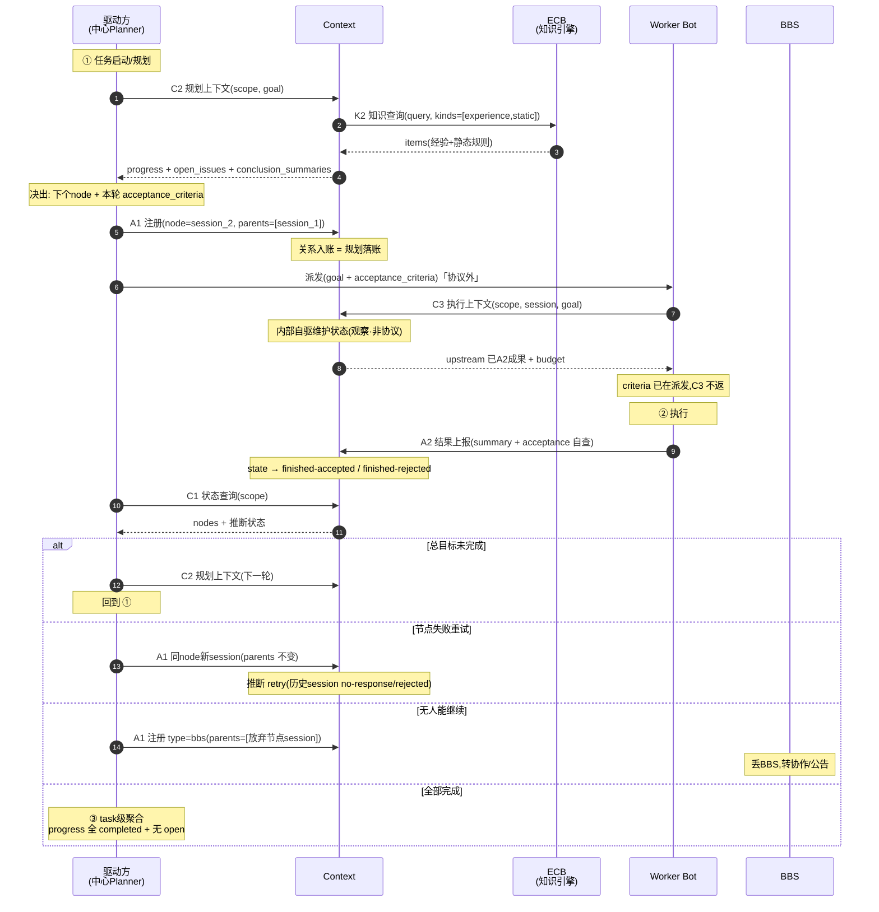

# x1 · Task Loop 上下文协议(精简版)

> 反复推演收敛。原则:
> - 注册 dumb,只传结构事实,不传状态/序号/意图/模态枚举。
> - 状态/版本/采纳/retry 由 Context 内部观测+推断,不进协议字段。
> - 字段够用即止,能从已有事实推出的不重复传。
> - 每个字段下面都写"是什么/谁填/为啥要"。

---

## 0. 约定与核心术语

### `scope`(任务范围)
```json
{"type": "task", "id": "task_1"}
```
- `type`:范围种类,当前固定 `task`。以后可扩 `goal`/`session` 等,但本版只 `task`。
- `id`:任务唯一 id。
- **所有协议都带 scope。** 原因:同一个 bot session 可能被多次 task 初始化复用(比如失败重来、或同会话接新任务),光靠 session 定位不了实例,必须 `(scope.id, session)` 一起才唯一。

### `node`(执行/触发单元声明)
```json
{"type": "bot", "session": "session_2", "participants": ["bot_B"]}
```
- `type`:模态。`bot`(单 bot)| `group`(协作群)| `bbs`(公告板)。决定 participants 怎么填。
- `session`:本实例 runtime 载体的 session id。实例唯一身份的一半。
- `participants`:参与本实例执行的 bot id 集合。
  - `bot` → 一个,如 `["bot_A"]`;
  - `group` → 多个,如 `["bot_A","bot_B"]`;
  - `bbs` → 省略或空数组 `[]`。
- **实例唯一身份 = `(scope.id, node.session)`。**

### `parents`(父实例引用数组)
```json
[{"session": "session_1"}]
```
- 每项只传 `{session}`,不传 type/participants——因为父实例注册过,Context 按 `(scope.id, session)` 能查回它的全部信息,重复传是冗余。
- **是数组不是单值:** DAG fan-in 时一个节点输入来自多个上游;单链/中心化通常 1 个;根节点空数组 `[]`。
- 关系(谁是谁的上游、整个 plan 长啥样)完全由 `node` + `parents[]` 推出,不另设父子字段。

---

## 1. 协议总览

| 方向 | 协议 | 用途 |
|---|---|---|
| 生产(写入) | A1 实例注册 | 实例进图 + 声明 parents。**规划动作也走 A1**(派生子节点=给子节点注册,parent=自己)。 |
| 生产 | A2 结果上报 | 一轮执行完,上报本轮产物 + 验收。**每轮执行粒度,不是整个目标粒度。** |
| 知识(Context↔ECB) | K2 知识查询 | Context ← 知识引擎,查跨任务经验 + 静态规则。Context 内部调,task 不直接调 |
| 消费(读取) | C1 任务状态查询 | 返回任务下全部实例 + 推断状态 + 关系。读 Context 已维护好的账本。 |
| 消费 | C2 规划上下文 | 给 planner(任意层)决"下个 node + 本轮 acceptance_criteria"的决策材料。 |
| 消费 | C3 执行上下文 | 给即将执行的 worker 拉相关上游已 A2 成果。 |
| 内部行为 | 观察(非协议) | Context 自驱维护实例状态,见 §8。 |

---

## 2. A1:实例注册(建立关系网)

```http
POST /v1/executions
```
```json
{
  "scope":   {"type": "task", "id": "task_1"},
  "node":
  {
    "type": "bot",
    "session": "session_2",
    "participants": ["bot_B"]
  },
  "parents": [{"session": "session_1"}]
}
```
**响应:** 200 确认(无业务 body)。

| 字段 | 是什么 | 谁填/何时 |
|---|---|---|
| `scope` | 任务范围,见 §0 | 注册方填 |
| `node` | 本次要进图的实例(planner 派生时放子节点;worker 自启动放自己) | 注册方填 |
| `node.type` | 模态 bot/group/bbs | 按实际触发形态 |
| `node.session` | 实例 runtime session | 中心化由 planner 给;去中心化由被唤醒方自带 |
| `node.participants` | 参与本实例的 bot 集合 | 按模态填 |
| `parents` | 父实例引用数组 | 有上游就填;根节点 `[]` |

### 三种模态示例
```jsonc
// 单 bot,根
{"scope":{"type":"task","id":"task_1"},
 "node":{"type":"bot","session":"s1","participants":["bot_A"]},
 "parents":[]}

// 协作群(多 participant),父是某 bot
{"scope":{"type":"task","id":"task_1"},
 "node":{"type":"group","session":"s2","participants":["bot_A","bot_B","bot_C"]},
 "parents":[{"session":"s1"}]}

// BBS(无 participant),父是协作群
{"scope":{"type":"task","id":"task_1"},
 "node":{"type":"bbs","session":"s3","participants":[]},
 "parents":[{"session":"s2"}]}
```

### DAG fan-in 示例
一个节点输入来自两个上游:
```json
"parents": [{"session":"s1"},{"session":"s4"}]
```

---

## 3. A2:结果上报(每轮执行产物)

```http
POST /v1/executions/outcomes
```
```json
{
  "scope":      {"type": "task", "id": "task_1"},
  "session":    "session_2",
  "finished_at":"2026-09-10T10:40:00+08:00",
  "summary":
  {
    "conclusion": "完成",
    "evidence":   "三个高风险字段补齐 + 证据可追",
    "reason":     "无"
  },
  "acceptance": "accepted"
}
```

| 字段 | 是什么 | 谁填/说明 |
|---|---|---|
| `scope` | 任务范围 | 上报方填。**必带**,原因见 §0:同 session 会被多次 task 初始化复用,不带 scope 两侧都挂错 |
| `session` | 本结果归属实例的 session | 上报方填;`(scope.id, session)` 唯一定位实例 |
| `finished_at` | 本轮执行结束时间 | 上报方 |
| `summary` | 本轮执行产物,JSON 对象,三字段固定 | 见下 |
| `summary.conclusion` | 结论一句话 | bot 写 |
| `summary.evidence` | 支撑结论的证据,**文本描述** | bot 写。A7 据此语义回捞 session 抽经验,**不另设结构化引用字段** |
| `summary.reason` | 理由/没成原因 | accepted 可填"无";rejected 写做了啥、为啥没满足 criteria |
| `acceptance` | 本轮验收,二态 `accepted`/`rejected` | bot 按派发时给的 acceptance_criteria **自查**。accepted=本轮 criteria 满足;rejected=没满足 |

### 关键语义(易误解,扣一下)
- **A2 是"每轮执行"粒度,不是"原始总目标"粒度。** 一个实例做完它这一轮就 A2,账本里就有;剩下的不归这轮,由新一轮规划(C2)处理。所以 B 的成果永远在账本里,后续 worker 拉 C3 能直接看到,不存在"进行中半成品飘在派发链上"。
- **`acceptance` 不代表总目标是否达成。** 总目标是 task 级聚合(看 §9);单个 A2 只表态"我这一轮 criteria 满没满足"。
- **不引入 `partial`:** 节点没满足 criteria 时不会停在"半成"——要么继续 sub-规划处理剩余(新一轮 C2→A1),要么放弃丢 BBS,要么 A2=rejected 把 reason 写清。所以二态够。
- **没有 `status`、没有 `error` 字段:** 成败看 `acceptance`;失败原因看 `summary.reason`。agent 没有 error code,retry 也不是 bot 决的。

---

## 4. K2:知识查询(Context ← 知识引擎,拉)

task loop 里唯一的知识协议。**Context↔ECB,task 不直接调**——task 在 C2/C3 请求里带"要跨任务知识",Context 内部调 K2,把结果并进 C2/C3 返回。

```http
POST /v1/knowledge/query
```
```json
// 请求
{
  "scope": {"type":"task","id":"task_1"},
  "query": "补齐支付摘要高风险字段的过往经验和相关规则",
  "kinds": ["experience","static"],
  "budget": {"max_items": 5}
}

// 响应
{
  "items": [
    {"kind":"experience","content":"...","source":{"task_id":"task_0","session":"s9"}},
    {"kind":"static","content":"...","source":{"rule_id":"R_12"}}
  ]
}
```

| 字段 | 是什么 | 说明 |
|---|---|---|
| `scope` | 任务范围 | 可选,给 ECB 上下文 |
| `query` | 要什么知识 | 自然语言或结构化 |
| `kinds` | 要哪几类 | `experience`(会话抽的经验)/`static`(ECB 静态规则)。一次可都传,响应按 kind 区分,不拆成两个协议 |
| `budget` | 条数/token 上限 | |
| `items[].kind` | experience 还是 static | |
| `items[].content` | 知识正文 | |
| `items[].source` | 来源 | experience 指回原 task/session;static 指 rule_id |

### 为什么没有"采集入库(K1)"
- **任务内复用走 Context 自己的账本**(A1+A2 + C1/C2/C3),不需要抽成经验再喂回自己。
- 会话抽经验是给**未来任务**(跨任务)用,无时效要求;ECB 自己接收文件/内容、会话有地方存能拉——何时抽、谁喂是 **ECB 侧加工流水线,不属本协议集**。
- 所以 task loop 上下文协议只留 K2 这一个拉的;推的(K1)不在范围。

---

## 5. C1:任务状态查询

```http
POST /v1/context/state
```
```json
// 请求
{"scope": {"type": "task", "id": "task_1"}}

// 响应
{
  "scope": {"type": "task", "id": "task_1"},
  "as_of": "2026-09-10T10:41:00+08:00",
  "nodes": [
    {"session":"s1","type":"bot","participants":["bot_A"],"state":"finished-accepted","parents":[]},
    {"session":"s2","type":"bot","participants":["bot_B"],"state":"running","parents":[{"session":"s1"}]},
    {"session":"s3","type":"bbs","participants":[],"state":"no-response","parents":[{"session":"s2"}]}
  ]
}
```

| 字段 | 是什么 |
|---|---|
| `scope` | 任务范围 |
| `as_of` | 账本截止时间(Context 一直自驱维护,这是快照时间) |
| `nodes` | 任务下全部已注册实例 + 推断状态 + 关系 |
| `nodes[].state` | Context 内部推断的状态,见下 |

**`state` 取值(都是 Context 推断,不是上报):**
| 值 | 含义 |
|---|---|
| `running` | 已 A1 注册,还没 A2,且未超时 |
| `finished-accepted` | 收到 A2 且 acceptance=accepted |
| `finished-rejected` | 收到 A2 且 acceptance=rejected |
| `no-response` | A1 后超时仍无 A2(Context 探出) |

- **C1 直接返现成账本,不触发扫描。** 维护是 Context 内部自驱的(§8)。
- 中心化/去中心化都一样:所有上报都挂同一 scope.id,Context 按时间+parents 推顺序与关系。

---

## 6. C2:规划上下文(给 planner 决下一步)

```http
POST /v1/context/plan
```
```json
// 请求
{
  "scope": {"type": "task", "id": "task_1"},
  "goal":  "补齐高风险字段",
  "subtree_root": {"session": "session_2"}
}

// 响应
{
  "scope": {"type": "task", "id": "task_1"},
  "progress":
  {
    "completed":
    [{"session":"s1","acceptance":"accepted","conclusion":"身份核验完成"}],
    "open_issues":
    [
      {"session":"s2","acceptance":"rejected","reason":"支付摘要缺字段"},
      {"session":"s3","state":"no-response"}
    ]
  },
  "conclusion_summaries":
  [{"session":"s1","conclusion":"身份核验完成"}]
}
```

| 字段 | 是什么 | 说明 |
|---|---|---|
| `scope` | 任务范围 | |
| `goal` | 本轮规划要解决的目标 | 可选;planner 聚焦用 |
| `subtree_root` | 收窄到某子树 | sub-plan 时传自己 session;顶层规划不传 |
| `progress.completed` | 已 accepted 的节点 | session + acceptance + **conclusion 一句话**。不给 evidence 全文 |
| `progress.open_issues` | 没解决的 | rejected 的带 `reason`;no-response 的带 `state` |
| `conclusion_summaries` | 已完成节点 conclusion 级摘要 | 决策材料,轻内容 |

- **返回是"决策材料",重结构轻内容。** planner 拿它自己决出"下个 node + 本轮 acceptance_criteria"。
- **`acceptance_criteria` 不在 C2 响应里:** 它是 planner 的决策产物,随派发带去 worker,不归 C2/C3 返。
- 适用任意层:顶层 planner 和 worker-转-planner 都调同一个 C2,只是 `subtree_root` 不同。

---

## 7. C3:执行上下文(给 worker 执行用)

```http
POST /v1/context/execute
```
```json
// 请求
{"scope": {"type": "task", "id": "task_1"},
 "session": "session_2",
 "goal":  "补齐支付摘要高风险字段"}

// 响应
{
  "scope": {"type": "task", "id": "task_1"},
  "upstream": [
    {"session":"s1","conclusion":"身份核验完成","evidence":"...","acceptance":"accepted"}
  ],
  "budget": {"max_input_tokens": 12000}
}
```

| 字段 | 是什么 | 说明 |
|---|---|---|
| `scope` | 任务范围 | |
| `session` | 执行方(自己)的 session | 要拿上下文的那个 worker |
| `goal` | 本轮执行目标 | 用于相关度筛选 |
| `upstream` | 与本节点相关的上游已 A2 成果 | 按 parents 链 + goal 相关度筛;每项 conclusion+evidence+acceptance;大产物以引用形式给,不内联 |
| `budget` | 预算上限 | Context 按预算+相关度裁剪 |

- **只返已 A2 的上游成果。** 进行中、未 A2 的半成品不在账本里,自然不返。若某真依赖还在 running,C3 会在 upstream 里标其 state=running,worker 可判"做不了"——这是对的,C2 就不该在依赖没就绪时派它。
- **`acceptance_criteria` 不在响应里:** 随派发带,worker 执行前已知。
- **不带 `omitted`:** 预算裁剪省了什么不回传(已定不要可解释明细)。

---

## 8. Context 内部状态维护(观察行为,非协议)

Context 持续、自驱维护每个实例状态,**不等查询触发**。C1/C2/C3 读的是这份现成账本,查询不触发扫描。

推断规则(都是内部行为,不进协议字段):
| 触发 | 推断 |
|---|---|
| 收到 A1 | 实例进账本,`state=running` |
| 收到 A2 | `state=finished-accepted`/`finished-rejected`(按 acceptance) |
| A1 后超时无 A2 | `state=no-response`(超时阈值是部署参数,非协议) |
| 同执行点出现新 session | 历史版本;上一 session 若 no-response/rejected,视为 retry |

- **本版不出站 push:** task 驱动方轮询 C1 获取状态变化,Context 不主动推。(若以后要事件驱动重规划再加出站通知协议。)

---

## 9. 一轮 task loop(把协议串起来)

1. **planner 轮:** C2 取决策材料(若需跨任务经验/规则,Context 内部调 K2 并入) → 决出"下个 node + 本轮 acceptance_criteria" → **A1 注册子节点**(parent=自己,落关系=规划落账) → 派发,带 criteria 给 worker。
2. **worker 轮:** 收派发 → **A1 自我进图**(若未由 planner 注册)→ **C3** 拉上游已 A2 成果 → 执行 → **A2**(acceptance 按 criteria 自查)。
3. **总目标没解:** 回 1,新一轮规划(原 planner 或 worker 转 planner 都行)。
4. **没人能继续:** 丢 BBS——**A1 注册 `type=bbs` 实例**,`parents=[放弃节点 session]`,转协作/公告消化。关系链留痕,账本全量。

**总目标是否达成是 task 级聚合:** 看 progress.completed 是否覆盖全部 + 无 open_issues;不压进任何单个 A2。

---

## 9a. 全协议时序图(plan → 完成)

> 目标态动态 loop,把 A1/A2/C1/C2/C3/K2 串在一张图上。底部有现状对照。



### 阶段—协议对照

| 阶段 | 协议 | 谁→谁 | 交换内容 |
|---|---|---|---|
| 规划 | C2(+K2) | Driver→Context(+Context→ECB) | 决策材料;可选拉跨任务经验/规则 |
| 注册/派发 | A1 | Driver→Context | node + parents 关系入账 |
| 执行上下文 | C3 | Worker→Context | 上游已A2成果 + budget |
| 结果上报 | A2 | Worker→Context | summary + acceptance |
| 状态查询 | C1 | Driver→Context | nodes + 推断状态 |
| 失败重试 | A1 | Driver→Context | 同 node 新 session |
| 丢 BBS | A1 | Driver→Context | type=bbs 实例 |
| 完成 | (聚合,非协议) | — | task 级:progress 全 completed + 无 open |

### 现状对照(免误解)
当前 bcsfuse 是**单次编译 ExecutionPacket**:`context_pack` 在 compile 阶段一次性从 `candidate_bundle.knowledge_items` 构建,大小控制仅 `include_full_context`(bool)+`max_context_items`(数量);**无 A1/A2/C1/C2/C3/K2**。`CapabilityVerifyService`/`verify_judge` 是 bot 能力可信审计(发 probe 验能力),非任务结果验收。本图与协议是**目标态**:把单次编译重构为按节点的动态 C2/C3 + A1/A2 账本 + K2 知识 + 内部状态维护。

---

## 10. 已删除/不引入字段(可追溯)

| 删掉的 | 替代/理由 |
|---|---|
| `execution_id` | 用 `(scope.id, session)` 唯一定位 |
| `attempt_id` / `version` / retry-mode | 同执行点新 session + §8 推断 |
| `status` | 用 `acceptance` |
| `error`(整字段) | 原因进 `summary.reason`;agent 无 error code,retry 非 bot 决 |
| `evidence_refs` | A7 用 `summary.evidence` 语义回捞 session |
| `partial` | A2 二态;总目标是聚合 |
| `Idempotency-Key` | `scope.id`+`session` 已唯一 |
| `artifact_refs`(在 A2) | 大产物在 C3 upstream 以引用给,不入 A2 |
| C3 响应 `omitted` | 不要可解释明细 |
| `acceptance_criteria`(在 C3 响应) | 随派发带,不归 C3 返 |
| A4/A6 独立协议 | view=C3 响应;验收=bot 按 criteria 自查写 A2 |
| K1 采集入库(会话→ECB) | 经验生产是 ECB 侧流水线,非 task loop 协议;任务内复用走账本,跨任务无时效 |
| 字段名 `self`/`instance` | 统一用 `node`;A2 用裸 `session` |

---

## 11. 待细化

- **no-response 超时阈值、retry 判定阈值:** 部署参数,不进协议。
- **出站 push 通知:** 本版不加,驱动方轮询 C1;未来若要事件驱动重规划再议。
