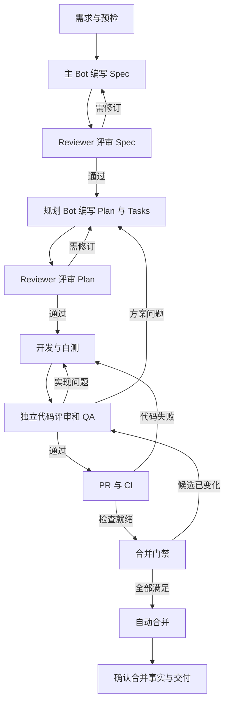

# 主子群 AI Coding Loop 规格

- 日期：2026-10-18
- 版本：0.1
- 状态：用户已确认总体方案；本文定义实现与验收要求，不代表功能已经交付。
- 目标：基于现有主子群，实现从需求、规格、规划、开发、独立评审、测试到自动合并的有界闭环。
- 组织：1 个主 Bot、4 个固定子 Bot、1～3 个 Review Bot，总计 6～8 个 Bot。
- 方法：采用轻量 Spec-Driven Development（SDD）；主 Bot 对 Spec 负责，方案规划 Bot 对 Plan 与 Tasks 负责。
- 模块归属：Backend 应用层承载 Coding Loop 的运行记录与交付策略；BCS 承载主子群任务协作。Skills、Engine Runtime 与 GitHub 集成分别遵守既有能力管理、执行和外部系统边界。
- 实现状态：本次仅编写规格；实施 Issue、Plan、实现 PR 和运行验证记录在进入实施阶段后补充。

## 1. 问题与目标

现有主子群提供主 Bot 派单、子 Bot 执行及结果回传的协作基础。Coding Loop 还需要统一的需求基线、角色职责、评审规则、验证证据和交付状态，才能判断一项需求何时需要返修、何时可以合并。

本规格要求正常路径自主推进。主 Bot 不在每个阶段重复请求人工批准，而是在已授权的仓库、目标分支和任务范围内完成决策与调度。只有无法可靠消除的需求歧义、缺失权限、必须由人完成的审批或超过预算仍无法收敛的阻塞，才交回用户。

成功的交付必须同时满足：

1. 实现满足已确认 Spec 的全部适用验收项。
2. 当前所需 Reviewer 全部完成评审，有效阻断项全部关闭。
3. QA 与仓库要求的 CI 验证通过，证据对应当前候选代码。
4. 仓库的分支保护、审批与合并条件全部满足。
5. GitHub 已实际完成合并，并记录 PR、合并提交和目标分支。

“Worker 已回复”“已创建 PR”“已请求自动合并”均不等于交付完成。

### 1.1 范围

- 一个 Coding Loop Run 处理一个有明确验收边界的需求，最终交付一个仓库中的一个 PR。
- 支持 1～3 个 Reviewer，默认 2 个；参与者在运行开始时绑定并形成快照。
- 支持 Spec、Plan、代码三个阶段的评审，以及独立 QA 验收。
- 支持返修、重新规划、需求变更、超时、取消、结果不确定和恢复。
- 支持 GitHub PR、CI 状态跟进、自动合并及合并结果确认。
- 支持按 Bot 职责配置 Skills 和实际工具权限。

### 1.2 非目标

- 不自动部署生产环境，不执行合并之外的发布、数据库生产迁移或生产回滚。
- 不实现跨仓库事务、多 PR 原子合并或无限扩张的 Bot 层级。
- 不替换 BCS 的任务队列、投递、身份、权限或停止语义。
- 不修改 GitHub 分支保护来使某次任务通过，不自动授予自身权限。
- 不要求安装完整的第三方 SDD 框架，也不另建一套 Skills 内容库或版本体系。

## 2. 依据与现有能力

### 2.1 仓库规范

本规格遵守以下来源；发生冲突时，已接受 ADR、架构规则和正式接口合同优先：

- [AGENTS.md](../../../AGENTS.md)、[Context Map](../../../CONTEXT-MAP.md)、[共享领域词汇](../../../CONTEXT.md)。
- [领域文档规则](../../agents/domain.md)、[Issue 跟踪规则](../../agents/issue-tracker.md)。
- [架构规则](../../arch/arch.rules.md)、[CI 门禁](../../arch/ci.enforce.md)。
- [Context Boundary 格式](../../arch/context-boundary-format.md)、[Plugin 契约测试要求](../../arch/protocol-contract-tests.md)。
- [ADR 0001：Skill 稳定身份](../../adr/0001-stable-skill-identity-across-versions.md)。
- [ADR 0002：绑定 Track Latest 与服务发布物冻结](../../adr/0002-market-and-space-skills-track-latest.md)。
- [ADR 0010：托管 Skill 的写入权威](../../adr/0010-teamclaw-is-authority-for-managed-skills.md)。

本文不替代或修改上述 ADR；新增 Coding Loop 业务记录不能成为 Skill 身份、绑定或版本的第二事实来源。

### 2.2 已核对的实现基础

以下依据来自编写时仓库基线 `26196ac2c` 的静态核对，不表示目标部署已经启用相应能力。

| 能力 | 当前依据 | 本规格使用方式 |
| --- | --- | --- |
| 主子群角色及创建 | [BCS Group 使用说明](../../../apps/bcs/crates/tools/bcs-cli/bcs-coordination/references/group.md) | 使用唯一 manager 和多个 worker；Review、QA 等是 worker 的业务职责 |
| 主 Bot 派单、子 Bot 回传 | [协同上下文实现](../../../apps/bcs/crates/services/bcs-system-message/src/producers/session_context.rs) | 按运行时声明的工具形态使用 `bcs_assign_task`，按支持情况使用 `bcs_send_task_message` 或正常任务返回 |
| 初始化任务上下文 | 同上 | 完整任务说明只提供给主 Bot；每次派单必须包含子任务所需上下文 |
| 失败和确认中断的结果通知 | [主子群任务状态契约](../../../apps/bcs/specs/2026-09-22-manager-worker-status-notifications/spec.md) | 复用 TaskResult 通知，由主 Bot 决定后续动作 |
| 协同工具回执 | [Coordination v2 合同](../../../apps/bcs/crates/contracts/bcs-protocol/docs/coordination-reference-v2.md) | `intent_id` 是已保存请求的引用，不能冒充实际 `task_id` 或已执行事实 |
| BCS 服务边界 | [Service API Context](../../../apps/bcs/crates/service-api/bcs-service-api/CONTEXT.md) | 保留任务投递、结果不确定、取消和持久化语义 |
| Skills 生效与运行时 | [Skill Center 约束](../../../apps/backend/src/agentclaw/community/core/skill_center/AGENTS.md)、[服务 Skills 布局合同](../../arch/service-skills-layout-wire-contract.md) | 通过正式安装和投影链路交付能力，核对运行时实际可用性 |

角色 Skill、Coding Loop 运行记录、多人评审聚合、GitHub 事件回流和自动合并门禁是本规格要求建设或接通的能力，不能仅凭现有派单功能宣称已经具备。

## 3. Bot 组成与责任

### 3.1 固定角色

| 角色绑定 | Bot | 职责与决策范围 | 必须交付的产物 |
| --- | --- | --- | --- |
| `manager` | 主 Bot／研发负责人 | 对接用户，拥有 Spec，选择流程规模，派单，管理依赖与预算，汇总问题，决定返修、重新规划或升级阻塞 | Spec、调度决策、问题处理记录、最终交付报告 |
| `planner` | 方案规划 Bot | 研究仓库与契约，评估技术可行性，形成 Plan，拆分 Tasks，分析测试与兼容影响 | Plan、Tasks、必要的 research，Spec 修订建议 |
| `developer` | 开发 Bot | 按已确认方案实现，补充必要测试，执行自测，响应评审与 QA 反馈 | 代码提交、变更说明、自测证据、问题修复映射 |
| `qa` | 测试验收 Bot | 从 Spec 验收项独立设计并执行验证，检查异常和回归行为，区分代码与环境问题 | 验收矩阵、测试报告、失败复现与环境信息 |
| `integrator` | 集成与合并 Bot | 准备交付分支与 PR，跟进 CI，处理集成状态，执行门禁检查，发起并确认合并 | PR、CI 与合并证据、集成阻塞说明 |
| `reviewer_1`～`reviewer_3` | Review Bot | 独立评审 Spec、Plan 和代码，对发现的问题提供证据，复核修复或误报裁决 | 绑定产物版本的 Review Report |

主 Bot 是业务调度的唯一入口。子 Bot 可以建议引入其他角色，但不得自行建立第二套跨 Bot 派单链路。主 Bot 不代替 Reviewer、QA 或 GitHub 宣布它们的门禁通过。

### 3.2 身份与权限

- 每个角色绑定真实、可调用的 Bot；本版固定角色与 Reviewer 使用不同 Bot 身份。不能把同一个 Bot 重命名三次作为三个独立 Reviewer。
- Reviewer 的任务上下文与开发上下文独立；使用不同模型可以增加视角，但不是本版强制条件。
- 开发 Bot 只写任务分支与授权工作区。Reviewer 只读候选实现，评审建议由开发 Bot 落地。
- QA 可以在隔离工作区创建或执行测试；若测试需要进入交付分支，交由开发或集成流程纳入，新提交重新取得相关证据。
- 集成 Bot 持有交付所需 GitHub 权限，但不得具有依赖本流程而自动获得的门禁绕过权。角色约束必须由工具授权和仓库规则共同落实，不能只写在 Prompt 中。
- 自动化身份与 GitHub 评审身份是否满足仓库审批要求须在预检时验证。内部 Reviewer 报告不天然等同于 GitHub 的有效审批。

## 4. Skills 配置与交付

### 4.1 配置矩阵

“复用”指已有方法或仓库 Skill 可作为来源，仍须验证目标 Bot 的安装与执行适配；“新增”指本规格要求编写的 Skill，不代表市场中已经存在同名成品。

复用来源为仓库内的 [bcs-coordination](../../../apps/bcs/crates/tools/bcs-cli/bcs-coordination/SKILL.md) 和 [Superpowers](https://github.com/obra/superpowers) 方法技能。安装清单须记录来源与实际适配内容，不依赖操作者机器上的绝对路径。

| Bot | 必需 Skills | 配置说明 |
| --- | --- | --- |
| 全部 Bot | `coding-loop-protocol`（新增） | 任务和结果合同、产物版本、事实与推断区分、停止规则、仓库规范读取 |
| 主 Bot | `bcs-coordination`（复用）、`coding-loop-orchestrator`（新增）、`spec-authoring`（新增） | 协作入口、完整阶段调度、Spec 所有权、多 Reviewer 聚合 |
| 方案规划 Bot | `writing-plans`（复用） | 仓库研究、技术方案、依赖拆分、验证安排；需求探索可按需复用 `brainstorming` |
| 开发 Bot | `executing-plans`、`test-driven-development`、`systematic-debugging`、`receiving-code-review`、`using-git-worktrees`、`verification-before-completion`（复用） | 按计划实施、必要测试、调试、返修、工作区隔离与证据核验 |
| Review Bots | `sdd-review`（新增）、`verification-before-completion`（复用） | 通过 `spec`、`plan`、`code` 三种评审模式与职责配置复用同一 Skill |
| QA Bot | `acceptance-testing`（新增）、`systematic-debugging`、`verification-before-completion`（复用） | 验收映射、独立执行、复现与失败分类 |
| 集成 Bot | `pr-delivery`（新增）、`finishing-a-development-branch`、`verification-before-completion`（复用） | PR、CI、门禁、自动合并及结果确认 |

主 Bot 的评审派单规则可复用 `requesting-code-review` 的输入模板，必须改为通过 BCS 调用群内 Reviewer。所有复用项以项目规范和本规格的角色边界为准，不原样继承与主子群冲突的行为。

项目技术 Skill 按需加入开发、规划或评审角色。例如确实涉及 Bigfish 或对应构建工具时才启用相关 Skill。不能因为某 Skill 已安装在操作者本机，就认定所有远端 Bot 已获得它。

### 4.2 新增 Skill 的行为合同

| Skill | 输入 | 输出及强制规则 |
| --- | --- | --- |
| `coding-loop-protocol` | 任务信封、仓库规范、角色配置 | 按第 8 节回报；不得猜测产物路径、伪造检查结果或把进度当完成 |
| `coding-loop-orchestrator` | 用户目标、运行快照、子任务结果、外部事件 | 只依据当前版本推进阶段；管理依赖、返修预算、阻塞和唯一有效调度权 |
| `spec-authoring` | 用户需求、仓库背景、研究与评审意见 | 带验收编号的 Spec；显式标识假设、范围和非目标；范围变化必须保留记录 |
| `sdd-review` | 对象类型、产物版本、评审职责、仓库规则 | 有证据的 Findings 与明确结论；先独立评审，不能为了增加轮数制造问题 |
| `acceptance-testing` | Spec、候选提交、环境和验证计划 | 验收项到测试证据的映射；未运行、环境阻塞和功能失败分别表示 |
| `pr-delivery` | 当前候选、授权范围、评审及 QA 证据、仓库门禁 | 幂等维护 PR，核对实际 CI 状态，执行受约束的合并并确认结果 |

`verification-before-completion` 在多 Bot 场景中要求核对当前产物的可追溯证据；主 Bot 可以读取并验证 QA/CI 证据，不需要在同一个聊天回合重复运行全部测试。缺失、过期或无法验证的报告不能作为通过依据。

### 4.3 BCS 与上游方法适配

1. 主 Bot 使用当前运行时提供的原生工具、原生 MCP 或 mcporter 形态，不猜测工具名称和传输方式。
2. 子 Bot 按系统注入的协同规则返回结果；不强制调用未开放的回传工具，不提前结束整个主群任务。
3. `subagent-driven-development` 等内置子代理调度不得成为跨群角色的第二调度器。首版群内角色任务统一走 BCS。
4. 上游 Skill 中面向人的常规设计检查和批次确认，由主 Bot 在用户既有授权范围内承担；真实缺失的用户决策、权限和仓库人工审批仍需等待对应主体。
5. `using-git-worktrees` 仅用于可共享同一 Git 仓库的执行环境；不同机器或容器使用独立 clone，通过提交 SHA 交接。
6. 同名 Skill 的不同来源不得同时激活而形成矛盾规则；适配后的内容保留来源和可追溯版本。

### 4.4 安装和运行时就绪

- 使用直接技能安装或按角色组织的 Skill Set；通过既有有效技能集合语义去重，不建立另一个生效算法。
- active 目录只暴露当前 Bot 显式激活的 Skills，不连接完整 `skills-repo` 或 `skills-local` 内容库。
- 通过现有 Backend/Engine 合同交付；本流程不新增引擎专属硬编码目录。
- 就绪检查分别确认：技能引用有效、已发布内容可解析、目标运行时实际可读、依赖工具可调用。安装请求成功或 `center://` 前缀不能替代这些证据。
- 市场和空间 Skill 绑定继续 Track Latest。运行记录保存实际观察到的版本或摘要，仅用于审计，不引入 Bot 级固定版本绑定。
- 需要稳定执行版本时使用既有不可变 Service Bot Artifact；草稿运行态发生技能变化时必须记录，并重新验证受影响的角色输出，不能假定运行期间内容不会变化。
- 缺少 Git、终端、依赖环境或 GitHub 凭证时应报告运行条件未满足，不能通过补写 Skill 文字宣称能力就绪。

## 5. SDD 产物与所有权

### 5.1 Spec

Spec 的 Owner 是主 Bot。方案规划 Bot 可以提供研究或代写初稿，主 Bot 必须对用户目标、范围和验收标准负责。

每个需求 Spec 至少包含：问题与目标、范围与非目标、术语及现有契约、预期行为、失败行为、兼容约束、编号验收项、假设与待决问题。跨模块变更还须列明所属模块、消费者、实现方和相关 ADR。

验收项使用稳定编号，例如 `AC-001`；每项具有可观察的输入、行为与结果。不能只写“体验良好”“测试通过”或“没有明显问题”。

### 5.2 Plan 与 Tasks

Plan 的 Owner 是方案规划 Bot，至少覆盖现有实现依据、选择的技术方案、受影响模块与接口、实施顺序、依赖、验证方法和兼容/迁移安排。

Tasks 在 Plan 下拆分，每项明确任务 ID、对应验收项、输入产物、允许修改范围、依赖、交付物和完成条件。主 Bot 根据这些信息调度，开发 Bot 不因收到单项任务就自行扩大范围。

Spec 定义契约与验收边界，Plan 定义满足这些边界的实现路径；Plan 不能覆盖 Spec，二者均不能覆盖已接受 ADR 或仓库架构规则。

### 5.3 位置、版本与变更

- 产物存入目标仓库的规范目录。Avernet 的跨模块需求使用 `docs/specs/YYYY-MM-DD-<topic>/`，Spec、Plan、Tasks 相邻；模块需求使用对应模块实际存在的 specs 目录。
- 文件引用至少包含仓库、路径和不可变版本。单文件版本可使用 Git blob SHA，多个文件的产物集合使用规范化内容摘要；同时保留获取该内容的 commit SHA。
- Code Review 使用明确的 base SHA、head SHA 和适用的目标分支上下文；不能只引用会变化的分支名。
- Spec 内容变化后生成新版本，主 Bot 记录原因并重新安排受影响的规划、评审和验收。开发 Bot 只能提出修订建议，不得为适配实现自行删除或降低验收项。
- 仅 Plan 的内部实施安排变化且不改变 Spec 时，由规划 Bot 更新 Plan 并重新取得受影响的 Plan 评审；无需重新询问用户。
- 不改变内容的提交移动不会自动改变文档内容版本，但任何证据复用必须重新核对输入、候选代码和依赖，记录复用依据。

## 6. 1～3 个 Reviewer 的协作规则

### 6.1 人数与职责覆盖

| 人数 | R1 | R2 | R3 |
| --- | --- | --- | --- |
| 1 | 综合覆盖需求、正确性、架构、兼容、安全、测试有效性及运行风险 | 不配置 | 不配置 |
| 2，默认 | 需求符合性、代码正确性、异常行为与测试有效性 | 架构、契约、兼容、安全及并发/性能风险 | 不配置 |
| 3 | 需求符合性与代码正确性 | 架构、契约、兼容与安全 | 测试有效性、异常路径、并发与运行风险 |

增加或减少人数只改变职责分配，不删除必需检查维度。不同 Reviewer 可以发现职责外的真实问题，但不因重复发现获得额外权重。

人数必须为整数 1、2 或 3，绑定完整且身份不重复。不得在评审中途删掉提出阻断问题的 Reviewer 来取得通过。人员替换必须记录原因、保持职责覆盖，并使受影响的评审轮次重新建立有效结果。

### 6.2 三类评审

| 评审对象 | 核心问题 | 通过条件 |
| --- | --- | --- |
| Spec | 目标是否准确、边界是否明确、契约是否冲突、验收是否可测 | 无未解决的阻断歧义或契约冲突，验收项可执行 |
| Plan | 是否基于真实仓库、是否覆盖全部验收项、依赖与验证是否完整 | 无不可行步骤、遗漏的契约传播或必需验证缺口 |
| Code | 实现是否满足 Spec/Plan、是否存在可证实缺陷、测试是否有效 | 无有效阻断项，当前候选的相关变更已覆盖 |

默认所有配置的 Reviewer 参与三个阶段。小修复可把 Spec 与 Plan 放在同一个评审任务中，但须分别给出两类结论；不得省略 Reviewer 或直接跳过验收依据。

### 6.3 独立性与输入

每轮开始前冻结评审对象、版本、职责和必要 Reviewer 集合。所有 Reviewer 获取相同的适用文档基线；代码评审时还必须获取同一份候选代码。

首次独立评审不提供其他 Reviewer 的结论。主 Bot 收齐有效报告后再聚合；后续复核可以读取原始问题及修复说明。缺少代码、文档或环境证据时返回 `blocked`，不能凭开发 Bot 的摘要判定通过。

### 6.4 Findings 与结论

每个 Finding 必须包含稳定 ID、对象及位置、关联验收项或契约、问题说明、证据、影响、严重性、是否阻断、修复或验证条件。

严重性使用目标仓库的分级；没有既有规则时按下列语义处理：

- P0/P1：严重正确性、数据、安全或契约问题，必须阻断。
- P2：通常需要修复；是否阻断由明确的验收、兼容和风险影响决定，不能只凭级别自动忽略。
- P3：不影响验收的建议可以记录后续处理，不应制造无意义的返修循环。

Reviewer 报告结论为 `approved`、`changes_required` 或 `blocked`。`approved` 可以携带非阻断建议，但不能携带尚未处理的有效阻断项。

### 6.5 聚合、争议与放行

1. 主 Bot 对同一原因的问题合并显示，保留所有来源和证据，不按发现次数投票。
2. 聚合通过要求：全部必需 Reviewer 的有效结论为 `approved`，且聚合问题集中不存在未关闭的阻断项。
3. 任一 `changes_required` 或 `blocked` 都不能被其余多数票抵消。
4. 主 Bot 将可执行问题整理为一个返修任务，避免多个 Reviewer 直接同时指挥开发。
5. 开发 Bot 对每个问题返回修复提交、验证证据或有依据的异议。
6. 对疑似误报，主 Bot 提供契约或可复现证据，原 Reviewer 或记录原因后的替代 Reviewer 复核并形成新结论。主 Bot 不能仅修改报告状态或以“风险可接受”关闭真实阻断项。
7. Reviewer 仍有分歧时，主 Bot 可以安排有限的定向验证；证据不足则保持阻塞，不通过无限讨论消耗预算。
8. 返修后所有必要 Reviewer 都必须对新候选形成有效结论。可以缩小检查范围，但必须核对新 diff 和影响范围，并显式重确认仍成立的旧结论。
9. 未回复、超时、工具异常和空报告均不是通过。允许按预算重试或替换；不得静默减少必要 Reviewer 集合。

## 7. 从需求到自动合并

### 7.1 阶段与推进条件

| 阶段 | 主责 | 行为 | 推进条件或返回路径 |
| --- | --- | --- | --- |
| 接入与预检 | 主 Bot、集成 Bot | 确认需求、仓库、目标分支、授权、角色、Skills、工具、预算与仓库门禁 | 条件齐备后开始 Spec；缺失必需条件则阻塞 |
| Spec 编写与评审 | 主 Bot、Reviewers | 明确范围、契约、验收项；规划 Bot 提供必要研究 | Spec 评审通过；有问题回主 Bot 修订 |
| Plan/Tasks 编写与评审 | 规划 Bot、Reviewers | 研究实现、安排改动、拆分依赖与验证 | Plan 评审通过；方案缺陷回规划 Bot，需求缺陷回 Spec |
| 实现与自测 | 开发 Bot | 在隔离分支实施，运行必要自测，提交代码及证据 | 产物可获取且自测满足进入评审条件 |
| 独立代码评审与 QA | Reviewers、QA | 对同一候选并行评审和验证 | 两类门禁均通过；失败按原因返修或重新规划 |
| PR 与 CI | 集成 Bot | 创建/更新 PR，关联 Issue 与 Spec，观察实际 CI 和外部评审 | 必需检查与审批满足；代码问题回开发，环境问题由集成诊断 |
| 合并门禁 | 集成 Bot、执行门禁 | 核对第 10 节的条件与最新候选身份 | 全部门禁满足才实际合并；托管等待与入队遵守第 10.1 节 |
| 自动合并与确认 | 集成 Bot | 发起合并、查询实际状态及目标分支结果 | GitHub 明确已合并后记录事实；结果不明进入观察 |
| 交付收尾 | 主 Bot | 汇总需求、PR、合并提交、验证结果和残余非阻断事项 | 记录交付成功并停止本次调度 |

PR 可以在开发阶段提前建立为 Draft，以便运行 CI；提前创建不改变后续评审、验收和合并条件。

### 7.2 QA 与评审的区别

Reviewer 检查“实现和测试是否有缺陷”；QA 独立验证“用户可观察行为是否满足 Spec”。QA 不仅重复开发提供的测试命令，还要根据验收项补充必要的异常和回归场景。

QA 对每项适用验收项给出 `passed`、`failed` 或 `blocked`。不适用项必须说明原因并经主 Bot 核对，不能用“不适用”取消 Spec 明确要求的行为。报告中的命令、环境、退出码、结果和候选版本必须可追溯。

### 7.3 任务与运行状态

Coding Loop 的业务运行状态与 BCS 的任务/投递状态分开保存，不改写 BCS 枚举：

| 状态 | 含义 | 允许的后续行为 |
| --- | --- | --- |
| `running` | 正在执行上述某一阶段 | 按依赖派单或处理结果 |
| `waiting_external` | 等待 CI、外部审批或已受理操作的确定结果 | 有界观察；收到有效事件后核对事实 |
| `blocked` | 缺少必需输入、权限或无法自动解决的条件 | 输出原因与恢复条件；条件满足后显式恢复 |
| `stopping` | 已接受停止请求，但在途副作用尚未完全确认 | 禁止新派单和新合并请求，确认停止或已发生的外部结果 |
| `cancelled` | 已停止且不存在未确认的本流程副作用 | 不被迟到结果唤醒；新工作需新 Run |
| `failed` | 不可恢复错误或预算耗尽 | 保留证据，不自动重启；新的尝试须有新的授权/预算 |
| `succeeded` | 已确认合并并完成交付记录 | 只读查询与报告，不重复合并 |

阶段是运行状态下的进度，不以一次 Bot 任务的成功代替业务阶段通过。已合并后发生通知失败，记录通知失败但保留合并事实；不得为了重发通知重新执行开发或合并。

## 8. 任务交接与证据合同

本节是待实现的 Coding Loop 应用层合同，不是现有 BCS MCP 参数或 HTTP schema。首版可以把任务信封序列化到既有 `message`，把报告放入结果正文或可访问制品；生产放行必须使用经过校验的结构化记录，不能只从自然语言中的“通过”猜测。

### 8.1 任务信封

每次派单至少包含：

| 字段 | 要求 |
| --- | --- |
| `schema_version` | 固定的合同版本，首版为 `1`；未知版本拒绝 |
| `loop_run_id`、`task_key`、`attempt` | 业务运行、逻辑任务和本次尝试身份；不冒充 BCS 的身份 |
| `phase`、`role` | 当前阶段和任务承担职责 |
| `repository`、`target_branch`、`base_sha` | 精确仓库与基线，不从 Bot 的默认目录推断 |
| `objective`、`acceptance_ids`、`allowed_scope` | 目标、对应验收项和允许修改范围 |
| `artifact_refs` | 所需 Spec、Plan、代码或其他输入的路径、版本与可访问引用 |
| `dependencies`、`previous_findings` | 已满足依赖及需处理问题；没有时为空集合 |
| `deadline`、`budget` | 本任务有效期限及剩余执行预算 |

针对候选代码的 Code Review、QA 和集成交付任务还必须包含 `head_sha`；预检和 Spec 阶段尚不存在候选代码时不伪造该字段。验收编号尚未形成时，预检与 Spec 编写任务的 `acceptance_ids` 可以为空，后续实施、评审和验收任务必须关联适用验收项。各阶段按明确的输入变体校验，不把必需字段普遍改成可空以掩盖缺失。

任务指令应自包含，链接用于取得详细产物。不能把本机路径当成另一个容器已可访问的文件，也不能要求 Worker 从不可见的主群历史推断验收标准。

### 8.2 结果信封

每个结果回传原任务身份、输入产物版本、执行 Bot、完成时间、`completed|blocked|failed|cancelled` 执行结果、产物引用、实际检查、Findings 和阻塞原因。

执行 `completed` 仅表示本次受托工作结束；评审另有 `approved|changes_required|blocked` 业务结论，QA 另有逐项验收结果。二者不能混用。

检查证据至少记录命令或 CI job 身份、代码版本、环境标识、退出状态、结果摘要和可读取日志/报告。敏感凭据不得进入任务、结果或日志。引用必须继续经过接收者的权限检查。

### 8.3 关联、去重与恢复

- 保存 Coding Loop 身份与 BCS 派发引用、可获得的实际任务身份、结果身份的映射。`status=stored` 不能记成 Worker 已开始执行。
- 按运行、逻辑任务、attempt 和结果身份消费；重复回调不重复推进、不重复创建 PR 或合并。
- 旧 Spec/Plan、旧候选或旧 attempt 的迟到结果保留作审计，不作为当前门禁证据。
- 原任务失败后再次派发是新 attempt，不能覆盖原始失败事实。
- 底层操作结果不明时先观察与核对；不得因未收到回复立即复制一份有副作用的任务。

## 9. 返修、预算与恢复

### 9.1 失败分类

| 情况 | 处理 |
| --- | --- |
| 可复现实现缺陷 | 主 Bot 汇总后交开发修复，再评审与验证受影响范围 |
| 技术方案不可行或遗漏依赖 | 回规划 Bot 更新 Plan，保留原 Spec；重做受影响评审 |
| 需求矛盾或确需扩大范围 | 回主 Bot 修订 Spec；超出授权或关键含义无法推断时请求用户决策 |
| CI/环境故障 | 集成 Bot 诊断；不得通过删除测试、降低阈值或替换私有依赖掩盖失败 |
| Reviewer/Worker 明确失败 | 有界重试或替换，保留职责与原错误事实 |
| 用户停止某个子任务 | 保留停止原因，判断是否意味着改变安排；不机械重跑用户刚停止的任务 |
| 用户停止整个 Run | 进入 `stopping`，阻止新动作；迟到回调不重启协作 |
| GitHub 写操作结果不明 | 查询 PR/操作的实际状态；无法确认时等待或阻塞，不盲目重发 |

### 9.2 有界执行

首版工作流默认值如下；这些是本规格提出的产品默认值，不是现有 BCS 配置：

- Spec 和 Plan 各最多 2 次返修，初稿不计入返修次数。
- 代码在首次提交后最多 3 次返修，QA、Review 和 CI 发现的代码缺陷共用该预算。
- 已明确可安全重试的技术失败，每个逻辑任务最多额外重试 2 次；结果不明不使用此规则重发。
- 同一阻断问题连续两次返修没有可验证进展时，停止重复同一路径，进行一次原因分析或重新规划。
- 每个 Run 必须有显式总期限；任务、CI 等待和技术重试均受总期限约束。部署可提供默认期限，但缺少有效值时预检失败。
- 重新规划、替换 Bot 或阶段切换不重置已消耗预算。延长预算需明确记录来源与原因，不能由循环自身无限续期。

到达上限不表示通过。明确无法完成或预算耗尽时进入 `failed`；缺少可由外部补齐的条件时进入 `blocked`，说明当前产物、问题和下一步。

### 9.3 持久化与外部唤醒

运行记录至少保存：角色与策略快照、当前阶段、文档和候选版本、任务关联、Review/QA/CI 证据、问题状态、剩余预算、PR 身份、外部操作意图及结果。

阶段推进和门禁决定必须有持久化事实；写入失败不能返回阶段成功。主 Bot 重启后先恢复当前记录和外部事实，再决定动作，不能只靠聊天摘要重新执行整条流程。

CI、外部评审和 PR 状态变化应通过认证事件触发核对；未接事件的环境允许使用受总期限约束的退避轮询。重复或乱序事件只触发查询，不能直接覆盖较新的候选状态。长时间等待不依赖一个持续占用的模型回合。

同一 Run 同时只能有一个有效调度者和一个有效合并操作持有者；租约或等效并发控制必须防止旧执行者继续推进。具体存储与调度复用方案由 Plan 落实，不预设新增常驻服务或全库扫描。

## 10. 自动合并门禁

### 10.1 合并依据

集成 Bot 准备证据，确定性的执行门禁核对后才允许调用合并工具。LLM 的汇总结论不能代替机器可核对的状态。

合并依据至少包含：Run、仓库、PR、目标分支、当前 PR head SHA、目标基线、Spec/Plan 内容版本、Reviewer 集合及有效报告、QA 报告、预期 CI 检查清单及实际结果、授权与预算状态。

全部条件必须满足：

1. Run 仍有效且未停止，合并动作在已记录授权范围内。
2. 当前 Spec 和 Plan 已通过对应评审，全部适用验收项通过。
3. 所有必要 Reviewer 对当前候选的代码评审有效，无未解决阻断项。
4. QA、必需测试和架构/契约门禁通过；证据缺失、无法读取、未知或过期均不能放行。
5. 预期执行的 CI job 实际成功；`skipped`、`neutral` 或“没有失败”不能直接等同于必需测试成功。确实不适用的检查需由受信任的变更范围判定提供证据。
6. PR 不处于 Draft、无冲突，所有 GitHub 必需审批及讨论处理要求满足。
7. Reviewer 身份、GitHub 检查来源和权限符合仓库规则；不能用内部报告伪装外部审批。
8. 合并前重新核对 head、目标分支及门禁策略，使用平台支持的预期 head 条件或等效原子约束执行。缺少防止候选被替换的保障时不允许自动合并。

GitHub 的 [auto-merge](https://docs.github.com/en/pull-requests/how-tos/merge-and-close-pull-requests/automatically-merging-a-pull-request) 和[受保护分支](https://docs.github.com/en/repositories/configuring-branches-and-merges-in-your-repository/managing-protected-branches/about-protected-branches)可以承接平台最终条件，但内部 Review 与 QA 门禁也必须对候选版本有效。

在内部评审与 QA 已通过、剩余平台检查能够可靠阻止实际合并时，可以先启用 auto-merge 或进入 merge queue，并保持 `waiting_external`。队列专属检查在入队后执行。托管等待不构成门禁通过，平台必须在实际合并前满足全部适用条件；不具备该保障的部署只能等待全部条件满足后调用合并。

### 10.2 候选变化与竞态

- PR 新增提交、冲突解决、rebase、合入测试代码等都会产生新的候选，旧代码批准不能直接复用；按第 6.5 节重确认并运行受影响验证。
- 目标分支变化后重新核对兼容性和检查上下文。需要更新分支时回到候选验证；使用 merge queue 时，验证对应的实际集成候选及队列要求。
- 开启 auto-merge 后仍须持续保护内部门禁：新提交不得继承旧的有效检查。实现必须将必要内部结论投影为受信任、绑定候选的必需检查，或提供等效的不可绕过保障。
- 取消 Run 时尝试取消尚未完成的 auto-merge/队列请求，并核对结果。不能承诺撤回已经发生的合并。
- 合并请求超时后查询 PR；已合并则记录成功，明确未执行才可按策略重试，结果仍不明则保持观察。不能凭超时认定失败并重复交付。
- squash/rebase 合并后的 commit 可以不同于 PR head；记录平台返回的 merge commit 和候选关联，并确认目标分支包含合并结果。

### 10.3 Avernet 验证基线

Plan 和集成 Bot 根据目标分支的 merge-base 与当前候选确定变更范围，使用仓库既有模块门禁；不能用目标分支与候选的直接树差异误选目标分支独有变更。

| 变更类型 | 必需验证依据 |
| --- | --- |
| 窄实现变更 | 最近的有意义单测与对应模块门禁 |
| Service/Plugin 契约变更 | 更新文档与相关 conformance/兼容测试 |
| 跨模块行为或架构边界变更 | 所有受影响模块测试与架构门禁 |
| Backend/BaaS/BCS 或 Singlebox 相关路径 | 按仓库模块选择规则运行统一 Singlebox 门禁，并验证产物基线 |
| Frontend/其他模块 | 对应模块 CI 和行为验证 |

具体命令、阈值和模块范围以目标仓库当前规则为准，不在 Skill 中维护一份易过期的副本。每个新 worktree 按仓库要求安装 hooks；默认 pre-push 的 lint-only 结果不足以作为自动合并证据。新增或修改源文件仍须检查 1,000 行限制，不得为通过本流程削弱检查。

## 11. 架构边界与接口影响

### 11.1 责任归属

| 边界 | 提供 | 不应承担 |
| --- | --- | --- |
| Coding Loop 应用层，Backend 所属 | 运行与策略记录、证据聚合、阶段转换、机器门禁及外部事件应用 | 不替代 BCS 投递/路由，不管理 Engine 物理技能目录 |
| 主 Bot 与角色 Skills | 需求与技术判断、产物生成、任务建议和可解释报告 | 不以 Prompt 绕过确定性门禁，不充当唯一持久化存储 |
| BCS | 群关系、角色、派单、消息与任务结果、停止和投递状态 | 不把 GitHub 分支策略、代码评审标准写入路由核心 |
| Backend 能力管理 | Skill 身份、安装、技能集、MCP 配置与授权 | 不把内容存在视为运行时已激活 |
| Engine Runtime | 工具执行、隔离工作区、物理技能布局与实际能力 | 不自行修改业务验收或群级合并策略 |
| GitHub 适配 | PR、检查、评审、merge queue/合并事实的读写与事件转换 | 不在传输适配器中决定业务放行政策 |
| Frontend | 展示阶段、问题、证据链接与待用户处理事项 | 不根据文案猜测成功或自行批准合并 |

### 11.2 契约与兼容性

- 本文新增的是 Coding Loop 业务合同；本次文档变更不修改任何公开 API、数据库 schema 或 BCS MCP 参数。
- 实施时，运行管理与门禁通过独立 Service API 暴露；GitHub 等环境相关能力通过 Plugin API 隔离。具体端点、类型和存储设计在 Plan 中明确后，随实现补充版本化合同与 conformance 测试。
- 配置必须验证 reviewer 数量、绑定唯一性、角色覆盖、目标仓库/分支、预算及工具能力；未知字段拒绝，必需配置缺失时明确失败。
- 原有普通群、主子群和自定义协作保持原行为，只有选择 Coding Loop 工作流的运行应用本规格。
- 首版可复用 manager-worker 调度；是否采用 BCS 自定义协作执行阶段是实施选择。采用时必须核对目标服务端能力并校验定义，不能把本规格中的字段直接当作 BCS YAML 支持字段。
- 核心保持传输无关，配置与实现选择只发生在批准的 composition roots；新增 Backend 边界按既有格式声明 Context Boundary。
- 公共本地验证使用可重复的 Git 仓库、Bot/Provider fixture 和 GitHub 隔离实现；真实 GitHub 自动合并另作集成验收，不引入公司专属依赖。

## 12. 验收场景

以下为本能力自身的验收要求，不是已执行的测试结果。

| 编号 | 场景 | 预期结果 |
| --- | --- | --- |
| AC-001 | 分别配置 1、2、3 个 Reviewer | 群共有 6、7、8 个 Bot，绑定与职责覆盖完整 |
| AC-002 | 配置 0、4、非整数或重复 Reviewer 身份 | 运行前拒绝，不部分派单 |
| AC-003 | 主 Bot 接收清晰需求 | 生成带稳定验收编号的 Spec，并自主进入评审 |
| AC-004 | Worker 不能读取主群历史 | 仍能仅凭派单与授权产物引用完成任务 |
| AC-005 | 规划任务完成 | Plan 和 Tasks 覆盖 Spec 验收项、依赖及验证方式 |
| AC-006 | 小修复使用合并文档评审 | 保留每个必要 Reviewer 对 Spec 和 Plan 的明确结论 |
| AC-007 | 三个 Reviewer 独立评审 | 首轮不见其他人的结论，对同一输入版本输出报告 |
| AC-008 | 两人通过、一人提出有效阻断项 | 聚合不通过，主 Bot 派发返修而非多数票放行 |
| AC-009 | 多人报告相同缺陷 | 聚合为一个问题，保留各来源和证据 |
| AC-010 | Reviewer 报告疑似误报 | 经证据和复核产生新结论；主 Bot 不能直接把阻断状态改成通过 |
| AC-011 | Reviewer 超时、空回复或工具失败 | 重试/替换或阻塞，不当作通过，不静默减少人数 |
| AC-012 | 开发提交返修 | 问题关联修复证据，所有必要 Reviewer 重确认新候选 |
| AC-013 | QA 实际发现验收失败 | 即使所有 Reviewer 通过也不能合并 |
| AC-014 | 开发尝试删除难以满足的验收项 | 不能直接生效；回主 Bot 的 Spec 变更流程 |
| AC-015 | Spec/Plan 或候选代码更新 | 旧结果不直接放行，重新取得受影响阶段的有效证据 |
| AC-016 | 必需 CI 缺失、跳过、未知或日志不可取 | 门禁不通过；不以“没有红灯”代替验证 |
| AC-017 | 仓库需要人工/CODEOWNER 审批 | 等待真实审批，不用 Bot 内部结论替代 |
| AC-018 | 仅本地 lint-only pre-push 通过 | 不能跳过仓库要求的测试、契约或 Singlebox 门禁 |
| AC-019 | 所有条件满足且已授权自动合并 | 无逐阶段人工确认地完成合并并给出真实 merge commit |
| AC-020 | 门禁检查后 PR head 或目标基线变化 | 旧候选不能被错误放行；重新检查或由受保护队列验证 |
| AC-021 | auto-merge 等待期间新增提交 | 新候选不能继承旧内部批准直接合并 |
| AC-022 | 合并请求超时但 GitHub 已执行 | 查询后记录实际合并结果，不重复创建 PR 或重做任务 |
| AC-023 | CI 事件重复、乱序或属于旧候选 | 只影响对应记录，当前阶段最多推进一次 |
| AC-024 | 主 Bot 或进程重启 | 恢复任务关联、产物版本、预算和外部事实，不从头重跑 |
| AC-025 | 任务结果/阶段写入失败 | 返回错误，不宣称任务验收或阶段推进成功 |
| AC-026 | 用户停止子任务或整个 Run | 分别遵守停止作用域；整个 Run 的迟到回调不重新派单 |
| AC-027 | 停止与 GitHub 合并并发 | 阻止新请求并核对事实；已合并则报告实际结果，不伪称取消成功 |
| AC-028 | 达到返修或总期限上限 | 明确失败/阻塞及未决问题，不把上限耗尽解释为通过 |
| AC-029 | Skill 安装响应成功但 Runtime 未就绪 | 预检阻塞，不启动依赖该 Skill 的任务 |
| AC-030 | 草稿 Bot 的 Skill 在运行期间更新 | 记录实际版本变化，重新验证受影响输出；不篡改 Track Latest 语义 |
| AC-031 | Bot 位于不同容器/主机 | 能通过提交和可访问制品交接，不依赖共享本机目录 |
| AC-032 | 已合并后通知发送失败 | 合并事实保留，只恢复报告，不重复合并 |

## 13. 实施验证与交付条件

实施 Plan 必须把上述场景映射到应用层单测、协议 conformance、跨模块集成测试和端到端故事，并说明需要真实外部服务验证的部分。

最低完整故事包括：

1. 1、2、3 Reviewer 配置下的正常需求到合并路径。
2. 一名 Reviewer 阻断、开发返修、多人复核、QA 和 CI 通过后合并。
3. QA 失败、CI 环境失败、需求变更三种不同返回路径。
4. 重启、重复回调、旧候选回调、持久化错误和合并结果不确定的恢复。
5. 停止与合并竞态，以及 auto-merge 等待期间候选改变。
6. 本地隔离测试通过后，在经授权的测试仓库验证真实 GitHub 权限、必需检查与自动合并。

不得用本地 fake 通过替代真实部署边界的验收。交付记录应关联实施 Issue、Spec/Plan、实现 PR 或 commit、实际执行命令、结果和未验证范围。

本规格的文档完成条件是职责、配置、阶段、门禁与验收条款自洽，引用可解析；功能完成条件是以上实施证据齐备。后续 Plan 需要落实的工程选择包括运行存储与并发控制、GitHub 工具/事件适配、内部门禁的受信任检查投影，以及各目标 Engine 的实际技能与工具就绪验证。这些选择不得降低本文的行为和验收要求。

### 13.1 本次文档验证记录

2026-10-18：检查本文件的本地相对链接、Markdown 代码块闭合、32 个验收场景编号及空白格式。当前交付仅包含 Spec；未运行产品单测、Singlebox 或真实 GitHub 合并流程，因为本次没有实现代码或运行环境变更。上述功能验收仍由后续实施提供证据。
